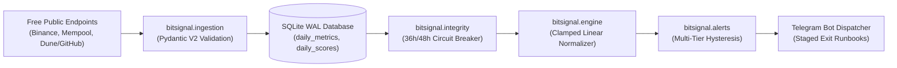

# ⚡ BitSignal: Bitcoin Macro Cycle Sentinel

BitSignal is an autonomous, quantitative sentinel designed to track Bitcoin macro cycle turns without emotional bias. Operating on a daily batch cadence (UTC 00:05), it collects market price, network mining stats, and on-chain valuation ratios from free public sources, computing a continuous **Composite Cycle Score (0 to 100)** via clamped piecewise linear normalization.

When market conditions reach extreme cyclical overheating (Score $\ge 80$), BitSignal issues tiered Telegram push alerts with actionable runbooks to orchestrate staged divestment of cold-storage holdings (up to 40% maximum exit, preserving a permanent 60% sovereign reserve). Conversely, during generational capitulation troughs (Score $\le 20$), it signals staged dollar-cost averaging (DCA) accumulation.

---

## 🏗️ Architecture & Core Components



* **Zero Recurring Data Cost**: Consumes public Binance endpoints (with Yahoo Finance fallback), Mempool.space API, and public on-chain execution queries.
* **Integrity Monitor & Circuit Breaker**: Audits metric staleness with a 36-hour fresh threshold. Imputes a neutral baseline ($S_i = 50$) for degraded metrics ($\le 20\%$ missing weight); freezes phase alerts and emits emergency diagnostics if missing weight exceeds 20%.
* **Multi-Tier Hysteresis**: Prevents alert fatigue using deadbands (Tier 1 resets $<75$; Tier 2 re-arms $<82$; Tier 3 re-arms $<87$; Bottom resets $>25$).
* **Sovereign Persistence**: Lightweight SQLite in Write-Ahead Logging (WAL) mode (`./data/bitsignal.db`).

---

## 📊 Indicator Calibration Matrix

| Indicator | Weight ($w_i$) | Bottom ($S_i = 0$) | Top ($S_i = 100$) | Formulation / Direction |
| :--- | :--- | :--- | :--- | :--- |
| **MVRV Z-Score** | 25% | $Z \le 0.15$ | $Z \ge 5.00$ | Direct: higher = overheated valuation |
| **200-Week SMA Ratio** | 20% | $\text{Price} / \text{SMA}_{200w} \le 1.0$ | $\text{Price} / \text{SMA}_{200w} \ge 3.5$ | Direct: price extension over baseline |
| **Puell Multiple** | 20% | $\text{Puell} \le 0.45$ | $\text{Puell} \ge 2.20$ | Direct: miner revenue multiple |
| **Pi Cycle Top / Bottom** | 15% | Bottom cross active ($S = 0$) | Top cross active ($S = 100$) | Top Spread: $R_{\text{top}} = \frac{\text{SMA}_{111}}{2 \times \text{SMA}_{350}}$ clamped $[0.70, 1.00]$ |
| **Weekly RSI (14p)** | 10% | $\text{RSI} \le 32$ | $\text{RSI} \ge 80$ | Direct: rolling 7-day sampled RSI |
| **Hash Ribbon** | 10% | Buy recovery cross ($S = 10$) | Normal state ($S = 50$) | Discrete: `NORMAL=50`, `CAPITULATION=20`, `BUY_RECOVERY=10` |

---

## 📋 Staged Cold-Storage Runbooks

* **Tier 1 (Score 80–84)**: Stage **20% divestment tranche** from cold storage to intermediate staging wallet. Check mempool fee rates.
* **Tier 2 (Score 85–89)**: Stage additional **10% tranche** (**30% cumulative exit**). Deposit to institutional exchange order book with limit orders.
* **Tier 3 (Score $\ge 90$)**: Stage final **10% tranche** (**40% cumulative exit maximum**). Execute final euphoria scale-out.
* **Sovereign Baseline**: **60% of cold storage is permanently retained** as a non-divestible reserve.
* **Bottom DCA (Score $\le 20$)**: Initiate weekly dollar-cost averaging accumulation.

---

## 🚀 Installation & Setup

### 1. Prerequisites
* Python 3.11+
* Git

### 2. Install Package
```bash
# Clone and enter directory
git clone https://github.com/yourusername/BitSignal.git
cd BitSignal

# Create and activate virtual environment
python -m venv .venv
source .venv/bin/activate  # On Windows: .venv\Scripts\activate

# Install core CLI package
pip install -e .

# Or install with UI and development tools:
pip install -e ".[ui,dev]"
```

### 3. Environment Variables
Copy the template and configure your secrets:
```bash
cp .env.example .env
```
Edit `.env`:
```ini
TELEGRAM_BOT_TOKEN="123456789:ABCdefGHIjkLMNOP"
TELEGRAM_CHAT_ID="987654321"
DATABASE_PATH="./data/bitsignal.db"
```

---

## 💻 CLI Usage

### Initialize Database
```bash
bitsignal db-init
```

### Run Daily Pipeline (Dry Run)
```bash
bitsignal run-daily --dry-run
```

### Run Daily Pipeline (Production Mode with Telegram Push)
```bash
bitsignal run-daily
```

### Run Phase 1.5 Historical Backtest
```bash
bitsignal backtest --start 2012-01-01
```

### Launch Interactive Streamlit Dashboard
```bash
bitsignal ui
# or: streamlit run bitsignal/ui/app.py
```

---

## ⏰ Automated Daily Execution (OS Cron)

BitSignal is engineered as a lean batch job that executes once daily in $<15$ seconds. Configure your operating system's scheduler to run at **UTC 00:05** (immediately following daily candle close):

### Linux / macOS (`crontab -e`)
```cron
5 0 * * * cd /path/to/BitSignal && /path/to/BitSignal/.venv/bin/bitsignal run-daily >> /path/to/BitSignal/daily.log 2>&1
```

### Windows (Task Scheduler)
Create a daily task triggering at `00:05 UTC` executing:
* **Program/script**: `D:\Projetos Gui\BitSignal\.venv\Scripts\bitsignal.exe`
* **Arguments**: `run-daily`
* **Start in**: `D:\Projetos Gui\BitSignal`

---

## 🧪 Testing & Verification

Run the automated test suite with coverage:
```bash
pytest -v --cov=bitsignal --cov-report=term-missing
```

---

## 📄 License
MIT License.
