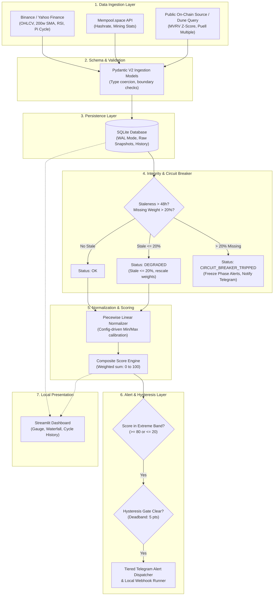

# Bitcoin Macro Cycle Sentinel (BitSignal)

*   **Author:** Project Lead
*   **Status:** Draft
*   **Date:** 2026-11-05

--------------------------------------------------------------------------------

## Overview

Bitcoin Macro Cycle Sentinel (BitSignal) is an autonomous, quantitative monitoring system designed to track Bitcoin macro cycle turns without emotional bias. The system ingests daily market OHLCV data, on-chain valuation ratios, and mining metrics at UTC 00:05, computing a deterministic Composite Cycle Score normalized between 0 and 100.

When market conditions reach extreme cyclical overheated valuation (Composite Score >= 80), BitSignal issues tiered push alerts to guide staged divestment of cold-storage holdings (30% to 40%). Conversely, during generational capitulation troughs (Composite Score <= 20), it signals staged dollar-cost averaging (DCA) accumulation. The architecture enforces zero external data costs, defensive circuit breakers against public API degradation, and strict alert hysteresis to prevent operator fatigue.

## The Problem

Long-term Bitcoin allocators face severe psychological and operational friction when navigating four-year macro market cycles:

1. **Emotional Distortion at Cycle Extremes**: Euphoric market sentiment near cycle tops induces greed and delay in taking profits, while despair and fear during capitulation bottoms paralyze accumulation.
2. **Cold Storage Transaction Friction**: Reallocating assets held in cold storage (multisig setups or hardware wallets) requires manual retrieval, transaction signing, mempool fee management, and exchange deposit latency. Without early, structured, tiered runbooks, allocators fail to execute timely rebalancing.
3. **Fragility of Free Public Data**: Quantitative cycle indicators (e.g., MVRV Z-Score, Puell Multiple) are typically locked behind expensive proprietary analytics subscriptions. While free public endpoints exist, they are prone to rate limits, schema mutations, and temporary outages. A naive monitoring script using public endpoints will crash or emit corrupted signals when upstream data fails.
4. **Indeterminate Thresholds and Boundary Jumps**: Heuristic trading rules often rely on arbitrary discrete indicators without continuous normalization or attribution, leading to conflicting signals and erratic indicator spikes.

BitSignal solves this by providing a unified, mathematically continuous, zero-cost, self-hosted sentinel engine that audits its own data integrity before dispatching operational runbooks.

## Goals

*   **Deterministic Composite Scoring**: Normalize 6 on-chain, technical, and mining indicators into a unified, continuous 0–100 Composite Cycle Score using clamped piecewise linear mapping.
*   **Zero Recurring Data Cost**: Construct ingestion pipelines exclusively around verified free endpoints (Binance/Yahoo Finance, Mempool.space, CoinGecko, and public community on-chain aggregates).
*   **Automated Data Integrity Circuit Breaker**: Track upstream metric staleness with a 48-hour tolerance ceiling. Automatically freeze phase-transition alerts and dispatch an operational diagnostic notice if stale metrics exceed 20% of aggregate indicator weight.
*   **Alert Hysteresis & Tiered Runbooks**: Enforce a 5-point deadband (e.g., score must drop below 75 after hitting 80 before re-triggering) and deliver tiered operational checklists (Score 80–84: 20% tranche, 85–89: 30%, >=90: 50%) via Telegram and local webhooks.
*   **Historical Backtesting Validation Gate**: Implement a Phase 1.5 replay engine against daily historical data (2012–2026) to calibrate thresholds, measure lead times before historical cycle tops/bottoms, and verify drawdown protection prior to live deployment.
*   **Lightweight Self-Hosted Architecture**: Implement a modular Python engine backed by SQLite (WAL mode) with an interactive Streamlit local dashboard, requiring minimal host resources.

## Non-Goals

*   **Automated Trade Execution or Private Key Access**: BitSignal will never hold private keys, manage exchange API trading keys, or execute automated buy/sell orders. All transfers and reallocations remain strictly manual.
*   **High-Frequency or Intraday Trading**: The system operates strictly on a 24-hour macro cadence (UTC 00:05 daily candle close). Intraday scalping, leverage trading, and short-term swing signals are out of scope.
*   **Multi-Asset or Altcoin Support**: BitSignal is engineered solely for Bitcoin macro cycle dynamics. Generalizing the scoring engine to Ethereum, altcoins, or traditional equities is explicitly excluded.
*   **Commercial Multi-Tenant SaaS**: The system is designed as a sovereign, single-tenant, self-hosted tool. Multi-user billing, tenancy isolation, and cloud scaling are out of scope.

## Open Questions

*   **Question 1**: What specific free public endpoint provides the most reliable daily series for historical and live Realized Cap (necessary for MVRV Z-Score calculation)? Candidate sources include public CoinGecko/Blockchain.com endpoints, cached Dune API queries, or GitHub-backed daily on-chain mirrors.
*   **Question 2**: For local webhook integration, what exact payload schema is preferred for downstream home automation (e.g., Home Assistant / JARVIS node)?

## Critical User Journeys (CUJs)

### CUJ 1: Parabolic Top Warning & Staged Divestment Runbook

*   **Given**: BitSignal daemon runs daily at UTC 00:05. Bitcoin experiences an aggressive multi-month parabolic expansion.
*   **When**: Daily data ingestion succeeds, and the Composite Cycle Score reaches 82.4 (crossing the Tier 1 threshold of 80).
*   **Then**: BitSignal dispatches a high-priority Telegram message containing:
    - Current score (82.4 / 100) and top metric contributors (e.g., MVRV Z-Score at 88, 200w SMA extension at 85).
    - Tier 1 Action Runbook: Recommendation to stage a 20% divestment tranche from cold storage to an exchange.
    - Hysteresis active: Suppresses repetitive "Top Alert" notifications on subsequent days until the score drops below 75 and re-crosses 80.

### CUJ 2: Upstream API Outage & Circuit Breaker Activation

*   **Given**: The on-chain data provider undergoes API maintenance or enforces an IP block, causing MVRV Z-Score (weight: 25%) to fail for 3 consecutive days (> 48 hours).
*   **When**: Daily ingestion job runs at UTC 00:05 and detects missing weight = 25% (> 20% threshold).
*   **Then**:
    - BitSignal trips its circuit breaker, setting system status to `CIRCUIT_BREAKER_TRIPPED`.
    - Phase-transition alerts are frozen to prevent distorted scores from firing false trading signals.
    - An operational warning is dispatched to Telegram: `"⚠️ BitSignal Circuit Breaker Tripped: MVRV Z-Score stale > 48h (Missing weight: 25%). Phase alerts suspended until source recovers."`

### CUJ 3: Capitulation Bottom Confirmation & DCA Accumulation

*   **Given**: Bitcoin is in a prolonged macro bear market.
*   **When**: Hash Ribbon detects post-capitulation recovery (score drops/recovers), Puell Multiple falls below 0.45, and the Composite Cycle Score drops to 17.8 (<= 20).
*   **Then**: BitSignal dispatches an accumulation alert:
    - Current score (17.8 / 100) indicating generational capitulation.
    - DCA Accumulation Runbook: Recommendation to initiate staged tranche accumulation.


--------------------------------------------------------------------------------

## Technical Plan (Architecture)

### Architectural Overview

BitSignal is structured as a decoupled, modular Python system operating in a batch-driven pipeline. Once daily at UTC 00:05 (immediately following the daily candle close), the daemon triggers the following deterministic pipeline:



### 1. Ingestion Layer & Zero-Cost Connectors

Ingestion connectors implement a shared `BaseConnector` interface with exponential backoff retries (`tenacity`) and strict 10-second request timeouts.

*   **Market Price & Moving Averages (`BinanceConnector` / `YahooConnector`)**:
    - Source: Public Binance API (`GET /api/v3/klines?symbol=BTCUSDT&interval=1d&limit=1000`) with automatic fallback to `yfinance`.
    - Computes: Daily close price, SMA 111, SMA 350, SMA 471, EMA 150, 200-week SMA (1400 daily candles), and 14-period weekly RSI.
    - Pi Cycle Top: Checked via $\text{SMA}_{111} \ge 2 \times \text{SMA}_{350}$.
    - Pi Cycle Bottom: Checked via $\text{EMA}_{150} \times 0.745 \le \text{SMA}_{471}$.
*   **Network & Mining Stats (`MempoolConnector`)**:
    - Source: Public `mempool.space/api/v1/mining/hashrate/pools/1m` and block reward metrics.
    - Computes: 30-day and 60-day moving averages of network hashrate for Hash Ribbon status.
*   **On-Chain Valuation Metrics (`OnChainConnector`)**:
    - Source: Public CoinGecko/Blockchain.com metrics combined with verified daily community Dune queries (or cached daily on-chain mirrors).
    - Computes: MVRV Z-Score and Puell Multiple.

### 2. Normalization Engine & Mathematical Formulation

To eliminate non-linear distortion and arbitrary hyperparameter tuning, all continuous metrics are transformed via a **Clamped Piecewise Linear Normalizer**.

For a metric $x_i$ with defined bottom boundary $\text{Min}_i$ (corresponding to sub-score 0) and top boundary $\text{Max}_i$ (corresponding to sub-score 100):

$$S_i = \text{clamp}\left(\frac{x_i - \text{Min}_i}{\text{Max}_i - \text{Min}_i} \times 100, 0, 100\right)$$

For metrics where higher values denote market bottoms (inverse metrics):

$$S_i = 100 - \text{clamp}\left(\frac{x_i - \text{Min}_i}{\text{Max}_i - \text{Min}_i} \times 100, 0, 100\right)$$

The **Composite Cycle Score** $C \in [0, 100]$ is the weighted sum:

$$C = \sum_{i=1}^{N} w_i \times S_i \quad \text{where} \quad \sum_{i=1}^{N} w_i = 1.0$$

#### Metric Calibration & Attribution Matrix

| Indicator | Weight ($w_i$) | Bottom Boundary ($S_i = 0$) | Top Boundary ($S_i = 100$) | Formulation / Direction |
| :--- | :--- | :--- | :--- | :--- |
| **MVRV Z-Score** | 25% | $Z \le 0.15$ | $Z \ge 5.00$ | Direct: higher = overheated top |
| **200-Week SMA Ratio** | 20% | $\text{Price} / \text{SMA}_{200w} \le 1.0$ | $\text{Price} / \text{SMA}_{200w} \ge 3.5$ | Direct: price extension over baseline |
| **Puell Multiple** | 20% | $\text{Puell} \le 0.45$ | $\text{Puell} \ge 2.20$ | Direct: miner revenue multiple |
| **Pi Cycle Top / Bottom** | 15% | Bottom cross active ($S_i = 0$) | Top cross active ($S_i = 100$) | Piecewise: Top spread vs Bottom spread |
| **Weekly RSI (14p)** | 10% | $\text{RSI} \le 32$ | $\text{RSI} \ge 80$ | Direct: macro momentum exhaustion |
| **Hash Ribbon** | 10% | Recovery cross ($S_i = 15$) | Normal state ($S_i = 50$) | Asymmetric: Normal = 50 (neutral), Capitulation = 15 |

*Note on Hash Ribbon*: In ordinary bull or neutral periods, Hash Ribbon outputs a neutral score of 50 (contributing exactly $50 \times 10\% = 5.0$ points), preventing top score artificial compression while preserving bottom sensitivity.

### 3. Circuit Breaker & Defensive Ingestion Mechanics

The `IntegrityMonitor` checks the timestamp of every fetched metric against system time:

1.  **Staleness Classification**:
    - `FRESH`: Data timestamp $\le 24$ hours old.
    - `STALE`: Data timestamp $> 24$ and $\le 48$ hours old. Reused with warning flag.
    - `EXPIRED`: Data timestamp $> 48$ hours old. Excluded from valid calculation.
2.  **Missing Weight Threshold**:
    - Let $W_{\text{missing}} = \sum_{j \in \text{EXPIRED}} w_j$.
    - **If $W_{\text{missing}} = 0$**: Status is `HEALTHY`. Normal calculation proceeds.
    - **If $0 < W_{\text{missing}} \le 0.20$**: Status is `DEGRADED`. Active weights are rescaled: $w'_k = \frac{w_k}{1 - W_{\text{missing}}}$. Diagnostic note added to daily log.
    - **If $W_{\text{missing}} > 0.20$**: Status transitions to `CIRCUIT_BREAKER_TRIPPED`.
        - Composite score calculation is marked invalid.
        - All automated phase-transition alerts (Score $\ge 80$ or $\le 20$) are **frozen**.
        - An immediate operational alert is dispatched to Telegram.

### 4. Alerting Engine, Hysteresis & Tiered Runbooks

To eliminate alert fatigue and ensure safe cold-storage operations:

1.  **Hysteresis Deadband (5 Points)**:
    - When a top alert triggers at Score $\ge 80$, the state transitions to `IN_TOP_ZONE`.
    - No further "Entering Top Zone" alerts are issued on subsequent days.
    - The state resets to `NEUTRAL` only when the score falls strictly below $80 - 5 = 75$.
    - Identical symmetric logic applies to the bottom zone (triggers at $\le 20$, resets only when score rises strictly above $20 + 5 = 25$).
2.  **Tiered Divestment Runbooks (Telegram Push)**:
    - **Tier 1 (Score 80–84)**: Stage 20% divestment tranche. Transfer from cold storage to intermediate staging wallet. Check mempool fee estimates.
    - **Tier 2 (Score 85–89)**: Stage additional 10% tranche (30% cumulative). Deposit to institutional exchange order book with limit orders.
    - **Tier 3 (Score $\ge 90$)**: Stage additional 10% tranche (40% cumulative). Full cycle euphoria exit execution.

### 5. Persistence Layer (SQLite Schema)

A lightweight local SQLite database operating with Write-Ahead Logging (`PRAGMA journal_mode=WAL;`) ensures crash-resilient local persistence.

```sql
CREATE TABLE IF NOT EXISTS raw_snapshots (
    date TEXT PRIMARY KEY,
    btc_price REAL NOT NULL,
    sma_111 REAL,
    sma_350 REAL,
    sma_471 REAL,
    ema_150 REAL,
    sma_200w REAL,
    rsi_14w REAL,
    mvrv_z REAL,
    puell_multiple REAL,
    hash_ribbon_status TEXT,
    created_at TIMESTAMP DEFAULT CURRENT_TIMESTAMP
);

CREATE TABLE IF NOT EXISTS daily_scores (
    date TEXT PRIMARY KEY,
    composite_score REAL NOT NULL,
    mvrv_score REAL NOT NULL,
    sma200w_score REAL NOT NULL,
    puell_score REAL NOT NULL,
    picycle_score REAL NOT NULL,
    rsi_score REAL NOT NULL,
    hashribbon_score REAL NOT NULL,
    system_status TEXT NOT NULL,
    stale_metrics TEXT,
    created_at TIMESTAMP DEFAULT CURRENT_TIMESTAMP
);

CREATE TABLE IF NOT EXISTS alert_dispatches (
    id INTEGER PRIMARY KEY AUTOINCREMENT,
    date TEXT NOT NULL,
    alert_type TEXT NOT NULL, -- 'TOP_TIER1', 'TOP_TIER2', 'TOP_TIER3', 'BOTTOM_DCA', 'CIRCUIT_BREAKER'
    composite_score REAL,
    payload TEXT NOT NULL,
    delivered_telegram BOOLEAN NOT NULL DEFAULT 0,
    delivered_webhook BOOLEAN NOT NULL DEFAULT 0,
    created_at TIMESTAMP DEFAULT CURRENT_TIMESTAMP
);
```

### 6. Phase 1.5 Historical Backtesting Engine (Quality Gate)

Before the live daily daemon is authorized for production alerting, the backtesting module (`bitsignal.backtest`) evaluates historical performance across all historical Bitcoin cycles (January 2012 – November 2026):

*   **Evaluation Criteria**:
    1. **Lead Time to Cycle Peak**: Days between the first Tier 1 alert (Score $\ge 80$) and the actual macro cycle high. Target: 10 to 45 days.
    2. **False Positive Rate**: Number of occurrences where Score $\ge 80$ fired without a subsequent $>50\%$ macro correction within 180 days. Target: 0 false positives.
    3. **Capitulation Detection**: Verification that Score $\le 20$ flagged the major cycle bottoms (Nov 2015, Dec 2018, Nov 2022).
    4. **Drawdown Protection**: Simulation of a portfolio executing 30% staged cold-storage divestment at Tier 1/2 vs. Buy-and-Hold.

### 7. Interactive Local Dashboard (Streamlit)

A single-page local Streamlit dashboard (`bitsignal.ui.app`) reads directly from `daily_scores` and `raw_snapshots`:
*   **Macro Cycle Gauge**: Semi-circular dial (0 to 100) highlighting current market regime: Green ($\le 20$), Neutral ($21–79$), Red ($\ge 80$).
*   **Waterfall Attribution**: Bar chart showing the exact point contribution of each metric to the current composite score.
*   **Historical Overlay**: Interactive Plotly graph overlaying the Composite Cycle Score against historical Bitcoin price and Pi Cycle bands.
*   **Health & Logs Pane**: Current circuit breaker status, metric staleness counters, and historical alert dispatch audit log.


--------------------------------------------------------------------------------

## Alternatives Considered

### Alternative 1: Full Sovereign Local Node (Bitcoin Core RPC + Electrs + Custom Tx Indexer)

*   **Description**: Running a dedicated full Bitcoin Core node locally to compute Realized Cap, Hashrate, and UTXO age distribution directly from raw block data without any external API calls.
*   **Pros**:
    - Absolute data sovereignty with zero third-party dependency.
    - Immune to API rate limits, deprecations, or terms-of-service changes.
*   **Cons**:
    - High disk storage requirements (>700 GB for a full node, or complex pruned state).
    - Initial blockchain synchronization (IBD) takes days to weeks depending on hardware.
    - Calculating daily historical Realized Cap requires parsing and indexing every UTXO creation and destruction event across the entire history of the blockchain, adding immense engineering complexity.
*   **Reason for Rejection**: The operational complexity and hardware overhead are disproportionate for an initial release. Free public APIs backed by strict Pydantic validation, exponential backoff, and a defensive circuit breaker deliver identical operational signals at zero hosting cost. Sovereign node RPC integration is deferred to an optional Phase 4 extension.

### Alternative 2: Logistic Sigmoidal Activation for Indicator Normalization

*   **Description**: Mapping raw indicators to the 0–100 score using logistic sigmoid curves ($S_i = \frac{100}{1 + e^{-k(x_i - x_0)}}$) to create asymptotic smoothing at the extremes.
*   **Pros**:
    - Smooth, continuous curves with no abrupt derivative changes at the boundary thresholds.
    - Natural asymptotic bounds at 0 and 100.
*   **Cons**:
    - Introduces arbitrary inflection point ($x_0$) and slope temperature ($k$) hyperparameters for every metric, increasing calibration sensitivity and overfitting risk.
    - Asymmetric saturation: values far in the tail can compress meaningful differences, obscuring the exact contribution of each indicator in the composite score.
*   **Reason for Rejection**: Piecewise linear clamped normalization was selected because it provides complete mathematical transparency, deterministic attribution, and immediate interpretability for the operator without hidden hyperparameters.

### Alternative 3: Distributed Multi-Container Microservices Architecture

*   **Description**: Decoupling ingestion, scoring, and alerting into separate containerized services communicating via a message broker (RabbitMQ/Kafka) with PostgreSQL storage and Celery workers.
*   **Pros**:
    - Independent horizontal scaling and decoupled service lifecycles.
    - Industry-standard pattern for high-throughput enterprise SaaS.
*   **Cons**:
    - Substantial memory footprint (>2–4 GB RAM idle).
    - Complex Docker Compose orchestration and multi-container dependency management.
    - Fragile local operational overhead on personal laptops (macOS Apple Silicon / local Linux servers).
*   **Reason for Rejection**: BitSignal runs a batch calculation strictly once every 24 hours (at UTC 00:05). Designing a high-throughput event-driven microservices cluster for a process that executes in less than 3 seconds per day is extreme over-engineering (violating YAGNI). A single lightweight Python package with embedded SQLite in WAL mode achieves identical reliability with zero maintenance.

--------------------------------------------------------------------------------

## Non-Functional Requirements

### Security & Privacy
*   **Zero Key Custody**: BitSignal contains no code capable of generating, storing, or handling private keys, seed phrases, or exchange API trading credentials.
*   **Credential Isolation**: Telegram Bot tokens and webhook signing secrets must be loaded strictly from local environment variables or an uncommitted `.env` file (never hardcoded in source control).
*   **Local Data Boundary**: All raw data snapshots, score histories, and alert logs remain confined to the local filesystem (`~/.bitsignal/bitsignal.db` or local project root). No outbound telemetry or usage reporting is emitted.

### Performance & Latency
*   **Daily Batch Runtime**: The complete ingestion, normalization, and alert dispatch cycle must finish within 15 seconds under normal network conditions.
*   **Database Footprint**: SQLite database growth must not exceed 25 MB per year of continuous daily operation.
*   **Dashboard Responsiveness**: Local Streamlit dashboard queries against historical datasets must render initial graphs in under 500 milliseconds.

### Reliability & Fault Tolerance
*   **Network Resilience**: Every outbound API request enforces a 10-second timeout ceiling and up to 3 retries with exponential backoff and jitter (`tenacity`).
*   **Crash Recovery**: SQLite WAL mode ensures transactional ACID compliance; interrupted writes during power loss or system reboot will not corrupt historical tables.
*   **Rollback & Versioning**: All metric calculation bounds and threshold rules in `config.yaml` are versioned. Re-running the calculation CLI against historical dates is fully idempotent.


--------------------------------------------------------------------------------

## Detailed Implementation Plan

### Target Files to Create/Modify

#### 1. `pyproject.toml` (Create)
*   **Type / Scope**: Build system and dependency configuration.
*   **Proposed Changes**: Define project metadata (`name = "bitsignal"`, `version = "0.1.0"`), Python version constraint (`>=3.11`), build backend (`hatchling`), core dependencies (`pydantic>=2.5.0`, `requests>=2.31.0`, `pandas>=2.1.0`, `numpy>=1.26.0`, `tenacity>=8.2.0`, `streamlit>=1.30.0`, `plotly>=5.18.0`, `python-dotenv>=1.0.0`, `pyyaml>=6.0.1`), and development/test dependencies (`pytest>=7.4.0`, `pytest-cov>=4.1.0`, `ruff>=0.1.5`).

#### 2. `config/config.yaml` (Create)
*   **Type / Scope**: Application configuration and calibration profiles.
*   **Proposed Changes**: Externalize all indicator calibration weights, minimum/maximum normalization boundaries, alert thresholds (Tier 1: 80, Tier 2: 85, Tier 3: 90, Bottom: 20), hysteresis deadbands (5 points), staleness limit (48 hours), missing weight circuit breaker threshold (20%), and retry configurations.

#### 3. `.env.example` (Create)
*   **Type / Scope**: Environment secret template.
*   **Proposed Changes**: Provide environment variable stubs for `TELEGRAM_BOT_TOKEN`, `TELEGRAM_CHAT_ID`, `WEBHOOK_URL`, `DATABASE_PATH` (defaults to `./data/bitsignal.db`), and `LOG_LEVEL` (defaults to `INFO`).

#### 4. `bitsignal/__init__.py` (Create)
*   **Type / Scope**: Package initialization.
*   **Proposed Changes**: Expose package version (`__version__ = "0.1.0"`) and high-level module exports.

#### 5. `bitsignal/models.py` (Create)
*   **Type / Scope**: Pydantic V2 data contracts.
*   **Proposed Changes**:
    - `MarketDataSnapshot`: Validates date, open, high, low, close, volume.
    - `MiningDataSnapshot`: Validates date, hashrate 30d, hashrate 60d, Hash Ribbon state enum (`NORMAL`, `CAPITULATION`, `BUY_RECOVERY`).
    - `OnChainSnapshot`: Validates date, MVRV Z-Score, Puell Multiple.
    - `RawSnapshot`: Aggregated daily snapshot combining market, mining, and on-chain inputs.
    - `NormalizedMetricScore`: Stores raw value, normalized sub-score (0–100), applied weight, and staleness status (`FRESH`, `STALE`, `EXPIRED`).
    - `DailyCompositeResult`: Stores calculation date, composite score, status (`HEALTHY`, `DEGRADED`, `CIRCUIT_BREAKER_TRIPPED`), breakdown dictionary, and hysteresis zone state.

#### 6. `bitsignal/storage/db.py` (Create)
*   **Type / Scope**: Persistence Layer (SQLite WAL).
*   **Proposed Changes**: Context manager for SQLite database connection enforcing `PRAGMA journal_mode=WAL;` and `PRAGMA synchronous=NORMAL;`. Implements schema initialization (`init_db`), raw snapshot insertion (`upsert_raw_snapshot`), daily composite score insertion (`upsert_daily_score`), alert record logging (`record_alert_dispatch`), and historical queries for backtesting and dashboard rendering.

#### 7. `bitsignal/ingest/base.py` (Create)
*   **Type / Scope**: Ingestion Interface & Utilities.
*   **Proposed Changes**: Abstract base class `BaseConnector` providing standardized HTTP session setup, custom user-agent headers, 10-second timeout enforcement, and exponential backoff retry decorators using `tenacity`.

#### 8. `bitsignal/ingest/binance.py` (Create)
*   **Type / Scope**: Market Data Connector.
*   **Proposed Changes**: Pulls daily OHLCV candles from Binance API (`/api/v3/klines`). If Binance is unreachable (HTTP error or geo-blocking), automatically falls back to Yahoo Finance query for BTC-USD daily series.

#### 9. `bitsignal/ingest/mempool.py` (Create)
*   **Type / Scope**: Mining & Hashrate Connector.
*   **Proposed Changes**: Pulls 1-month and 3-month network hashrate and difficulty histories from `mempool.space/api/v1/mining/hashrate/pools/1m` to compute 30-day and 60-day moving averages.

#### 10. `bitsignal/ingest/onchain.py` (Create)
*   **Type / Scope**: On-Chain Ratio Connector.
*   **Proposed Changes**: Ingests daily MVRV Z-Score and Puell Multiple from verified public aggregators (CoinGecko / Blockchain.com / Dune public query endpoints) with JSON schema validation.

#### 11. `bitsignal/engine/indicators.py` (Create)
*   **Type / Scope**: Mathematical Indicator Calculations.
*   **Proposed Changes**: Pure functional vector calculations via Pandas/NumPy:
    - `calculate_sma(series, window)`
    - `calculate_ema(series, span)`
    - `calculate_rsi(series, period=14)` (weekly aggregation)
    - `evaluate_picycle(sma_111, sma_350, ema_150, sma_471)`: Top cross and bottom convergence flags.
    - `evaluate_hash_ribbon(hashrate_30d, hashrate_60d)`: Evaluates crossover states.

#### 12. `bitsignal/engine/normalizer.py` (Create)
*   **Type / Scope**: Normalization & Composite Scoring Engine.
*   **Proposed Changes**:
    - Implements clamped piecewise linear normalizer: `clamp((x - min) / (max - min) * 100, 0, 100)`.
    - Implements inverse normalizer for bottom-skewed indicators.
    - Handles Hash Ribbon asymmetric assignment (Normal = 50, Capitulation = 15, Buy Recovery = 85).
    - Dynamically rescales active weights when degraded metrics are detected within the 20% limit.
    - Computes final 0–100 Composite Cycle Score.

#### 13. `bitsignal/integrity/monitor.py` (Create)
*   **Type / Scope**: Circuit Breaker & Health Monitor.
*   **Proposed Changes**:
    - Compares metric timestamps against the execution timestamp.
    - Classifies metrics as `FRESH` ($\le 24h$), `STALE` ($24–48h$), or `EXPIRED` ($> 48h$).
    - Computes missing weight $W_{\text{missing}}$. If $W_{\text{missing}} > 0.20$, transitions status to `CIRCUIT_BREAKER_TRIPPED` and suppresses phase-change alert dispatch.

#### 14. `bitsignal/alerts/dispatcher.py` (Create)
*   **Type / Scope**: Alert Dispatcher with Hysteresis.
*   **Proposed Changes**:
    - Manages hysteresis state machines (`NEUTRAL`, `IN_TOP_ZONE`, `IN_BOTTOM_ZONE`) using database history.
    - Checks deadband threshold (must drop $<75$ before re-alerting top at $\ge 80$; must rise $>25$ before re-alerting bottom at $\le 20$).
    - Formats markdown Telegram alert templates with tiered divestment runbooks (Tier 1: 20%, Tier 2: 30%, Tier 3: 50%) and component point contributions.
    - Dispatches webhook payloads to configured local automation endpoints.

#### 15. `bitsignal/backtest/engine.py` (Create)
*   **Type / Scope**: Phase 1.5 Historical Backtest Engine.
*   **Proposed Changes**:
    - Replays historical daily data from 2012 to 2026 through the normalization and scoring pipeline.
    - Tracks signals against historical cycle peaks (Nov 2013, Dec 2017, Apr/Nov 2021) and macro bottoms (Jan 2015, Dec 2018, Nov 2022).
    - Generates a validation summary report: false positive count, lead times in days before peaks, and portfolio drawdown comparison against a Buy-and-Hold benchmark.

#### 16. `bitsignal/ui/app.py` (Create)
*   **Type / Scope**: Interactive Local Streamlit Dashboard.
*   **Proposed Changes**:
    - Renders semi-circular gauge dial (0–100) with color bands for current score.
    - Renders Plotly waterfall chart decomposing individual indicator contributions.
    - Renders historical time-series chart showing Bitcoin price overlaid with Composite Score bands and Pi Cycle curves.
    - Renders health panel detailing metric freshness, circuit breaker state, and recent alert dispatch history.

#### 17. `bitsignal/cli.py` (Create)
*   **Type / Scope**: Command-Line Interface.
*   **Proposed Changes**: CLI entrypoint using `argparse` with subcommands:
    - `db-init`: Initializes database tables.
    - `run-daily`: Executes single daily pipeline (ingest $\to$ validate $\to$ score $\to$ alert).
    - `calculate-date --date YYYY-MM-DD`: Deterministic calculation for a specific historical date.
    - `backtest --start YYYY-MM-DD --end YYYY-MM-DD`: Executes Phase 1.5 historical backtest.
    - `ui`: Launches Streamlit dashboard (`streamlit run bitsignal/ui/app.py`).

#### 18. `bitsignal/daemon.py` (Create)
*   **Type / Scope**: Daily Execution Daemon / Cron Wrapper.
*   **Proposed Changes**: Lightweight scheduler loop sleeping until UTC 00:05 daily, or executing via systemd/launchd entrypoint with logging and crash containment.

#### 19. `tests/test_normalizer.py` (Create)
*   **Type / Scope**: Normalization Unit Tests.
*   **Proposed Changes**: Tests boundary clamping (inputs below min clamp to 0; inputs above max clamp to 100), inverse indicator logic, Hash Ribbon ternary scoring, and dynamic weight rescaling with missing inputs.

#### 20. `tests/test_integrity.py` (Create)
*   **Type / Scope**: Circuit Breaker Unit Tests.
*   **Proposed Changes**: Tests staleness classification ($<24h$, $24–48h$, $>48h$), weight summation, transition to `DEGRADED` when missing weight $\le 20\%$, and transition to `CIRCUIT_BREAKER_TRIPPED` when missing weight $> 20\%$.

#### 21. `tests/test_indicators.py` (Create)
*   **Type / Scope**: Indicator Unit Tests.
*   **Proposed Changes**: Tests SMA, EMA, RSI, Pi Cycle cross detection, and Hash Ribbon crossovers against synthetic test series with known expected mathematical values.

#### 22. `tests/test_alerts.py` (Create)
*   **Type / Scope**: Alert & Hysteresis Unit Tests.
*   **Proposed Changes**: Tests hysteresis deadband logic (oscillating between 79.5 and 80.5 generates only 1 top alert until score drops below 75), and validates Telegram markdown message payload structure.

#### 23. `README.md` (Create)
*   **Type / Scope**: Project Documentation & Operational Runbook.
*   **Proposed Changes**: System architecture summary, installation instructions (`pip install -e .`), configuration guide (`config.yaml`), daemon setup via systemd/launchd, and detailed operational procedures for executing cold-storage divestment when alerts arrive.

---

### Verification Plan

#### 1. Build & Environment Verification
*   Create and activate a clean Python 3.11+ virtual environment:
    ```bash
    python -m venv .venv
    source .venv/bin/activate  # or .venv\Scripts\activate on Windows
    pip install -e ".[dev]"
    ```

#### 2. Static Analysis & Code Quality
*   Enforce code formatting and linting:
    ```bash
    ruff check bitsignal tests
    ruff format --check bitsignal tests
    ```

#### 3. Automated Unit & Integration Tests
*   Execute test suite with coverage report:
    ```bash
    pytest tests/ -v --cov=bitsignal --cov-report=term-missing
    ```
*   **Pass Criteria**: 100% of tests passing; minimum 85% branch coverage across `bitsignal/engine`, `bitsignal/integrity`, and `bitsignal/storage`.

#### 4. Historical Backtest Quality Gate (Phase 1.5 Validation)
*   Execute the backtest engine over historical cycles:
    ```bash
    python -m bitsignal backtest --start 2012-01-01 --end 2026-11-01
    ```
*   **Pass Criteria**:
    - Zero false positives in Tier 1 Top Alerts (Score $\ge 80$) during mid-bull consolidation phases.
    - Lead time of 10 to 45 days prior to major macro peaks (Nov 2013, Dec 2017, Apr/Nov 2021).
    - Capitulation alert trigger (Score $\le 20$) during major bear market lows (Jan 2015, Dec 2018, Nov 2022).

#### 5. End-to-End Daily Pipeline Smoke Test
*   Execute database initialization and test daily calculation:
    ```bash
    python -m bitsignal db-init
    python -m bitsignal run-daily --dry-run
    ```
*   **Pass Criteria**: Pipeline executes in $<15$ seconds, inserts record into `raw_snapshots` and `daily_scores`, logs system health as `HEALTHY` or `DEGRADED`, and dry-run alert payload formats correctly without error.

#### 6. Dashboard Verification
*   Launch Streamlit local server:
    ```bash
    python -m bitsignal ui
    ```
*   **Pass Criteria**: Dashboard loads at `http://localhost:8501`, renders the gauge dial, waterfall chart, and historical overlay without browser console or backend errors.
