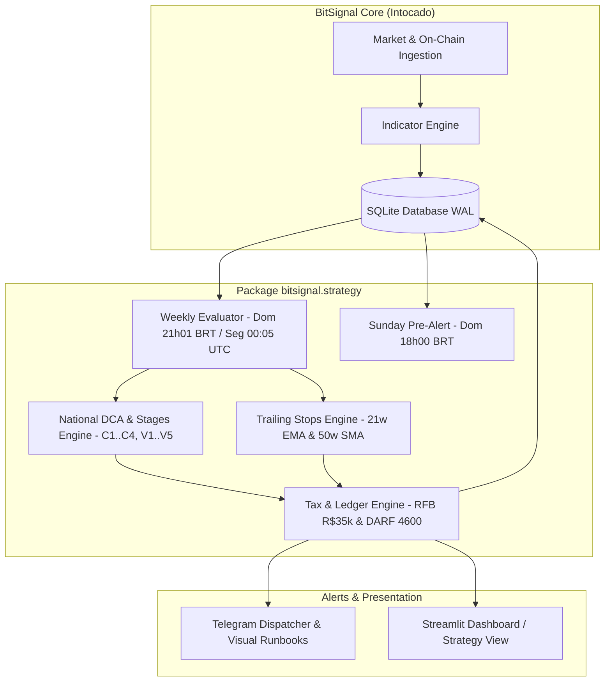

# Estratégia de Ciclo Macro com Gestão Tributária Nacional (BitSignal Strategy Engine)

*   **Author:** @Guilherme
*   **Status:** Draft
*   **Date:** 2026-11-06

--------------------------------------------------------------------------------

## Overview

A **Estratégia de Ciclo Macro com Gestão Tributária Nacional** expande o BitSignal de um sentinela passivo/observacional para uma plataforma de orquestração de estratégias executáveis de ciclo completo de 3 a 4 anos do Bitcoin. A funcionalidade combina:

1. **Acumulação Assimétrica em Quedas (Bear Market / Capitulação):** Aportes escalonados em degraus de desconto percentual em relação ao topo histórico do ciclo anterior (ATH de referência = US$ 126 mil em outubro de 2025) e confirmação on-chain (MVRV Z-Score $\le 0.0$ e rompimento da média de 50 semanas).
2. **Distribuição Gradual em Expansão Parabólica (Bull Market):** Desova em tranches percentuais baseadas em múltiplos da ATH ($1.0\times$, $1.3\times$, $1.6\times$, $2.0\times$ e $2.5\times$), complementadas por trailing stops semanais de proteção patrimonial (21w EMA e 50w SMA no fechamento de domingo às 21h00 BRT).
3. **Engenharia Fiscal Brasileira Especializada para Posições $< 0.5$ BTC:** Automação de conformidade com as regras da Receita Federal do Brasil (RFB) e Banco Central (BCB), aproveitando a isenção de alienações de até R$ 35.000,00 por mês civil, algoritmo de *split intermensal* condicional para tranches de R$ 35k a R$ 70k (quando o sinal ocorrer a partir do dia 25 do mês), livro razão de custo médio ponderado e apuração automática de Ganho de Capital com emissão de guia DARF (código 4600) à alíquota de 15%.
4. **Off-ramp Soberano para Renda Fixa:** Protocolo operacional de liquidação direta no par BTC/BRL em corretoras nacionais autorizadas pelo BCB e transferência imediata via PIX para instrumentos de renda fixa em Reais com liquidez diária (preservando o poder de compra até o próximo ciclo).

## The Problem

Investidores de Bitcoin que utilizam custódia própria e operam sob a jurisdição tributária brasileira enfrentam fricções severas que corroem a rentabilidade e a disciplina de ciclo:

1. **Incompatibilidade das Ferramentas Globais com a Tributação Nacional:**
   Softwares internacionais de análise e bots de trade ignoram o ordenamento tributário da RFB (art. 35 da Lei 8.981/1995 e IN RFB 1.888/2019). No Brasil, vendas mensais agregadas de até R$ 35.000 são 100% isentas de imposto de renda, enquanto vendas de R$ 35.000,01 tributam todo o ganho de capital do mês a 15%–22,5%. A ausência de um algoritmo de dimensionamento de lote consciente do calendário civil faz alocadores desperdiçarem dezenas de milhares de reais em impostos evitáveis.
2. **Falha de Níveis Absolutos de Indicadores On-Chain:**
   A diminuição histórica da volatilidade e a maturação institucional do Bitcoin fizeram com que os picos de indicadores on-chain clássicos diminuíssem a cada ciclo (o MVRV Z-Score atingiu 9.4 em 2017, 3.5 em 2021 e apenas 2.5 no topo de outubro de 2025). Alocadores que aguardam gatilhos rígidos históricos (ex.: MVRV $> 5.0$) não vendem nada e devolvem todos os ganhos durante o bear market.
3. **Fricção de Execução Dominical e Travas de Liquidez do PIX:**
   O fechamento da vela semanal aos domingos às 21h00 BRT coincide com o horário de limite noturno de segurança do PIX bancário (R$ 1.000 a R$ 5.000 na maioria das contas) e com a inoperância do expediente de fundos de renda fixa tradicionais. Sem um protocolo com pré-alerta e runbooks pré-calculados, o investidor procrastina ou enfrenta bloqueios de compliance bancário.
4. **Viés Emocional e Síndrome do "Desta Vez é Diferente":**
   Em topos parabólicos, a ganância retarda as vendas; em fundos de capitulação, o medo paralisa os aportes. Um sistema mecanicista baseado em regras auditadas remove o componente emocional da tomada de decisão.

## Goals

*   **Gatilhos Determinísticos de Entrada e Saída:** Codificar com precisão os degraus de compra C1 a C4 (DCA de 30% a $-30\%$, C1 de 15% a $-45\%$, C2 de 20% a $-55\%$, C3 de 20% a $-65\%$ ou MVRV Z-Score $\le 0.0$, e C4 de 15% + saldo restante na confirmação da 50w SMA) e as tranches de venda V1 a V5 (V1 10%, V2 15%, V3 15%, V4 20%, V5 20%, Moonbag 10% permanente).
*   **Trailing Stops Semanais no Fechamento Dominical (21h BRT):** Avaliar na virada semanal (`segunda-feira 00:00 UTC` / `domingo 21h00 BRT`) o rompimento da 21w EMA (Stop 1: alienação de 50% do saldo remanescente) e da 50w SMA (Stop 2: alienação de 100% do saldo remanescente, exceto Moonbag).
*   **Motor Fiscal Especializado RFB:**
    *   Controle contínuo do estoque e cálculo de custo médio ponderado em Reais incluindo taxas de transação e saque.
    *   Monitoramento em tempo real do volume acumulado de alienações no mês civil contra o teto de R$ 35.000,00.
    *   Algoritmo de *Split Intermensal Condicional*: fracionamento automático de tranches entre R$ 35k e R$ 70k caso o sinal ocorra a partir do dia 25 do mês; caso contrário, liquidação imediata para priorizar a preservação patrimonial.
    *   Emissão do relatório de apuração de Ganho de Capital com o valor exato a recolher na DARF (código 4600) até o último dia útil do mês seguinte.
*   **Pré-Alerta e Runbooks Operacionais Passo a Passo:** Envio de notificação no Telegram aos domingos às 18h00 BRT alertando para a proximidade de gatilhos ($< 2\%$ de distância da média semanal), seguido de runbook às 21h01 BRT com comandos explícitos de quantidade de satoshis a depositar, limites de ordem e chave PIX bancária de saída.
*   **Desacoplamento Arquitetural:** Implementar a lógica no submódulo `bitsignal.strategy` sem alterar o núcleo analítico global do BitSignal.

## Non-Goals

*   **Trading Automatizado sem Intervenção Humana (API Trading):** O BitSignal não terá custódia de chaves privadas de corretoras nem enviará ordens diretamente ao livro de ofertas sem autorização do operador. A custódia permanece estritamente soberana (cold storage).
*   **Gestão de Posições Institucionais ($> 1.0$ BTC):** O dimensionamento da estratégia e a regra de isenção de R$ 35k são modelados exclusivamente para posições familiares/individuais $< 0.5$ BTC.
*   **Negociação de Derivativos e Alavancagem:** A estratégia proíbe expressamente contratos futuros, margem ou opções.
*   **Uso de Stablecoins como Destino de Caixa:** Devido à regulação cambial do Banco Central (Resoluções BCB 519/520/521), a saída é executada diretamente em Reais (BRL) para conta corrente bancária e instrumentos de Renda Fixa com liquidez diária.


--------------------------------------------------------------------------------

## Open Questions

*   **Ponto de Integração do Câmbio PTAX (Resolvido):** Para garantir consistência legal com a apuração da Receita Federal, as conversões de ordens e apuração fiscal utilizarão o fechamento da PTAX do Banco Central via API oficial do BACEN (com fallback para Yahoo Finance `BRL=X`).
*   **Ajuste de Tranches de Saída (Resolvido):** A soma original totalizava 85%. Foi normalizada para: V1 (10%), V2 (15%), V3 (15%), V4 (20%), V5 (20%) e Moonbag (10% intocável), totalizando 100% da posição base.
*   **Condição Temporal de Split Intermensal (Resolvido):** Para evitar carregar risco direcional em quedas acentuadas, o split de tranches entre R$ 35k e R$ 70k só é permitido se o fechamento dominical ocorrer a partir do dia 25 do mês civil. Sinais anteriores ao dia 25 são liquidados integralmente com emissão de DARF de 15%.

## Critical User Journeys (CUJs)

### CUJ 1: Entrada Escalonada em Capitulação (Gatilho C2 a -55% de ATH)

*   **Given**: ATH de referência ancorada em US$ 126.000. Reserva total $R = \text{R\$} 100.000$. O investidor já alocou os 30% de DCA ($R\$ 30.000) e os 15% de C1 ($R\$ 15.000). Saldo em BTC = 0.18 BTC com custo médio ponderado de R$ 320.000/BTC.
*   **When**: O fechamento semanal de domingo às 21h00 BRT encerra em US$ 56.400 (queda de -55,2% em relação à ATH).
*   **Then**: 
    1. O BitSignal dispara o gatilho C2 (20% de $R = \text{R\$} 20.000$).
    2. O Telegram envia o alerta com runbook: "Depositar R$ 20.000 via PIX na Corretora A; programar ordem limitada de compra entre US$ 55.270 e US$ 55.830 (1% a 2% abaixo do fechamento); prazo de 7 dias antes de converter a mercado".
    3. Após a confirmação da execução pelo operador, o sistema registra a transação, atualiza o saldo para 0.245 BTC e recalcula o custo médio ponderado para R$ 312.500/BTC.
    4. O runbook instrui a retirada do saldo de 0.065 BTC para a hardware wallet.

### CUJ 2: Saída em Topo Parabólico com Split Intermensal (Gatilho V1)

*   **Given**: Posição acumulada de 0.40 BTC com custo médio ponderado de R$ 280.000/BTC. Mês corrente: Outubro de 2027. Data: Domingo, 26 de Outubro às 21h00 BRT.
*   **When**: O Bitcoin fecha a semana em US$ 128.500, rompendo a ATH anterior (V1 ativado: alienação de 10% da posição = 0.04 BTC). Câmbio PTAX = R$ 5,80 (Valor da tranche = $0.04 \times 128.500 \times 5.80 = \text{R\$} 29.812$).
*   **Then**:
    1. O sistema verifica que o valor da tranche (R$ 29.812) é menor que R$ 35.000,00 e o volume acumulado alienado no mês de outubro é R$ 0,00.
    2. O BitSignal emite alerta de V1: "Transferir 0.04 BTC da cold storage para a Corretora A. Executar venda a mercado/limite no par BTC/BRL".
    3. Status fiscal: **ISENTO** (Alienação $\le$ R$ 35.000). Ganho de capital isento = R$ 18.612. Imposto a pagar = R$ 0,00.
    4. Instrução de off-ramp: "Realizar PIX de R$ 29.812 para a conta bancária de mesma titularidade e aplicar em CDB de liquidez imediata".

### CUJ 3: Saída de Emergência por Trailing Stop com DARF (Stop 1: Perda da 21w EMA)

*   **Given**: O Bitcoin atingiu topo em US$ 240.000. Foram executadas as tranches V1, V2, V3 (restando 0.24 BTC na carteira, excluindo Moonbag de 0.04 BTC). Saldo elegível a stop = 0.20 BTC. Custo médio ponderado = R$ 280.000/BTC.
*   **When**: Em meados de um ciclo de baixa, no domingo, dia 12, a vela semanal fecha abaixo da 21w EMA em US$ 185.000. Câmbio = R$ 6,00.
*   **Then**:
    1. Stop 1 é ativado: alienação imediata de 50% do saldo elegível = 0.10 BTC.
    2. Valor da alienação = $0.10 \times 185.000 \times 6.00 = \text{R\$} 111.000,00$.
    3. Como o valor (R$ 111.000) excede R$ 70.000 e a data é dia 12 (fora da janela de split), o sistema bloqueia qualquer fracionamento para evitar perdas adicionais de preço.
    4. Alerta de execução: "Executar venda imediata de 0.10 BTC na Corretora A/B. Realizar PIX de R$ 111.000 para conta bancária".
    5. Motor fiscal calcula: Custo de aquisição = $0.10 \times 280.000 = \text{R\$} 28.000$. Ganho de capital tributável = $\text{R\$} 111.000 - \text{R\$} 28.000 = \text{R\$} 83.000$.
    6. DARF calculado = $83.000 \times 15\% = \text{R\$} 12.450,00$, com código de receita 4600 e vencimento para o último dia útil do mês subsequente. O runbook instrui separar R$ 12.450 em CDB diário e destinar o saldo líquido restante de R$ 98.550 para a reserva do próximo ciclo.

--------------------------------------------------------------------------------

## Technical Plan (Architecture)

### 1. Visão Geral da Arquitetura e Limites de Componentes

A arquitetura adota um design modular em camadas, mantendo o núcleo preditivo/analítico do BitSignal desacoplado das regras de negócio de execução da carteira:



### 2. Módulos do Pacote `bitsignal.strategy`

1. **`bitsignal.strategy.models`**:
   - Definição de enums e dataclasses (`StageType`: `DCA`, `C1`..`C4`, `V1`..`V5`, `STOP_1`, `STOP_2`; `TaxStatus`: `EXEMPT`, `SPLIT_PENDING`, `TAXABLE`; `TransactionType`: `BUY`, `SELL`).
2. **`bitsignal.strategy.trailing_stops`**:
   - Cálculo e monitoramento das médias móveis semanais:
     - $	ext{EMA}_{21w}$ (calculada sobre fechamentos semanais com $lpha = rac{2}{21+1}$).
     - $	ext{SMA}_{50w}$ (média aritmética de 50 semanas; equivalente a `SMA 350` diária).
   - Verificação de quebra de suporte: $	ext{Close}_w < 	ext{EMA}_{21w}$ (Stop 1) e $	ext{Close}_w < 	ext{SMA}_{50w}$ (Stop 2).
3. **`bitsignal.strategy.national_dca`**:
   - Gerenciador de estado das tranches em relação ao parâmetro dinâmico `cycle_ath_reference` (default: US$ 126.000).
   - Rastreamento dos degraus concluídos na tabela `strategy_state` para garantir idempotência (um degrau nunca é executado duas vezes no mesmo ciclo).
4. **`bitsignal.strategy.tax_br`**:
   - Livro razão (*ledger*) para cálculo contínuo do Custo Médio Ponderado:
     $$CMP_t = \frac{\sum_{i=1}^n (Q_i \times P_{BRL, i} + \text{Taxas}_i)}{\sum_{i=1}^n Q_i}$$
   - Algoritmo de decisão de Split Intermensal:
     ```python
     def evaluate_tax_strategy(alienation_brl: float, signal_date: datetime) -> TaxExecutionPlan:
         if alienation_brl <= 35000.0:
             return TaxExecutionPlan(action="SELL_FULL", status="EXEMPT", darf_amount=0.0)
         elif 35000.0 < alienation_brl <= 70000.0 and signal_date.day >= 25:
             part1 = 34500.0  # Margem segura contra variação de spread
             part2 = alienation_brl - part1
             return TaxExecutionPlan(action="SPLIT_MONTH_END", part1_now=part1, part2_next_month=part2, status="EXEMPT", darf_amount=0.0)
         else:
             # Venda integral imediata para proteção de capital
             capital_gain = alienation_brl - (quantity_sold * current_cmp)
             darf = max(0.0, capital_gain * 0.15)
             return TaxExecutionPlan(action="SELL_FULL", status="TAXABLE", darf_amount=darf)
     ```
5. **`bitsignal.strategy.weekly_evaluator`**:
   - Orquestrador acionado na rotina diária quando `weekday() == 0` (segunda-feira 00:05 UTC / domingo 21h05 BRT) e no pré-alerta de domingo às 18h00 BRT.

### 3. Modelo de Dados e Persistência SQLite

Para rastrear transações, histórico fiscal e o estado do ciclo sem depender de planilhas externas, o banco `data/bitsignal.db` é expandido com três tabelas relacionais em modo WAL:

```sql
-- 1. Transações reais executadas pelo usuário
CREATE TABLE IF NOT EXISTS portfolio_transactions (
    id INTEGER PRIMARY KEY AUTOINCREMENT,
    date TEXT NOT NULL,
    tx_type TEXT CHECK(tx_type IN ('BUY', 'SELL')) NOT NULL,
    stage TEXT NOT NULL,
    amount_btc REAL NOT NULL,
    price_usd REAL NOT NULL,
    price_brl REAL NOT NULL,
    ptax_rate REAL NOT NULL,
    fee_brl REAL DEFAULT 0.0,
    exchange TEXT NOT NULL,
    tx_hash TEXT,
    notes TEXT,
    created_at TIMESTAMP DEFAULT CURRENT_TIMESTAMP
);

-- 2. Estado atual do ciclo e das tranches da estratégia
CREATE TABLE IF NOT EXISTS strategy_state (
    id INTEGER PRIMARY KEY CHECK (id = 1),
    cycle_ath_usd REAL NOT NULL DEFAULT 126000.0,
    total_reserve_brl REAL NOT NULL,
    allocated_reserve_brl REAL NOT NULL DEFAULT 0.0,
    current_btc_balance REAL NOT NULL DEFAULT 0.0,
    current_cmp_brl REAL NOT NULL DEFAULT 0.0,
    moonbag_btc REAL NOT NULL DEFAULT 0.0,
    active_phase TEXT CHECK(active_phase IN ('ACCUMULATION', 'DISTRIBUTION', 'COMPLETED')) NOT NULL,
    executed_stages TEXT NOT NULL DEFAULT '[]', -- JSON array com degraus acionados
    pending_split_btc REAL DEFAULT 0.0,
    pending_split_scheduled_date TEXT,
    updated_at TIMESTAMP DEFAULT CURRENT_TIMESTAMP
);

-- 3. Livro fiscal mensal e controle de DARF
CREATE TABLE IF NOT EXISTS tax_monthly_ledger (
    month_year TEXT PRIMARY KEY, -- Formato 'YYYY-MM'
    total_alienated_brl REAL NOT NULL DEFAULT 0.0,
    total_cost_brl REAL NOT NULL DEFAULT 0.0,
    gross_capital_gain_brl REAL NOT NULL DEFAULT 0.0,
    tax_exempt BOOLEAN NOT NULL DEFAULT 1,
    darf_amount_due REAL NOT NULL DEFAULT 0.0,
    darf_status TEXT CHECK(darf_status IN ('NOT_APPLICABLE', 'PENDING', 'PAID')) DEFAULT 'NOT_APPLICABLE',
    darf_due_date TEXT,
    created_at TIMESTAMP DEFAULT CURRENT_TIMESTAMP
);
```

### 4. Template de Runbook do Alerta do Telegram

Os alertas gerados para o Telegram seguem um formato visual estrito e inequívoco, eliminando hesitação operacional:

```markdown
🚨 *BITSIGNAL - ALERTA DE EXECUÇÃO ESTRATÉGICA* 🚨
━━━━━━━━━━━━━━━━━━━━━━━━━━━━━━━━━━━━
🎯 *Gatilho Acionado:* `VENDA V1 (NOVO TOPO HISTÓRICO)`
📅 *Data/Hora:* `2027-10-26 21:01 BRT`
💵 *Cotação:* `US$ 128.500` | *PTAX:* `R$ 5,80`
━━━━━━━━━━━━━━━━━━━━━━━━━━━━━━━━━━━━

📋 *RUNBOOK DE EXECUÇÃO IMEDIATA:*
1. 🔐 *Custódia:* Transfira exatamente `0.04000000 BTC` da sua cold wallet para a corretora.
2. 📈 *Ordem:* Abra ordem de venda a mercado no par `BTC/BRL`.
   • Valor estimado a receber: `R$ 29.812,00`
3. 💸 *Saque:* No mesmo instante da execução, solicite PIX de `R$ 29.812,00` para sua conta bancária.
4. 🏦 *Destino do Caixa:* Aplicar em CDB de Liquidez Imediata 24/7 (Caixinha / Inter).

⚖️ *ENGENHARIA FISCAL (RFB):*
• Status: *100% ISENTO* (Alienação no mês civil: R$ 29.812 < R$ 35.000)
• Custo Médio Ponderado: `R$ 280.000/BTC`
• Ganho de Capital Isento: `R$ 18.612,00`
• Imposto a pagar (DARF): `R$ 0,00`
━━━━━━━━━━━━━━━━━━━━━━━━━━━━━━━━━━━━
```

--------------------------------------------------------------------------------

## Alternatives Considered

### Alternative 1: Venda em Dólares via Corretora Internacional (Offshore / Binance Global)

*   **Pros**:
    *   Acesso aos livros mais profundos de liquidez global (BTC/USDT e BTC/USD).
    *   Possibilidade de manter liquidez imediata em dólares no exterior.
*   **Cons**:
    *   A Lei 14.754/2023 extinguiu qualquer faixa de isenção para ativos no exterior. Todo o ganho anual acumulado é tributado a 15% fixo na declaração anual de ajuste do IRPF.
    *   Custos adicionais de spread cambial (IOF de 1,1% e spread de remessa internacional) para retorno dos recursos ao Brasil.
*   **Reason for Rejection**:
    *   Inviabiliza a tese de otimização tributária para carteiras $< 0.5$ BTC. Em corretoras nacionais reguladas, alienações de até R$ 35.000/mês gozam de **isenção total (0% de imposto)** prevista no art. 35 da Lei 8.981/1995.

### Alternative 2: Trailing Stop Intrassemanal com Gatilhos em Tempo Real / Diários

*   **Pros**:
    *   Reação mais rápida a quedas repentinas de grande magnitude (evitando carregar desvalorizações durante a semana).
*   **Cons**:
    *   O Bitcoin apresenta volatilidade intrassemanal acentuada com rompimentos falsos (*wicks* e caçadas de liquidez) que violam médias móveis temporariamente na terça ou quarta-feira, mas fecham acima no domingo.
    *   Provoca saídas prematuras da posição em pleno bull market (*shakeouts*), gerando churn de transações, custos de taxas e perda de valorização.
*   **Reason for Rejection**:
    *   Os ciclos macro do Bitcoin respeitam os fechamentos semanais com fidelidade estatística superior. A regra de aguardar o fechamento oficial da vela semanal (domingo, 21h00 BRT / segunda-feira 00:00 UTC) filtra o ruído intrassemanal com segurança.

### Alternative 3: Acoplamento do Motor Fiscal Diretamente no Núcleo do BitSignal (`bitsignal.engine`)

*   **Pros**:
    *   Implementação concentrada em poucos arquivos existentes.
*   **Cons**:
    *   Viola o Princípio da Responsabilidade Única (SRP). O BitSignal é um sentinela quantitativo macro universal baseado em matemática pura, agnóstico a jurisdições geográficas ou moedas fiduciárias locais.
    *   Misturar regras tributárias da Receita Federal do Brasil, tabelas de alíquotas do GCAP e conversão PTAX no motor de scoring geraria código espaguete e dificultaria a manutenção futura.
*   **Reason for Rejection**:
    *   A separação de domínios é inegociável. A criação do pacote isolado `bitsignal.strategy` garante que o sentinela global continue desacoplado de estratégias de execução locais.

### Alternative 4: Estacionamento de Liquidez em Stablecoins (USDT / USDC)

*   **Pros**:
    *   Permanência no ecossistema cripto sem necessidade de transitar por contas bancárias tradicionais.
    *   Prontidão imediata para reentradas em caso de queda rápida.
*   **Cons**:
    *   As Resoluções BCB 519, 520 e 521 (vigentes desde fevereiro de 2026) passaram a enquadrar operações com stablecoins internacionais no mercado de câmbio sob supervisão do Banco Central.
    *   Risco de contraparte de emissores (risco de descolamento de paridade / *depeg*) e risco de congelamento de endereços por smart contract.
    *   Perda de rendimento: no Brasil, o capital estacionado em Reais rende taxa Selic/CDI (10% a 13% a.a.) com garantia do FGC durante os 18 a 24 meses do bear market.
*   **Reason for Rejection**:
    *   O plano adota o pragmatismo da preservação patrimonial soberana: liquidação no livro BTC/BRL, saque via PIX no mesmo dia e aplicação em CDB de liquidez imediata com proteção institucional.

### Alternative 5: Split Intermensal Irrestrito em Qualquer Data do Mês

*   **Pros**:
    *   Tentativa de aplicar isenção de R$ 35k a todas as vendas entre R$ 35k e R$ 70k, independentemente do dia em que o sinal foi disparado.
*   **Cons**:
    *   Se um gatilho de venda disparar no dia 05 ou dia 10 do mês, fracionar o lote e esperar até 25 dias para desovar a segunda metade expõe o investidor ao risco de derretimento do preço do Bitcoin.
    *   Uma queda de 20% a 30% no preço do ativo durante a espera anula completamente a economia de 15% da DARF.
*   **Reason for Rejection**:
    *   O split intermensal foi condicionado estritamente a sinais ocorridos a partir do dia 25 do mês civil (tempo de exposição residual máximo de 5 a 6 dias). Sinais disparados antes disso são executados integralmente de imediato com apuração de imposto.

--------------------------------------------------------------------------------

## Detailed Implementation Plan

Esta seção descreve todas as alterações concretas necessárias na base de código do BitSignal para implementar a estratégia com separação estrita de domínios, cobertura de testes e zero código espaguete.

### 1. Lista Unificada de Arquivos Impactados

| Arquivo | Ação | Justificativa / Descrição da Mudança |
| :--- | :--- | :--- |
| `bitsignal/strategy/__init__.py` | **Criar** | Inicializador do novo pacote de estratégias executáveis. Exporta as classes públicas de avaliação e cálculo fiscal. |
| `bitsignal/strategy/models.py` | **Criar** | Dataclasses e enums do domínio da estratégia: `StageType` (`DCA`, `C1`..`C4`, `V1`..`V5`, `STOP_1`, `STOP_2`), `StrategyPhase` (`ACCUMULATION`, `DISTRIBUTION`, `COMPLETED`), `TaxStatus` (`EXEMPT`, `SPLIT_PENDING`, `TAXABLE`), `PortfolioTransaction`, `StrategyState`, `TaxEvaluationResult`. |
| `bitsignal/strategy/trailing_stops.py` | **Criar** | Motor de cálculo das médias semanais: $\text{EMA}_{21w}$ (147 dias) e $\text{SMA}_{50w}$ (350 dias). Detecta violações de fechamento semanal no candle dominical das 21h00 BRT e computa os percentuais de desova do Stop 1 (50%) e Stop 2 (100% exceto Moonbag). |
| `bitsignal/strategy/national_dca.py` | **Criar** | Avaliador de degraus de compra (C1 a C4) e venda (V1 a V5) ancorados no parâmetro dinâmico `cycle_ath_reference` (default: US$ 126.000). Garante a idempotência da execução de cada estágio por ciclo. |
| `bitsignal/strategy/tax_br.py` | **Criar** | Motor tributário em conformidade com as regras da RFB: livro razão de custo médio ponderado ($CMP$), acumulador de alienação mensal civil, validador do limite de isenção de R$ 35.000,00, tomador de decisão do *split intermensal* condicional ($\ge$ dia 25) e cálculo de DARF de 15% (código 4600). |
| `bitsignal/strategy/weekly_evaluator.py` | **Criar** | Orquestrador de avaliação da estratégia: gera o pré-alerta dominical às 18h00 BRT (quando a distância do preço para o gatilho/média for $< 2\%$) e executa a auditoria definitiva aos domingos às 21h01 BRT (segunda-feira 00:01 UTC). |
| `bitsignal/storage/db.py` | **Modificar** | Adicionar DDL e funções de migração para as novas tabelas SQLite: `portfolio_transactions`, `strategy_state` e `tax_monthly_ledger`. Incluir métodos de inserção, leitura e atualização de estado com suporte ao modo WAL. |
| `bitsignal/alerts/dispatcher.py` | **Modificar** | Expandir o formatador do Telegram para gerar runbooks operacionais visuais de estratégia: cálculo exato de satoshis e BRL, status fiscal de isenção ou DARF, lembretes de limites noturnos do PIX e instrução de aplicação em CDB de liquidez diária. |
| `bitsignal/cli.py` | **Modificar** | Adicionar comandos CLI para controle da estratégia: `strategy-status` (exibe resumo do ciclo, saldo e CMP), `strategy-record-tx` (registra compra/venda executada pelo operador), `strategy-eval` (dispara auditoria manual) e `strategy-tax-report` (imprime balanço fiscal do mês). |
| `bitsignal/ui/app.py` | **Modificar** | Adicionar uma nova aba/visão no Streamlit intitulada *"Estratégia Nacional & Fiscal"*: velocímetro de degraus (C1-C4 e V1-V5), termômetro de consumo do teto de R$ 35k do mês corrente, histórico de transações e simulação de DARF pendente. |
| `config/config.yaml` | **Modificar** | Incluir bloco de configuração `strategy` (parâmetros de ATH de referência, reserva total $R$, tamanho máximo de carteira, percentual de moonbag e credenciais de alertas). |
| `tests/test_strategy_trailing_stops.py` | **Criar** | Testes unitários para cálculo da 21w EMA e 50w SMA, validação de quebras de suporte dominicais e tolerância contra falsos rompimentos. |
| `tests/test_strategy_dca.py` | **Criar** | Testes unitários para disparos determinísticos de C1-C4 e V1-V5 com diferentes níveis de drawdown e expansão de ATH. |
| `tests/test_strategy_tax_br.py` | **Criar** | Testes unitários exaustivos do motor fiscal: cálculo exato de custo médio ponderado com taxas, respeito ao teto de R$ 35k, decisão de split intermensal no dia 24 vs. dia 26 e cálculo de DARF a 15%. |
| `tests/test_strategy_storage.py` | **Criar** | Testes de integração de banco de dados para garantir integridade referencial, persistência de transações e idempotência de estado em SQLite. |
| `docs/designs/bitcoin_national_execution_strategy.md` | **Criar** | Documento final de especificação formal aprovado que consolida este design e guia as futuras iterações. |

---

### 2. Etapas Sequenciais de Implementação

1. **Fase 1: Persistência e Modelos de Domínio**
   - Implementar os esquemas em `bitsignal/storage/db.py` e os modelos Pydantic/dataclasses em `bitsignal/strategy/models.py`.
   - Criar testes em `tests/test_strategy_storage.py` validando o ciclo de vida de leitura/gravação.
2. **Fase 2: Motor Tributário Brasileiro e Custo Médio**
   - Implementar `bitsignal/strategy/tax_br.py` com lógica imutável de apuração tributária (RFB).
   - Validar com testes unitários cobrindo todos os cenários de isenção, split intermensal e recolhimento de DARF.
3. **Fase 3: Indicadores Semanais e Avaliador de Degraus**
   - Implementar `bitsignal/strategy/trailing_stops.py` e `bitsignal/strategy/national_dca.py`.
   - Integrar médias móveis de 21 semanas e 50 semanas no fechamento dominical das 21h00 BRT.
4. **Fase 4: Orquestração Semanal e Runbooks no Telegram**
   - Criar `bitsignal/strategy/weekly_evaluator.py` acoplando as chamadas de pré-alerta (18h) e execução (21h01).
   - Atualizar `bitsignal/alerts/dispatcher.py` com os templates visuais de runbook.
5. **Fase 5: CLI e Dashboard Streamlit**
   - Registrar os novos comandos no `bitsignal/cli.py`.
   - Adicionar a visualização interativa de estratégia e impostos no `bitsignal/ui/app.py`.
6. **Fase 6: Validação de Qualidade e Cobertura**
   - Executar suite completa do `pytest` com 100% de sucesso.
   - Auditar conformidade com `ruff` e formatação de código.
