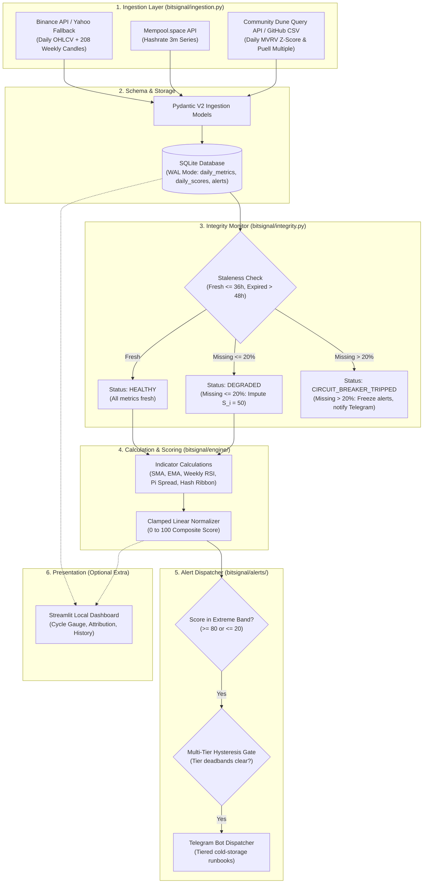

# Bitcoin Macro Cycle Sentinel (BitSignal)

*   **Author:** Project Lead
*   **Status:** Approved
*   **Date:** 2026-11-05

--------------------------------------------------------------------------------

## Overview

Bitcoin Macro Cycle Sentinel (BitSignal) is an autonomous, quantitative monitoring system designed to track Bitcoin macro cycle turns without emotional bias. The system executes as a lightweight daily batch pipeline at UTC 00:05 (following the daily candle close), ingesting market OHLCV data, on-chain valuation ratios, and mining metrics. It normalizes these inputs into a deterministic Composite Cycle Score bounded between 0 and 100 using clamped piecewise linear mapping.

When market conditions reach extreme cyclical overheated valuation (Composite Score >= 80), BitSignal issues tiered push alerts via Telegram to guide staged divestment of cold-storage holdings up to a maximum of 40% (retaining a permanent 60% sovereign reserve). Conversely, during generational capitulation troughs (Composite Score <= 20), it signals staged dollar-cost averaging (DCA) accumulation. The architecture enforces zero recurring data costs, defensive circuit breakers against public API degradation, neutral baseline imputation during partial outages, and strict multi-tier alert hysteresis to eliminate operator fatigue.

## The Problem

Long-term Bitcoin allocators face severe psychological and operational friction when navigating four-year macro market cycles:

1. **Emotional Distortion at Cycle Extremes**: Euphoric market sentiment near cycle tops induces greed and delays profit-taking, while despair and capitulation at macro bottoms paralyze accumulation.
2. **Cold Storage Transaction Friction**: Reallocating assets held in cold storage (multisig setups or hardware wallets) requires physical retrieval, multisig signing, mempool fee optimization, and exchange deposit confirmation. Without early, structured, tiered runbooks, allocators fail to execute timely rebalancing.
3. **Fragility of Free Public Data**: Proprietary on-chain analytics platforms lock metrics like MVRV Z-Score behind high-cost subscriptions. While free public endpoints exist, they are vulnerable to rate limits, schema mutations, and temporary outages. A naive monitoring script using public endpoints will crash or emit corrupted signals when upstream sources fail.
4. **Indeterminate Thresholds and Boundary Jumps**: Heuristic trading rules often rely on discrete Boolean triggers without continuous normalization or attribution, leading to conflicting signals and erratic indicator spikes.

BitSignal solves this by providing a unified, mathematically continuous, zero-cost, self-hosted sentinel engine that audits its own data integrity before dispatching operational runbooks.

## Goals

*   **Deterministic Composite Scoring**: Normalize 6 on-chain, technical, and mining indicators into a unified, continuous 0–100 Composite Cycle Score using clamped piecewise linear mapping.
*   **Zero Recurring Data Cost**: Construct ingestion pipelines exclusively around verified free endpoints (Binance with Yahoo Finance fallback, Mempool.space, and community on-chain queries).
*   **Automated Data Integrity Circuit Breaker & Neutral Imputation**: Track metric staleness with a 36-hour fresh threshold and a 48-hour hard expiration limit. If stale metrics are $\le 20\%$ of total weight, impute a neutral baseline score ($S_i = 50$) under `DEGRADED` status; if missing weight exceeds 20%, trip the circuit breaker (`CIRCUIT_BREAKER_TRIPPED`) and freeze phase-transition alerts.
*   **Multi-Tier Alert Hysteresis & Runbooks**: Enforce deadbands across all tiers (Tier 1 at 80 resets below 75; Tier 2 at 85 resets below 82; Tier 3 at 90 resets below 87; Bottom at 20 resets above 25). Deliver standardized operational runbooks via Telegram:
    - **Tier 1 (Score 80–84)**: Stage 20% divestment tranche.
    - **Tier 2 (Score 85–89)**: Stage additional 10% tranche (30% cumulative).
    - **Tier 3 (Score $\ge 90$)**: Stage additional 10% tranche (40% cumulative exit maximum).
    - **Sovereign Baseline**: 60% of cold storage is permanently retained as a non-divestible reserve.
*   **Historical Backtesting Validation Gate**: Implement a Phase 1.5 replay engine against daily historical data (2012–2026) to calibrate thresholds, measure lead times before historical cycle tops/bottoms, and verify drawdown protection prior to live production activation.
*   **Lightweight Self-Hosted Architecture**: Implement a modular Python engine backed by SQLite (WAL mode) scheduled via standard OS cron/Task Scheduler, with an optional interactive local Streamlit dashboard.

## Non-Goals

*   **Automated Trade Execution or Private Key Access**: BitSignal will never generate, hold, or store private keys, manage exchange trading API credentials, or execute automated buy/sell orders. All transfers and reallocations remain strictly manual.
*   **High-Frequency or Intraday Trading**: The system operates strictly on a 24-hour macro cadence (UTC 00:05 daily candle close). Intraday scalping, leverage trading, and short-term swing signals are out of scope.
*   **Speculative Multi-Channel Webhooks**: Local smart-home webhooks (Home Assistant / JARVIS) are excluded from the initial release to prioritize operational simplicity. Telegram Markdown alerts serve as the sole push channel.
*   **Multi-Asset or Altcoin Support**: BitSignal is engineered solely for Bitcoin macro cycle dynamics. Generalizing the scoring engine to Ethereum, altcoins, or traditional equities is explicitly excluded.
*   **Commercial Multi-Tenant SaaS**: The system is designed as a sovereign, single-tenant, self-hosted tool. Multi-user billing, tenancy isolation, and cloud scaling are out of scope.

## Critical User Journeys (CUJs)

### CUJ 1: Parabolic Top Warning & Staged Divestment Runbook

*   **Given**: BitSignal executes daily via OS cron at UTC 00:05. Bitcoin experiences an aggressive multi-month parabolic expansion.
*   **When**: Daily data ingestion succeeds, and the Composite Cycle Score reaches 82.4 (crossing the Tier 1 threshold of 80).
*   **Then**: BitSignal dispatches a high-priority Telegram message containing:
    - Current score (82.4 / 100) and top metric contributors (e.g., MVRV Z-Score at 88, 200w SMA extension at 85).
    - Tier 1 Action Runbook: Recommendation to stage a 20% divestment tranche from cold storage to an exchange.
    - Hysteresis state transitions to `TOP_TIER_1`: Suppresses repetitive Tier 1 alerts on subsequent days until the score drops below 75 or escalates to Tier 2 ($\ge 85$).

### CUJ 2: Upstream API Outage & Circuit Breaker Activation

*   **Given**: The primary on-chain data provider undergoes maintenance or enforces rate limits, causing MVRV Z-Score (weight: 25%) to fail for 3 consecutive days (> 48 hours).
*   **When**: Daily ingestion runs at UTC 00:05 and detects expired weight = 25% (> 20% threshold).
*   **Then**:
    - BitSignal trips its circuit breaker, setting system status to `CIRCUIT_BREAKER_TRIPPED`.
    - Phase-transition alerts are frozen to prevent distorted scores from firing false trading signals.
    - An operational warning is dispatched to Telegram: `"⚠️ BitSignal Circuit Breaker Tripped: MVRV Z-Score expired > 48h (Missing weight: 25%). Phase alerts suspended until source recovers."`

### CUJ 3: Capitulation Bottom Confirmation & DCA Accumulation

*   **Given**: Bitcoin is in a prolonged macro bear market.
*   **When**: Hash Ribbon detects post-capitulation recovery (`BUY_RECOVERY`, sub-score 10), Puell Multiple falls below 0.45, and the Composite Cycle Score drops to 17.8 ($\le 20$).
*   **Then**: BitSignal dispatches an accumulation alert:
    - Current score (17.8 / 100) indicating generational capitulation.
    - DCA Accumulation Runbook: Recommendation to initiate staged tranche accumulation.
    - Hysteresis state transitions to `BOTTOM_CAPITULATION`: Suppresses duplicate bottom alerts until the score rises above 25.

### CUJ 4: Degraded Mode & Neutral Imputation

*   **Given**: The mining hashrate API endpoint temporarily times out, causing Hash Ribbon (weight: 10%) to be stale for 30 hours ($> 24h$ but $\le 48h$, missing weight $10\% \le 20\%$).
*   **When**: Daily ingestion runs at UTC 00:05.
*   **Then**:
    - Status is set to `DEGRADED`.
    - The engine imputes a neutral sub-score of 50 for Hash Ribbon ($50 \times 10\% = 5.0$ pts) without distorting the weights of remaining metrics.
    - Score calculation proceeds deterministically; the daily Telegram summary (if subscribed) notes: `"[DEGRADED] Hash Ribbon stale; neutral score imputed."`

### CUJ 5: Tier Escalation & Multi-Tier Hysteresis Recovery

*   **Given**: Bitcoin accelerates from a strong bull market into peak parabolic mania. The score moves: Day 1: 82 $\to$ Day 2: 86 $\to$ Day 3: 84.5 $\to$ Day 4: 91.
*   **When**: BitSignal evaluates each daily close.
*   **Then**:
    - Day 1 (82): State = `TOP_TIER_1`. Emits Tier 1 Runbook (20% tranche).
    - Day 2 (86): State escalates to `TOP_TIER_2`. Emits Tier 2 Runbook (+10% tranche, 30% cumulative).
    - Day 3 (84.5): Score drops below 85 but remains above the Tier 2 re-arm deadband (82). No duplicate Tier 1 or Tier 2 alerts are emitted.
    - Day 4 (91): State escalates to `TOP_TIER_3`. Emits Tier 3 Runbook (+10% tranche, 40% cumulative exit maximum).

--------------------------------------------------------------------------------

## Technical Plan (Architecture)

### Architectural Overview

BitSignal is structured as a decoupled, functional batch pipeline executing once daily at UTC 00:05 via OS cron:



### 1. Ingestion Layer & Zero-Cost Connectors (`bitsignal/ingestion.py`)

A single, cohesive module (`bitsignal/ingestion.py`) manages outbound requests using a configured `requests.Session` with custom user-agents, 10-second timeouts, and exponential backoff (`tenacity`):

*   **Market Price & Moving Averages**:
    - Daily OHLCV: `GET https://api.binance.com/api/v3/klines?symbol=BTCUSDT&interval=1d&limit=500` (for SMA 111, SMA 350, SMA 471, EMA 150).
    - Weekly Candles: `GET https://api.binance.com/api/v3/klines?symbol=BTCUSDT&interval=1w&limit=208` (specifically for 200-week SMA and 14-period weekly RSI). Fetching 208 weekly candles avoids the 1000-candle limit of daily requests and cuts data volume by 85%.
    - Fallback: Direct query to Yahoo Finance (`BTC-USD`) or Coinbase public ticker (`https://api.coinbase.com/v2/prices/BTC-USD/spot`).
*   **Network & Mining Stats**:
    - Route: `GET https://mempool.space/api/v1/mining/hashrate/3m`.
    - Parses array of `{ timestamp, avgHashrate }` to compute 30-day and 60-day moving averages for Hash Ribbon status.
*   **On-Chain Valuation Metrics**:
    - Primary: Community Dune Analytics execution API querying daily aggregated MVRV Z-Score and Puell Multiple.
    - Cold Fallback: Public GitHub-mirrored daily CSV dataset providing historical and daily updated on-chain valuation rows.

### 2. Normalization Engine & Mathematical Formulation

Continuous metrics are transformed via a **Clamped Piecewise Linear Normalizer**:

$$S_i = \text{clamp}\left(\frac{x_i - \text{Min}_i}{\text{Max}_i - \text{Min}_i} \times 100, 0, 100\right)$$

For metrics where higher values denote market bottoms (inverse metrics):

$$S_i = 100 - \text{clamp}\left(\frac{x_i - \text{Min}_i}{\text{Max}_i - \text{Min}_i} \times 100, 0, 100\right)$$

The **Composite Cycle Score** $C \in [0, 100]$ is the weighted sum:

$$C = \sum_{i=1}^{N} w_i \times S_i \quad \text{where} \quad \sum_{i=1}^{N} w_i = 1.0$$

#### Metric Calibration & Attribution Matrix

| Indicator | Weight ($w_i$) | Bottom Boundary ($S_i = 0$) | Top Boundary ($S_i = 100$) | Mathematical Formulation |
| :--- | :--- | :--- | :--- | :--- |
| **MVRV Z-Score** | 25% | $Z \le 0.15$ | $Z \ge 5.00$ | Direct: $S = \text{clamp}\left(\frac{Z - 0.15}{5.00 - 0.15} \times 100, 0, 100\right)$ |
| **200-Week SMA Ratio** | 20% | $\frac{\text{Price}}{\text{SMA}_{200w}} \le 1.0$ | $\frac{\text{Price}}{\text{SMA}_{200w}} \ge 3.5$ | Direct: $S = \text{clamp}\left(\frac{\text{Ratio} - 1.0}{3.5 - 1.0} \times 100, 0, 100\right)$ |
| **Puell Multiple** | 20% | $\text{Puell} \le 0.45$ | $\text{Puell} \ge 2.20$ | Direct: $S = \text{clamp}\left(\frac{\text{Puell} - 0.45}{2.20 - 0.45} \times 100, 0, 100\right)$ |
| **Pi Cycle Top / Bottom** | 15% | Bottom cross active ($S = 0$) | Top cross active ($S = 100$) | Continuous Top Spread: $R_{\text{top}} = \frac{\text{SMA}_{111}}{2 \times \text{SMA}_{350}}$ clamped $[0.70, 1.00]$. If $\text{EMA}_{150} \times 0.745 \le \text{SMA}_{471}$, $S = 0$. Otherwise $S = \text{clamp}\left(\frac{R_{\text{top}} - 0.70}{1.00 - 0.70} \times 100, 0, 100\right)$. |
| **Weekly RSI (14p)** | 10% | $\text{RSI} \le 32$ | $\text{RSI} \ge 80$ | Direct: Rolling 7-day sampled RSI. $S = \text{clamp}\left(\frac{\text{RSI} - 32}{80 - 32} \times 100, 0, 100\right)$ |
| **Hash Ribbon** | 10% | Buy recovery cross ($S = 10$) | Normal state ($S = 50$) | Discrete mapping: `NORMAL = 50`, `CAPITULATION = 20`, `BUY_RECOVERY = 10`. Both distress states pull the composite score down toward the accumulation zone. |

### 3. Circuit Breaker & Neutral Imputation Mechanics

The `IntegrityMonitor` audits incoming metric timestamps against system time at UTC 00:05:

1.  **Staleness Classification**:
    - `FRESH`: Metric timestamp $\le 36$ hours old (accommodates 1-day candle publishing latency).
    - `STALE`: Metric timestamp $> 36$ and $\le 48$ hours old.
    - `EXPIRED`: Metric timestamp $> 48$ hours old.
2.  **Imputation vs. Circuit Breaker**:
    - Let $W_{\text{missing}}$ be the sum of weights of `EXPIRED` metrics.
    - **Healthy ($W_{\text{missing}} = 0$)**: Normal calculation proceeds.
    - **Degraded ($0 < W_{\text{missing}} \le 0.20$)**: The engine imputes a neutral midpoint sub-score of 50 for the missing component ($S_j = 50$). Active weights are **not** dynamically rescaled, preventing synthetic boundary breakouts. System status is marked `DEGRADED`.
    - **Circuit Breaker Tripped ($W_{\text{missing}} > 0.20$)**: Status transitions to `CIRCUIT_BREAKER_TRIPPED`. Calculation is aborted, phase-transition alerts are frozen, and a high-priority diagnostic alert is dispatched to Telegram.

### 4. Alerting Engine & Multi-Tier Hysteresis

To prevent alert fatigue and eliminate duplicate warnings during market consolidation:

1.  **Formal State Machine**:
    - States: `NEUTRAL`, `TOP_TIER_1`, `TOP_TIER_2`, `TOP_TIER_3`, `BOTTOM_CAPITULATION`.
2.  **Transition & Deadband Rules**:
    - `NEUTRAL` $\to$ `TOP_TIER_1`: Triggers when Score $\ge 80$. Resets to `NEUTRAL` only when Score drops strictly below 75.
    - `TOP_TIER_1` $\to$ `TOP_TIER_2`: Triggers when Score $\ge 85$. Re-arms for Tier 2 only if Score drops below 82 and re-crosses 85.
    - `TOP_TIER_2` $\to$ `TOP_TIER_3`: Triggers when Score $\ge 90$. Re-arms for Tier 3 only if Score drops below 87 and re-crosses 90.
    - `NEUTRAL` $\to$ `BOTTOM_CAPITULATION`: Triggers when Score $\le 20$. Resets to `NEUTRAL` only when Score rises strictly above 25.
3.  **Standardized Divestment Schedule (Telegram Push)**:
    - **Tier 1 (Score 80–84)**: Stage 20% divestment tranche from cold storage to exchange staging.
    - **Tier 2 (Score 85–89)**: Stage additional 10% tranche (30% cumulative).
    - **Tier 3 (Score $\ge 90$)**: Stage additional 10% tranche (40% cumulative exit maximum).
    - **Sovereign Hodl Baseline**: 60% of cold storage is permanently held.

### 5. Persistence Layer (SQLite WAL Schema)

Embedded SQLite operating with Write-Ahead Logging (`PRAGMA journal_mode=WAL;`):

```sql
CREATE TABLE IF NOT EXISTS daily_metrics (
    date TEXT PRIMARY KEY,
    btc_price REAL NOT NULL,
    open REAL,
    high REAL,
    low REAL,
    volume REAL,
    sma_111 REAL,
    sma_350 REAL,
    sma_471 REAL,
    ema_150 REAL,
    sma_200w REAL,
    rsi_14w REAL,
    mvrv_z REAL,
    puell_multiple REAL,
    hashrate REAL,
    hash_ribbon_status TEXT,
    created_at TIMESTAMP DEFAULT CURRENT_TIMESTAMP
);

CREATE TABLE IF NOT EXISTS daily_scores (
    date TEXT PRIMARY KEY,
    composite_score REAL NOT NULL,
    mvrv_score REAL NOT NULL,
    sma200w_score REAL NOT NULL,
    puell_score REAL NOT NULL,
    picycle_score REAL NOT NULL,
    rsi_score REAL NOT NULL,
    hashribbon_score REAL NOT NULL,
    system_status TEXT NOT NULL, -- 'HEALTHY', 'DEGRADED', 'CIRCUIT_BREAKER_TRIPPED'
    hysteresis_state TEXT NOT NULL, -- 'NEUTRAL', 'TOP_TIER_1', 'TOP_TIER_2', 'TOP_TIER_3', 'BOTTOM_CAPITULATION'
    stale_metrics TEXT,
    created_at TIMESTAMP DEFAULT CURRENT_TIMESTAMP
);

CREATE TABLE IF NOT EXISTS alert_dispatches (
    id INTEGER PRIMARY KEY AUTOINCREMENT,
    date TEXT NOT NULL,
    alert_type TEXT NOT NULL, -- 'TOP_TIER_1', 'TOP_TIER_2', 'TOP_TIER_3', 'BOTTOM_CAPITULATION', 'CIRCUIT_BREAKER'
    composite_score REAL,
    payload TEXT NOT NULL,
    delivered_telegram BOOLEAN NOT NULL DEFAULT 0,
    created_at TIMESTAMP DEFAULT CURRENT_TIMESTAMP
);
```

### 6. Phase 1.5 Historical Backtesting Engine (Quality Gate)

Prior to authorizing the live production daemon, the backtest module (`bitsignal.backtest`) evaluates daily historical series across all cycles (2012–2026):

*   **Pass Criteria**:
    1. Zero false positives for Tier 1 Top Alerts (Score $\ge 80$) during mid-bull market pullbacks.
    2. Lead time of 10 to 45 days prior to major macro tops (Nov 2013, Dec 2017, Apr/Nov 2021).
    3. Bottom Capitulation trigger (Score $\le 20$) during major bear market lows (Jan 2015, Dec 2018, Nov 2022).
    4. Demonstration of portfolio drawdown reduction executing the 40% cumulative divestment vs. Buy-and-Hold.

### 7. Interactive Local Dashboard (Optional Streamlit Extra)

Local dashboard (`bitsignal.ui.app`) reading directly from SQLite:
*   **Macro Cycle Gauge**: Semi-circular dial (0–100) with color zones: Green ($\le 20$), Neutral ($21–79$), Red ($\ge 80$).
*   **Attribution Waterfall**: Decomposes point contributions of each of the 6 indicators.
*   **Cycle History Overlay**: Historical price chart overlaid with composite score bands and Pi Cycle curves.
*   **Health & Audit Pane**: Displays circuit breaker status and recent alert log.

--------------------------------------------------------------------------------

## Alternatives Considered

### Alternative 1: Full Sovereign Local Node (Bitcoin Core RPC + Electrs + Custom Tx Indexer)

*   **Description**: Running a dedicated full Bitcoin Core node locally to compute Realized Cap, Hashrate, and UTXO (Unspent Transaction Output) age distribution directly from raw block data without external APIs.
*   **Pros**: Absolute data sovereignty with zero third-party dependency.
*   **Cons**: Requires >700 GB disk storage, weeks of IBD (Initial Block Download) sync time, and complex custom indexing software to reconstruct historical Realized Cap from scratch.
*   **Reason for Rejection**: Disproportionate hardware and maintenance overhead for MVP. Free public endpoints with Pydantic validation, exponential retries, and defensive circuit breakers deliver identical signals at zero cost.

### Alternative 2: Logistic Sigmoidal Activation for Normalization

*   **Description**: Mapping indicators to 0–100 using sigmoid curves ($S_i = \frac{100}{1 + e^{-k(x_i - x_0)}}$).
*   **Pros**: Asymptotically bounded smooth curves.
*   **Cons**: Introduces arbitrary inflection point ($x_0$) and slope temperature ($k$) hyperparameters, obscuring direct score interpretability and risking overfitting.
*   **Reason for Rejection**: Piecewise linear clamped normalization was selected for complete mathematical transparency, deterministic point attribution, and direct debuggability.

### Alternative 3: Distributed Multi-Container Microservices Architecture

*   **Description**: Decoupling ingestion, scoring, and alerting into separate containerized services with Kafka/PostgreSQL.
*   **Pros**: Independent horizontal scaling.
*   **Cons**: >2–4 GB idle memory usage, complex Docker Compose orchestration, and extreme over-engineering for a batch job that runs in 5 seconds once every 24 hours.
*   **Reason for Rejection**: A modular Python package with embedded SQLite in WAL mode achieves identical reliability with zero maintenance overhead.

--------------------------------------------------------------------------------

## Non-Functional Requirements

### Security & Privacy
*   **Zero Key Custody**: BitSignal contains no code capable of generating, storing, or handling private keys, seed phrases, or exchange trading credentials.
*   **Credential Isolation**: Telegram Bot tokens are loaded strictly from local environment variables or an uncommitted `.env` file.
*   **Local Boundary**: All raw metrics, score histories, and logs remain strictly on the local filesystem (`./data/bitsignal.db`). No external telemetry is emitted.

### Performance & Latency
*   **Daily Batch Runtime**: Ingestion, scoring, and alert dispatch must complete within 15 seconds.
*   **Storage Footprint**: SQLite database growth must not exceed 25 MB per year of continuous operation.
*   **Dashboard Latency**: Streamlit queries over the full 14-year daily dataset (~5,200 rows) must render initial graphs in under 500 ms on a standard 4-core, 8 GB RAM host.

### Reliability & Fault Tolerance
*   **Network Resilience**: Every outbound request enforces a 10-second timeout ceiling and up to 3 retries with exponential backoff and jitter (`tenacity`).
*   **Transactional ACID**: SQLite WAL mode ensures database integrity; sudden reboots or power interruptions will not corrupt historical tables.
*   **Idempotency**: All metric calculations are pure functions; re-running against any historical date produces identical composite scores.

--------------------------------------------------------------------------------

## Detailed Implementation Plan

### Target Files to Create/Modify

#### 1. `pyproject.toml` (Create)
*   **Type / Scope**: Build configuration and dependencies.
*   **Proposed Changes**: Define project metadata (`name = "bitsignal"`, `version = "0.1.0"`), Python requirement (`>=3.11`), build backend (`hatchling`), core headless dependencies (`pydantic>=2.5.0`, `requests>=2.31.0`, `pandas>=2.1.0`, `numpy>=1.26.0`, `tenacity>=8.2.0`, `python-dotenv>=1.0.0`, `pyyaml>=6.0.1`, `yfinance>=0.2.30`), optional UI dependencies (`[project.optional-dependencies] ui = ["streamlit>=1.30.0", "plotly>=5.18.0"]`), console script entrypoint (`[project.scripts] bitsignal = "bitsignal.cli:main"`), and dev tools (`pytest>=7.4.0`, `pytest-cov>=4.1.0`, `ruff>=0.1.5`).

#### 2. `config/config.yaml` (Create)
*   **Type / Scope**: Application configuration and calibration.
*   **Proposed Changes**: Externalize metric weights, calibration boundaries (MVRV: 0.15 to 5.0, 200w SMA ratio: 1.0 to 3.5, Puell: 0.45 to 2.20, Pi Spread: 0.70 to 1.00, RSI: 32 to 80), Hash Ribbon discrete states (`NORMAL=50`, `CAPITULATION=20`, `BUY_RECOVERY=10`), alert thresholds (Tier 1: 80, Tier 2: 85, Tier 3: 90, Bottom: 20), deadbands (Tier 1: 75, Tier 2: 82, Tier 3: 87, Bottom: 25), and staleness limits (fresh: 36h, expired: 48h).

#### 3. `.env.example` (Create)
*   **Type / Scope**: Secret template.
*   **Proposed Changes**: Provide environment variable stubs for `TELEGRAM_BOT_TOKEN`, `TELEGRAM_CHAT_ID`, `DUNE_API_KEY`, `DATABASE_PATH` (defaults to `./data/bitsignal.db`), and `LOG_LEVEL` (defaults to `INFO`).

#### 4. `bitsignal/__init__.py` (Create)
*   **Type / Scope**: Package root.
*   **Proposed Changes**: Expose `__version__ = "0.1.0"`.

#### 5. `bitsignal/__main__.py` (Create)
*   **Type / Scope**: Package entrypoint for module execution.
*   **Proposed Changes**: Forwards `sys.argv` directly to `bitsignal.cli.main()`, enabling execution via `python -m bitsignal <subcommand>`.

#### 6. `bitsignal/models.py` (Create)
*   **Type / Scope**: Pydantic V2 data contracts.
*   **Proposed Changes**:
    - `MarketDataSnapshot`: Validates date, open, high, low, close, volume, weekly candle series.
    - `MiningDataSnapshot`: Validates date, hashrate 30d, hashrate 60d, Hash Ribbon enum (`NORMAL`, `CAPITULATION`, `BUY_RECOVERY`).
    - `OnChainSnapshot`: Validates date, MVRV Z-Score, Puell Multiple.
    - `RawSnapshot`: Combined daily metric snapshot.
    - `NormalizedMetricScore`: Stores raw value, normalized score (0–100), applied weight, and staleness (`FRESH`, `STALE`, `EXPIRED`).
    - `DailyCompositeResult`: Stores date, composite score, status (`HEALTHY`, `DEGRADED`, `CIRCUIT_BREAKER_TRIPPED`), hysteresis state (`NEUTRAL`, `TOP_TIER_1`, `TOP_TIER_2`, `TOP_TIER_3`, `BOTTOM_CAPITULATION`), and metric attribution dictionary.

#### 7. `bitsignal/storage/db.py` (Create)
*   **Type / Scope**: Persistence Layer (SQLite WAL).
*   **Proposed Changes**: Context manager for SQLite connection enforcing `PRAGMA journal_mode=WAL;` and `PRAGMA synchronous=NORMAL;`. Implements schema initialization (`init_db`), metric snapshot insertion (`upsert_daily_metrics`), composite score logging (`upsert_daily_score`), alert history tracking (`record_alert_dispatch`), and historical time-series queries.

#### 8. `bitsignal/ingestion.py` (Create)
*   **Type / Scope**: Unified Data Ingestion Module.
*   **Proposed Changes**: Single module replacing the 4-file connector hierarchy. Uses a shared `requests.Session` with `tenacity` retries and 10s timeouts. Contains:
    - `fetch_market_data()`: Pulls daily OHLCV (limit 500) and weekly candles (limit 208) from Binance API with Yahoo Finance fallback.
    - `fetch_mempool_data()`: Pulls 3-month network hashrate from `mempool.space/api/v1/mining/hashrate/3m`.
    - `fetch_onchain_data()`: Pulls MVRV Z-Score and Puell Multiple from community Dune query endpoint with GitHub CSV fallback.

#### 9. `bitsignal/engine/indicators.py` (Create)
*   **Type / Scope**: Mathematical Indicator Calculations.
*   **Proposed Changes**: Pure functional calculations via Pandas/NumPy:
    - Moving averages: SMA 111, SMA 350, SMA 471, EMA 150, 200-week SMA.
    - Momentum: 14-period weekly RSI on rolling 7-day sampled closes.
    - Pi Cycle spread: Computes $R_{\text{top}} = \frac{\text{SMA}_{111}}{2 \times \text{SMA}_{350}}$ and evaluates bottom cross ($\text{EMA}_{150} \times 0.745 \le \text{SMA}_{471}$).
    - Hash Ribbon: Computes 30d/60d hashrate moving averages and evaluates crossover states.

#### 10. `bitsignal/engine/normalizer.py` (Create)
*   **Type / Scope**: Normalization & Scoring Engine.
*   **Proposed Changes**:
    - Implements clamped piecewise linear normalizer: `clamp((x - min) / (max - min) * 100, 0, 100)`.
    - Evaluates Pi Cycle spread ratio and bottom cross override.
    - Maps Hash Ribbon discrete states (`NORMAL=50`, `CAPITULATION=20`, `BUY_RECOVERY=10`).
    - Imputes neutral sub-score ($S_i = 50$) for stale metrics when in `DEGRADED` status without dynamic weight rescaling.
    - Computes final 0–100 Composite Cycle Score.

#### 11. `bitsignal/integrity.py` (Create)
*   **Type / Scope**: Circuit Breaker & Staleness Monitor.
*   **Proposed Changes**:
    - Compares metric timestamps against execution time at UTC 00:05.
    - Classifies metrics as `FRESH` ($\le 36h$), `STALE` ($36–48h$), or `EXPIRED` ($> 48h$).
    - Computes missing weight $W_{\text{missing}}$. If $W_{\text{missing}} \le 0.20$, sets `DEGRADED` (triggers neutral imputation); if $W_{\text{missing}} > 0.20$, transitions status to `CIRCUIT_BREAKER_TRIPPED` and suppresses phase-change alert dispatch.

#### 12. `bitsignal/alerts/dispatcher.py` (Create)
*   **Type / Scope**: Telegram Alert Dispatcher with Multi-Tier Hysteresis.
*   **Proposed Changes**:
    - Evaluates multi-tier hysteresis state machine against SQLite historical state.
    - Enforces deadbands: Tier 1 resets $<75$; Tier 2 re-arms $<82$; Tier 3 re-arms $<87$; Bottom resets $>25$.
    - Formats markdown Telegram alert messages with standardized runbooks (Tier 1: 20%, Tier 2: 30% cum, Tier 3: 40% cum) and component point contributions.
    - Dispatches emergency diagnostic alerts when `CIRCUIT_BREAKER_TRIPPED` occurs.

#### 13. `bitsignal/backtest/engine.py` (Create)
*   **Type / Scope**: Phase 1.5 Historical Backtesting Engine.
*   **Proposed Changes**:
    - Replays historical daily data (2012–2026) through the normalization and scoring pipeline.
    - Validates signals against historical tops (Nov 2013, Dec 2017, Apr/Nov 2021) and macro bottoms (Jan 2015, Dec 2018, Nov 2022).
    - Outputs validation summary report: false positive count, lead times in days before peaks, and portfolio drawdown comparison against Buy-and-Hold.

#### 14. `bitsignal/ui/app.py` (Create)
*   **Type / Scope**: Interactive Local Streamlit Dashboard (Optional Extra).
*   **Proposed Changes**:
    - Renders semi-circular gauge dial (0–100) with color zones.
    - Renders Plotly waterfall chart decomposing individual indicator contributions.
    - Renders historical time-series chart showing Bitcoin price overlaid with Composite Score bands and Pi Cycle curves.
    - Renders health panel detailing metric freshness and circuit breaker state.

#### 15. `bitsignal/cli.py` (Create)
*   **Type / Scope**: Command-Line Interface.
*   **Proposed Changes**: CLI entrypoint using `argparse` with subcommands:
    - `db-init`: Initializes database tables.
    - `run-daily`: Executes single daily pipeline (ingest $\to$ validate $\to$ score $\to$ alert).
    - `calculate-date --date YYYY-MM-DD`: Deterministic calculation for a specific historical date.
    - `backtest --start YYYY-MM-DD --end YYYY-MM-DD`: Executes Phase 1.5 historical backtest.
    - `ui`: Launches Streamlit dashboard (`streamlit run bitsignal/ui/app.py`).

#### 16. `tests/test_normalizer.py` (Create)
*   **Type / Scope**: Normalization Unit Tests.
*   **Proposed Changes**: Tests boundary clamping, Pi Cycle continuous spread mapping and bottom override, Hash Ribbon discrete scoring, and neutral imputation in `DEGRADED` status.

#### 17. `tests/test_integrity.py` (Create)
*   **Type / Scope**: Circuit Breaker Unit Tests.
*   **Proposed Changes**: Tests 36h fresh window, 48h expiration threshold, transition to `DEGRADED` when missing weight $\le 20\%$, and transition to `CIRCUIT_BREAKER_TRIPPED` when missing weight $> 20\%$.

#### 18. `tests/test_indicators.py` (Create)
*   **Type / Scope**: Indicator Unit Tests.
*   **Proposed Changes**: Tests SMA, EMA, rolling weekly RSI, Pi Cycle spread, and Hash Ribbon crossovers against synthetic test series with known mathematical values.

#### 19. `tests/test_alerts.py` (Create)
*   **Type / Scope**: Alert & Hysteresis Unit Tests.
*   **Proposed Changes**: Tests multi-tier hysteresis deadbands (Tier 1: 75, Tier 2: 82, Tier 3: 87, Bottom: 25) preventing duplicate alerts across consecutive days, and validates Telegram markdown message payload structure.

#### 20. `tests/test_storage.py` (Create)
*   **Type / Scope**: Database Persistence Unit Tests.
*   **Proposed Changes**: Tests SQLite WAL initialization, upsert idempotency on `daily_metrics` and `daily_scores`, hysteresis state query/retrieval, and alert dispatch logging.

#### 21. `tests/test_ingestion.py` (Create)
*   **Type / Scope**: Ingestion Network Unit Tests.
*   **Proposed Changes**: Tests API response parsing, schema validation, timeout handling, and exponential backoff retry logic using mocked HTTP responses.

#### 22. `README.md` (Create)
*   **Type / Scope**: Documentation & Runbook.
*   **Proposed Changes**: System architecture overview, installation instructions (`pip install -e .` or `pip install -e ".[ui]"`), configuration guide (`config.yaml`), 1-line OS cron setup (`5 0 * * * /path/to/venv/bin/bitsignal run-daily`), and detailed operational procedures for executing cold-storage divestment when alerts arrive.

---

### Verification Plan

#### 1. Build & Environment Verification
*   Create and activate a clean Python 3.11+ virtual environment:
    ```bash
    python -m venv .venv
    source .venv/bin/activate  # or .venv\Scripts\activate on Windows
    pip install -e ".[dev,ui]"
    ```

#### 2. Static Analysis & Code Quality
*   Enforce code formatting and linting:
    ```bash
    ruff check bitsignal tests
    ruff format --check bitsignal tests
    ```

#### 3. Automated Unit & Integration Tests
*   Execute test suite with coverage report:
    ```bash
    pytest tests/ -v --cov=bitsignal --cov-report=term-missing
    ```
*   **Pass Criteria**: 100% of tests passing; minimum 85% branch coverage across `bitsignal/engine`, `bitsignal/integrity`, and `bitsignal/storage`.

#### 4. Historical Backtest Quality Gate (Phase 1.5 Validation)
*   Execute the backtest engine over historical cycles:
    ```bash
    python -m bitsignal backtest --start 2012-01-01 --end 2026-11-01
    ```
*   **Pass Criteria**:
    - Zero false positives in Tier 1 Top Alerts (Score $\ge 80$) during mid-bull consolidation phases.
    - Lead time of 10 to 45 days prior to major macro peaks (Nov 2013, Dec 2017, Apr/Nov 2021).
    - Capitulation alert trigger (Score $\le 20$) during major bear market lows (Jan 2015, Dec 2018, Nov 2022).

#### 5. End-to-End Daily Pipeline Smoke Test
*   Execute database initialization and test daily calculation:
    ```bash
    python -m bitsignal db-init
    python -m bitsignal run-daily --dry-run
    ```
*   **Pass Criteria**: Pipeline executes in $<15$ seconds, inserts record into `daily_metrics` and `daily_scores`, logs system health as `HEALTHY` or `DEGRADED`, and dry-run alert payload formats correctly without error.

#### 6. Dashboard Verification
*   Launch Streamlit local server:
    ```bash
    python -m bitsignal ui
    ```
*   **Pass Criteria**: Dashboard loads at `http://localhost:8501`, renders the gauge dial, waterfall chart, and historical overlay without browser console or backend errors.

--------------------------------------------------------------------------------

*Drafted with EGM*
