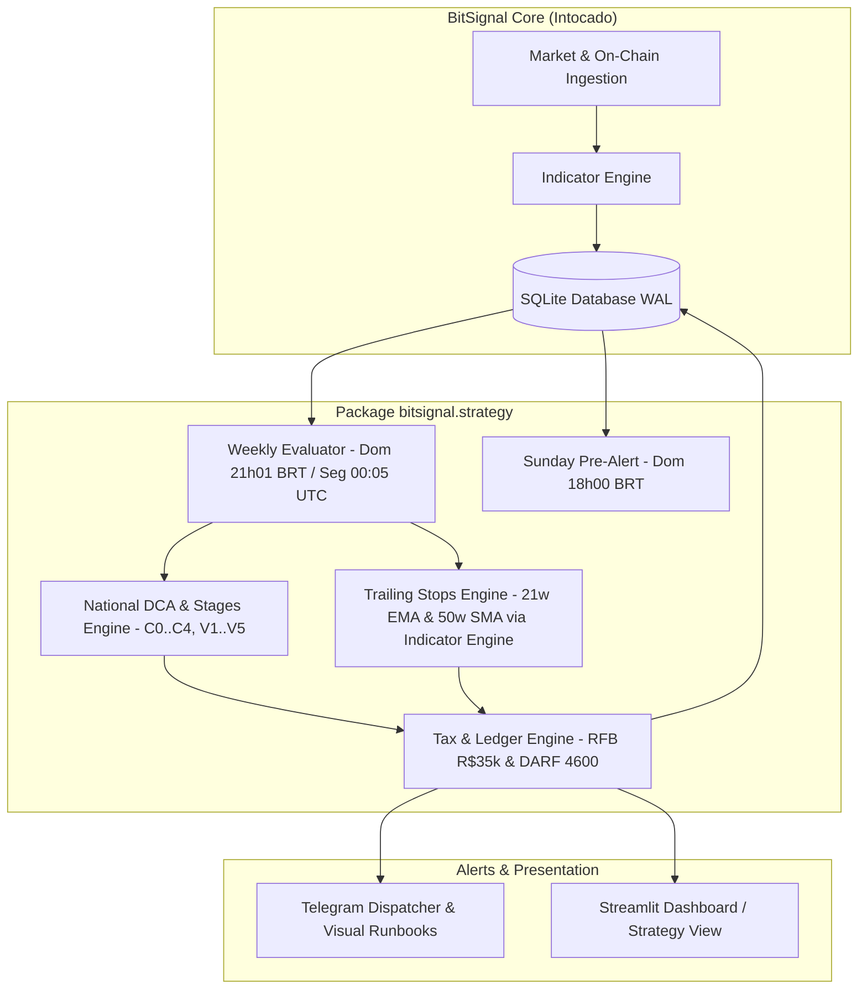

# Estratégia de Ciclo Macro com Gestão Tributária Nacional (BitSignal Strategy Engine)

*   **Author:** @Guilherme
*   **Status:** Approved
*   **Date:** 2026-11-06

--------------------------------------------------------------------------------

## Overview

A **Estratégia de Ciclo Macro com Gestão Tributária Nacional** expande o BitSignal de um sentinela passivo/observacional para uma plataforma de orquestração de estratégias executáveis de ciclo completo de 3 a 4 anos do Bitcoin. A funcionalidade combina:

1. **Acumulação Assimétrica em Quedas (Bear Market / Capitulação):** Aportes escalonados em degraus de desconto percentual em relação ao topo histórico do ciclo anterior (ATH de referência = US$ 126 mil em outubro de 2025) e confirmação on-chain por MVRV Z-Score (*Market Value to Realized Value Z-Score*) $\le 0.0$ e rompimento da média móvel simples de 50 semanas (50w SMA).
2. **Distribuição Gradual em Expansão Parabólica (Bull Market):** Desova em tranches percentuais baseadas em múltiplos da ATH ($1.0\times$, $1.3\times$, $1.6\times$, $2.0\times$ e $2.5\times$), complementadas por trailing stops semanais de proteção patrimonial (21w EMA e 50w SMA no fechamento de domingo às 21h00 BRT).
3. **Engenharia Fiscal Brasileira Especializada para Posições $< 0.5$ BTC:** Automação de conformidade com o art. 35 da Lei 8.981/1995 e normativas da Receita Federal do Brasil (RFB), aproveitando a isenção de alienações de até R$ 35.000,00 por mês civil agregado, algoritmo de *split intermensal* condicional para tranches de R$ 35k a R$ 70k disparadas a partir do dia 25 do mês, livro razão de Custo Médio Ponderado (CMP) e apuração de Ganho de Capital com relatório mastigado para emissão de DARF (*Documento de Arrecadação de Receitas Federais*, código 4600) à alíquota de 15%.
4. **Off-ramp Soberano para Renda Fixa:** Protocolo operacional de liquidação direta no par BTC/BRL em corretoras nacionais autorizadas pelo Banco Central do Brasil (BCB - Resoluções 519, 520 e 521) e transferência via PIX (*Pagamento Instantâneo Brasileiro*) para instrumentos de renda fixa em Reais com liquidez diária e proteção do FGC (*Fundo Garantidor de Créditos*).

## The Problem

Investidores de Bitcoin que utilizam custódia própria e operam sob a jurisdição tributária brasileira enfrentam fricções severas que corroem a rentabilidade e a disciplina de ciclo:

1. **Incompatibilidade das Ferramentas Globais com a Tributação Nacional:**
   Softwares internacionais de análise e bots de trade ignoram o ordenamento tributário da RFB (art. 35 da Lei 8.981/1995 e Instrução Normativa RFB 1.888/2019). No Brasil, o teto de isenção de até R$ 35.000,00 aplica-se à **soma de todas as alienações de criptoativos realizadas no mês civil**. Ultrapassar esse valor em R$ 1,00 faz com que todo o ganho de capital do mês seja tributado a 15% (no programa GCAP). A ausência de um algoritmo de dimensionamento de lote consciente do calendário civil faz alocadores pagarem impostos desnecessários.
2. **Falha de Níveis Absolutos de Indicadores On-Chain:**
   A diminuição histórica da volatilidade e a maturação institucional do Bitcoin fizeram com que os picos de indicadores on-chain clássicos diminuíssem a cada ciclo (o MVRV Z-Score atingiu 9.4 em 2017, 3.5 em 2021 e apenas 2.5 no topo de outubro de 2025). Alocadores que aguardam gatilhos rígidos históricos (ex.: MVRV $> 5.0$) não vendem nada e devolvem todos os ganhos durante o bear market.
3. **Fricção de Execução Dominical e Travas de Liquidez do PIX:**
   O fechamento da vela semanal aos domingos às 21h00 BRT coincide com o horário de limite noturno de segurança do PIX bancário (R$ 1.000 a R$ 5.000 por padrão nas instituições financeiras das 20h00 às 06h00) e com a inoperância do expediente de fundos de renda fixa tradicionais. Sem um protocolo com pré-alerta e runbooks com tratamento de limite noturno, o investidor enfrenta bloqueios de compliance bancário.
4. **Viés Emocional e Síndrome do "Desta Vez é Diferente":**
   Em topos parabólicos, a ganância retarda as vendas; em fundos de capitulação, o medo paralisa os aportes. Um sistema mecanicista baseado em regras auditadas remove o componente emocional da tomada de decisão.

## Goals

*   **Gatilhos Determinísticos de Entrada e Saída:** Codificar com precisão os degraus de compra C0 a C4 (C0: 30% em DCA iniciado a $-30\%$, C1: 15% a $-45\%$, C2: 20% a $-55\%$, C3: 20% a $-65\%$ ou MVRV Z-Score $\le 0.0$, e C4: 15% + saldo remanescente na confirmação da 50w SMA) e as tranches de venda V1 a V5 (V1: 10%, V2: 15%, V3: 15%, V4: 20%, V5: 20%, Moonbag: 10% permanente).
*   **Trailing Stops Semanais no Fechamento Dominical (21h00 BRT):** Avaliar na virada semanal (`domingo 21h00 BRT` / `segunda-feira 00h00 UTC`) o rompimento da 21w EMA (Stop 1: alienação de 50% do saldo remanescente) e da 50w SMA (Stop 2: alienação de 100% do saldo remanescente, exceto Moonbag).
*   **Motor Fiscal Especializado RFB com Livro Razão Append-Only:**
    *   Controle contínuo do estoque e cálculo de Custo Médio Ponderado (CMP) em Reais incluindo taxas de corretagem e transação.
    *   Monitoramento em tempo real do volume acumulado de alienações no mês civil contra o teto de R$ 35.000,00.
    *   Algoritmo de *Split Intermensal Condicional*: fracionamento automático de tranches entre R$ 35k e R$ 70k caso o sinal ocorra a partir do dia 25 do mês; caso contrário, liquidação imediata para priorizar a preservação patrimonial.
    *   Geração do relatório de apuração de Ganho de Capital com o valor exato a recolher na DARF (código 4600) via portal SicalcWeb até o último dia útil do mês seguinte.
*   **Protocolo de Liquidez Noturna e Runbooks Operacionais:** Envio de notificação no Telegram aos domingos às 18h00 BRT alertando para a proximidade de gatilhos ($< 2\%$ de distância da média semanal), seguido de runbook às 21h01 BRT com comandos explícitos de satoshis a vender, ordens limitadas com collar de spread, e instruções de saque bancário compatíveis com limites noturnos do PIX.
*   **Desacoplamento Arquitetural e Reuso de Indicadores:** Implementar a lógica no submódulo `bitsignal.strategy` sem alterar o núcleo analítico global do BitSignal, reutilizando diretamente as funções vetorizadas `calculate_sma` e `calculate_ema` de `bitsignal.engine.indicators`.

## Non-Goals

*   **Trading Automatizado sem Intervenção Humana (API Trading):** O BitSignal não terá custódia de chaves privadas de corretoras nem enviará ordens diretamente ao livro de ofertas sem autorização do operador. A custódia permanece estritamente soberana (cold storage) com confirmação humana (*Human-in-the-Loop*).
*   **Gestão de Posições Institucionais ($> 1.0$ BTC):** O dimensionamento da estratégia e a regra de isenção de R$ 35k são modelados exclusivamente para posições familiares/individuais $< 0.5$ BTC.
*   **Negociação de Derivativos e Alavancagem:** A estratégia proíbe expressamente contratos futuros, margem ou opções.
*   **Uso de Stablecoins como Destino de Caixa:** Devido à regulação cambial do Banco Central (Resoluções BCB 519/520/521), a saída é executada diretamente em Reais (BRL) para conta corrente bancária e instrumentos de Renda Fixa com liquidez diária.
*   **Geração de Arquivos da IN RFB 1.888/2019:** Conforme o art. 6º, inciso I da IN 1.888/2019, as operações realizadas em corretoras domiciliadas no Brasil são informadas diretamente pela própria exchange à Receita Federal, dispensando o envio de relatórios acessórios pelo usuário.

--------------------------------------------------------------------------------

## Open Questions & Resolution Summary

*   **Ponto de Referência Cambial (Resolvido):** Pela legislação brasileira, operações executadas em corretoras nacionais no par BTC/BRL são tributadas estritamente pelo **preço real de execução da nota de corretagem em Reais** (`price_brl`), com taxas de corretagem dedutíveis do custo. A cotação PTAX do BACEN (boletim 5 do último dia útil anterior) é mantida exclusivamente para fins de auditoria e relatórios informativos em dólar.
*   **Ajuste Aritmético de Tranches de Saída (Resolvido):** A soma original totalizava 85%. Foi normalizada para: V1 (10%), V2 (15%), V3 (15%), V4 (20%), V5 (20%) e Moonbag (10% intocável), totalizando 100% da posição base.
*   **Condição Temporal de Split Intermensal (Resolvido):** O fracionamento de tranches entre R$ 35k e R$ 70k só é permitido se o fechamento dominical ocorrer a partir do dia 25 do mês civil. Sinais anteriores ao dia 25 são liquidados integralmente com emissão de DARF de 15%.
*   **Coexistência com a Filosofia Core do BitSignal (Resolvido):** Adicionada a chave `strategy_mode` no `config.yaml` (`tax_optimized_cycle` vs `sovereign_sentinel`). Quando ativada a estratégia nacional, os alertas de desova estruturada (até 90%) substituem o teto fixo de 40% de desova do sentinela macro.

## Critical User Journeys (CUJs)

### CUJ 1: Entrada Escalonada em Capitulação (Gatilho C2 a -55% de ATH)

*   **Given**: ATH de referência ancorada em US$ 126.000. Reserva total $R = \text{R\$} 100.000$. O investidor já alocou os 30% de C0 ($R\$ 30.000) e os 15% de C1 ($R\$ 15.000). Saldo em BTC = 0.18 BTC com custo total de aquisição de R$ 57.600,00 (CMP anterior = R$ 320.000/BTC).
*   **When**: O fechamento semanal de domingo às 21h00 BRT encerra em US$ 56.400 (queda de -55,2% em relação à ATH). PTAX de referência da sexta-feira = R$ 5,4555.
*   **Then**: 
    1. O BitSignal dispara o gatilho C2 (20% de $R = \text{R\$} 20.000$).
    2. O Telegram envia o alerta com runbook: "Depositar R$ 20.000 via PIX na Corretora A; programar ordem limitada de compra no par BTC/BRL (com collar de 1% a 2% abaixo do fechamento); prazo de 7 dias antes de converter a mercado".
    3. O operador executa a compra de 0.065 BTC por R$ 20.000,00 e registra a confirmação via CLI (`bitsignal strategy-record-tx`) ou interface Streamlit.
    4. O sistema registra a transação no ledger `portfolio_transactions`, atualiza o saldo para 0.245 BTC e recalcula o custo médio ponderado exato:
       $$CMP = \frac{\text{R\$} 57.600 + \text{R\$} 20.000}{0.18 + 0.065} = \frac{\text{R\$} 77.600}{0.245} = \mathbf{\text{R\$} 316.734,69/\text{BTC}}$$
    5. O runbook instrui a retirada do saldo de 0.065 BTC para a hardware wallet.

### CUJ 2: Saída em Topo Parabólico com Split Intermensal (Gatilho V1)

*   **Given**: Posição acumulada de 0.40 BTC com custo médio ponderado de R$ 280.000/BTC. Mês corrente: Outubro de 2027. Data: Domingo, 26 de Outubro às 21h00 BRT. Volume alienado acumulado no mês de outubro = R$ 0,00.
*   **When**: O Bitcoin fecha a semana em US$ 128.500, rompendo a ATH anterior (V1 ativado: alienação de tranche correspondente a 0.08 BTC no par BTC/BRL cotado a R$ 745.300/BTC = R$ 59.624,00).
*   **Then**:
    1. O sistema verifica que:
       - R$ 35.000 < Alienação (R$ 59.624) $\le$ R$ 70.000;
       - A data do sinal é dia 26 ($\ge$ dia 25 do mês civil);
       - O volume acumulado alienado no mês corrente é R$ 0,00.
    2. O algoritmo ativa o **Split Intermensal**:
       - **Parte 1 (Execução Imediata):** Alienar R$ 34.500,00 ($pprox 0.04628$ BTC) no dia 26 de outubro. Status fiscal: **ISENTO** (R$ 34.500 $\le$ R$ 35.000).
       - **Parte 2 (Agendada):** Registrar saldo remanescente de R$ 25.124,00 ($pprox 0.03372$ BTC) para alienação programada no dia 1º de novembro às 09h00 BRT. Status fiscal no mês seguinte: **ISENTO** (R$ 25.124 $\le$ R$ 35.000).
    3. O Telegram emite o alerta da Parte 1 com o runbook de depósito e venda no livro BTC/BRL, e notifica o agendamento da Parte 2 para 01/11.
    4. Economia tributária gerada pelo split: R$ 5.585,00 em DARF poupados (15% sobre o ganho de capital de R$ 37.224).

### CUJ 3: Saída de Emergência por Trailing Stop com Protocolo Noturno (Stop 1: Perda da 21w EMA)

*   **Given**: O Bitcoin atingiu topo em US$ 240.000. Foram executadas tranches anteriores, restando 0.24 BTC na carteira (excluindo Moonbag de 0.04 BTC). Saldo elegível a stop = 0.20 BTC. Custo médio ponderado = R$ 280.000/BTC.
*   **When**: Em meados de um ciclo de baixa, no domingo, dia 12, a vela semanal fecha abaixo da 21w EMA em US$ 185.000. Cotação BTC/BRL na exchange = R$ 1.110.000/BTC.
*   **Then**:
    1. Stop 1 é ativado: alienação imediata de 50% do saldo elegível = 0.10 BTC.
    2. Valor da alienação = $0.10 \times \text{R\$} 1.110.000 = \text{R\$} 111.000,00$.
    3. Como o valor (R$ 111.000) excede R$ 70.000 e a data é dia 12 (fora da janela de split), o sistema bloqueia qualquer fracionamento para priorizar a proteção de capital.
    4. **Protocolo Noturno de PIX:** O runbook instrui a venda no livro BTC/BRL via ordem limitada com spread seguro. Reconhecendo o horário noturno (21h01 BRT), instrui:
       - Sacar até o limite noturno pré-configurado no banco (ex: R$ 5.000 via PIX imediato);
       - Manter os R$ 106.000 restantes na custódia fiduciária da exchange com saque PIX agendado para as 06h01 de segunda-feira.
    5. Motor fiscal calcula: Custo de aquisição = $0.10 \times 280.000 = \text{R\$} 28.000$. Ganho de capital tributável = $\text{R\$} 111.000 - \text{R\$} 28.000 = \text{R\$} 83.000$.
    6. Relatório de DARF calculado = $83.000 \times 15\% = \text{R\$} 12.450,00$, com código de receita 4600 e vencimento para o último dia útil do mês subsequente no portal SicalcWeb.

--------------------------------------------------------------------------------

## Technical Plan (Architecture)

### 1. Visão Geral da Arquitetura e Limites de Componentes

A arquitetura adota um design modular em camadas, mantendo o núcleo preditivo/analítico do BitSignal desacoplado das regras de negócio de execução da carteira:



### 2. Módulos do Pacote `bitsignal.strategy`

1. **`bitsignal.strategy.models`**:
   - Definição de enums e dataclasses (`StageType`: `C0`, `C1`..`C4`, `V1`..`V5`, `STOP_1`, `STOP_2`; `TaxStatus`: `EXEMPT`, `SPLIT_PENDING`, `TAXABLE`; `TransactionType`: `BUY`, `SELL`; `TaxExecutionPlan`).
2. **`bitsignal.strategy.trailing_stops`**:
   - Reutiliza diretamente `bitsignal.engine.indicators.calculate_ema` e `calculate_sma`.
   - Constrói a série temporal a partir dos fechamentos semanais (`weekly_candles` de domingo):
     - $\text{EMA}_{21w}$: `calculate_ema(weekly_closes, span=21)`.
     - $\text{SMA}_{50w}$: `calculate_sma(weekly_closes, window=50)`.
   - No pré-alerta dominical das 18h00 BRT, avalia uma vela tentativa incorporando o preço spot em tempo real.
   - Detecção de violações: $\text{Close}_w < \text{EMA}_{21w}$ (Stop 1) e $\text{Close}_w < \text{SMA}_{50w}$ (Stop 2).
3. **`bitsignal.strategy.national_dca`**:
   - Gerenciador de estado das tranches em relação ao parâmetro dinâmico `cycle_ath_reference` (configurado em `config.yaml`, default: US$ 126.000).
   - Rastreamento de degraus já executados através de consulta relacional ao histórico de `portfolio_transactions` (idempotência garantida sem duplicação de tabelas).
4. **`bitsignal.strategy.tax_br`**:
   - Livro razão (*ledger*) para cálculo contínuo do Custo Médio Ponderado:
     $$CMP_t = \frac{\sum_{i=1}^n (Q_i \times P_{\text{BRL}, i} + \text{Taxas}_i)}{\sum_{i=1}^n Q_i}$$
   - Algoritmo de decisão de Split Intermensal com verificação cumulativa mensal:
     ```python
     def evaluate_tax_strategy(
         alienation_brl: float,
         quantity_btc: float,
         current_cmp_brl: float,
         month_accumulated_brl: float,
         signal_date: datetime
     ) -> TaxExecutionPlan:
         total_month_projected = month_accumulated_brl + alienation_brl
         
         # Caso 1: Dentro do teto mensal de isenção de R$ 35.000,00
         if total_month_projected <= 35000.0:
             return TaxExecutionPlan(action="SELL_FULL", status="EXEMPT", darf_amount=0.0)
         
         # Caso 2: Elegível a split intermensal (primeira venda do mês, valor até R$ 70k e fim de mês)
         elif month_accumulated_brl == 0.0 and 35000.0 < alienation_brl <= 70000.0 and signal_date.day >= 25:
             part1 = 34500.0  # Margem segura contra variação de spread na execução
             part2 = alienation_brl - part1
             return TaxExecutionPlan(
                 action="SPLIT_MONTH_END",
                 part1_now=part1,
                 part2_next_month=part2,
                 status="EXEMPT",
                 darf_amount=0.0
             )
         
         # Caso 3: Tributável integral (venda imediata para preservação de capital)
         else:
             capital_gain = alienation_brl - (quantity_btc * current_cmp_brl)
             darf = max(0.0, capital_gain * 0.15)
             return TaxExecutionPlan(action="SELL_FULL", status="TAXABLE", darf_amount=darf)
     ```
5. **`bitsignal.strategy.weekly_evaluator`**:
   - Orquestrador semanal acionado na rotina diária quando `datetime.now(timezone.utc).weekday() == 0` (segunda-feira 00:05 UTC / domingo 21h05 BRT) e no pré-alerta dominical das 18h00 BRT.
   - Verificação diária na virada do mês (`datetime.now(timezone.utc).day == 1`) para despachar alertas de execução de parcelas pendentes de split intermensal.

### 3. Modelo de Dados SQLite: Ledger Transacional Único (Append-Only)

Eliminando tabelas mutáveis de cache para garantir consistência matemática absoluta e ausência de dualidade de estado, a persistência utiliza a tabela append-only `portfolio_transactions` no banco `data/bitsignal.db` em modo WAL:

```sql
-- Fonte Única da Verdade: Ledger de Transações da Carteira
CREATE TABLE IF NOT EXISTS portfolio_transactions (
    id INTEGER PRIMARY KEY AUTOINCREMENT,
    date TEXT NOT NULL,                          -- ISO 8601 (YYYY-MM-DD HH:MM:SS)
    tx_type TEXT CHECK(tx_type IN ('BUY', 'SELL')) NOT NULL,
    stage TEXT NOT NULL,                         -- 'C0'..'C4', 'V1'..'V5', 'STOP_1', 'STOP_2', 'SPLIT_PART_2'
    amount_btc REAL NOT NULL,                    -- Quantidade em BTC
    price_brl REAL NOT NULL,                     -- Preço real de execução da nota de corretagem
    price_usd REAL NOT NULL,                     -- Cotação spot de referência em USD
    ptax_rate REAL,                              -- PTAX informativa do BACEN (D-1 útil)
    fee_brl REAL DEFAULT 0.0,                    -- Taxa total de corretagem e rede em BRL
    exchange TEXT NOT NULL,                      -- Nome da exchange nacional autorizada pelo BCB
    tx_hash TEXT,                                -- Hash on-chain de depósito/saque (opcional)
    notes TEXT,                                  -- Observações operacionais
    created_at TIMESTAMP DEFAULT CURRENT_TIMESTAMP
);

-- View Dinâmica de Saldo e Custo Médio Ponderado (CMP)
CREATE VIEW IF NOT EXISTS v_portfolio_summary AS
SELECT 
    COALESCE(SUM(CASE WHEN tx_type = 'BUY' THEN amount_btc ELSE -amount_btc END), 0.0) AS current_btc_balance,
    COALESCE(
        SUM(CASE WHEN tx_type = 'BUY' THEN (amount_btc * price_brl + fee_brl) ELSE 0.0 END) /
        NULLIF(SUM(CASE WHEN tx_type = 'BUY' THEN amount_btc ELSE 0.0 END), 0),
        0.0
    ) AS current_cmp_brl
FROM portfolio_transactions;

-- View Dinâmica de Alienações Mensais Civis para Auditoria RFB
CREATE VIEW IF NOT EXISTS v_tax_monthly_summary AS
SELECT 
    strftime('%Y-%m', date) AS month_year,
    SUM(amount_btc * price_brl) AS total_alienated_brl,
    SUM(fee_brl) AS total_fees_brl,
    CASE WHEN SUM(amount_btc * price_brl) <= 35000.0 THEN 1 ELSE 0 END AS is_exempt
FROM portfolio_transactions
WHERE tx_type = 'SELL'
GROUP BY strftime('%Y-%m', date);
```

### 4. Template de Runbook do Alerta do Telegram

Os alertas gerados para o Telegram seguem um formato visual estrito e inequívoco, com tratamento explícito para o limite noturno bancário:

```markdown
🚨 *BITSIGNAL - ALERTA DE EXECUÇÃO ESTRATÉGICA* 🚨
━━━━━━━━━━━━━━━━━━━━━━━━━━━━━━━━━━━━
🎯 *Gatilho Acionado:* `VENDA V1 (NOVO TOPO HISTÓRICO)`
📅 *Data/Hora:* `2027-10-26 21:01 BRT`
💵 *Cotação BTC/BRL:* `R$ 745.300,00` | *USD Spot:* `US$ 128.500`
━━━━━━━━━━━━━━━━━━━━━━━━━━━━━━━━━━━━

📋 *RUNBOOK DE EXECUÇÃO:*
1. 🔐 *Custódia:* Transfira exatamente `0.04628000 BTC` da sua cold wallet para a corretora.
2. 📈 *Ordem:* Abra ordem de venda limitada no par `BTC/BRL` a `R$ 743.000,00` (collar de 0,3% para evitar slippage).
   • Valor estimado a receber: `R$ 34.500,00`
3. 💸 *Protocolo Noturno de PIX:*
   • Se o valor ultrapassar o limite noturno do seu app bancário (20h–06h), realize PIX imediato de até `R$ 5.000,00` e agende a retirada do saldo restante para amanhã às `06h01 BRT`.
4. 🏦 *Destino do Caixa:* Aplicar em CDB de liquidez diária com resgate 24/7 (CDI).

⚖️ *ENGENHARIA FISCAL (RFB):*
• Status: *100% ISENTO* (Alienação no mês: R$ 34.500 $\le$ R$ 35.000)
• Custo Médio Ponderado: `R$ 280.000,00/BTC`
• Ganho de Capital Isento: `R$ 21.541,60`
• Imposto a recolher (DARF): `R$ 0,00`
• *Split Intermensal:* Parcela 2 (R$ 25.124,00) agendada para 01/11 às 09h00 BRT.
━━━━━━━━━━━━━━━━━━━━━━━━━━━━━━━━━━━━
```

--------------------------------------------------------------------------------

## Alternatives Considered

### Alternative 1: Venda em Dólares via Corretora Internacional (Offshore / Binance Global)

*   **Pros**:
    *   Acesso aos livros mais profundos de liquidez global (BTC/USDT e BTC/USD).
    *   Possibilidade de manter liquidez imediata em dólares no exterior.
*   **Cons**:
    *   A Lei 14.754/2023 extinguiu qualquer faixa de isenção para ativos no exterior. Todo o ganho anual acumulado é tributado a 15% fixo na declaração anual de ajuste do IRPF.
    *   Custos adicionais de spread cambial (IOF de 1,1% e spread de remessa internacional) para retorno dos recursos ao Brasil.
*   **Reason for Rejection**:
    *   Inviabiliza a tese de otimização tributária para carteiras $< 0.5$ BTC. Em corretoras nacionais reguladas, alienações de até R$ 35.000/mês gozam de **isenção total (0% de imposto)** prevista no art. 35 da Lei 8.981/1995.

### Alternative 2: Trailing Stop Intrassemanal com Gatilhos em Tempo Real / Diários

*   **Pros**:
    *   Reação mais rápida a quedas repentinas de grande magnitude (evitando carregar desvalorizações durante a semana).
*   **Cons**:
    *   O Bitcoin apresenta volatilidade intrassemanal acentuada com rompimentos falsos (*wicks* e caçadas de liquidez) que violam médias móveis temporariamente na terça ou quarta-feira, mas fecham acima no domingo.
    *   Provoca saídas prematuras da posição em pleno bull market (*shakeouts*), gerando churn de transações, custos de taxas e perda de valorização.
*   **Reason for Rejection**:
    *   Os ciclos macro do Bitcoin respeitam os fechamentos semanais com fidelidade estatística superior. A regra de aguardar o fechamento oficial da vela semanal (domingo, 21h00 BRT / segunda-feira 00h00 UTC) filtra o ruído intrassemanal com segurança.

### Alternative 3: Acoplamento do Motor Fiscal Diretamente no Núcleo do BitSignal (`bitsignal.engine`)

*   **Pros**:
    *   Implementação concentrada em poucos arquivos existentes.
*   **Cons**:
    *   Viola o Princípio da Responsabilidade Única (SRP). O BitSignal é um sentinela quantitativo macro universal baseado em matemática pura, agnóstico a jurisdições geográficas ou moedas fiduciárias locais.
    *   Misturar regras tributárias da Receita Federal do Brasil, tabelas de alíquotas do GCAP e conversão cambial no motor de scoring geraria código espaguete e dificultaria a manutenção futura.
*   **Reason for Rejection**:
    *   A separação de domínios é inegociável. A criação do pacote isolado `bitsignal.strategy` garante que o sentinela global continue desacoplado de estratégias de execução locais.

### Alternative 4: Estacionamento de Liquidez em Stablecoins (USDT / USDC)

*   **Pros**:
    *   Permanência no ecossistema cripto sem necessidade de transitar por contas bancárias tradicionais.
    *   Prontidão imediata para reentradas em caso de queda rápida.
*   **Cons**:
    *   As Resoluções BCB 519, 520 e 521 (vigentes desde fevereiro de 2026) passaram a enquadrar operações com stablecoins internacionais no mercado de câmbio sob supervisão do Banco Central.
    *   Risco de contraparte de emissores (risco de descolamento de paridade / *depeg*) e risco de congelamento de endereços por smart contract.
    *   Perda de rendimento: no Brasil, o capital estacionado em Reais rende taxa Selic/CDI (10% a 13% a.a.) com garantia do FGC durante os 18 a 24 meses do bear market.
*   **Reason for Rejection**:
    *   O plano adota o pragmatismo da preservação patrimonial soberana: liquidação no livro BTC/BRL, saque via PIX no mesmo dia e aplicação em CDB de liquidez imediata com proteção institucional.

### Alternative 5: Split Intermensal Irrestrito em Qualquer Data do Mês

*   **Pros**:
    *   Tentativa de aplicar isenção de R$ 35k a todas as vendas entre R$ 35k e R$ 70k, independentemente do dia em que o sinal foi disparado.
*   **Cons**:
    *   Se um gatilho de venda disparar no dia 05 ou dia 10 do mês, fracionar o lote e esperar até 25 dias para desovar a segunda metade expõe o investidor ao risco de derretimento do preço do Bitcoin.
    *   Uma queda de 20% a 30% no preço do ativo durante a espera anula completamente a economia de 15% da DARF.
*   **Reason for Rejection**:
    *   O split intermensal foi condicionado estritamente a sinais ocorridos a partir do dia 25 do mês civil (tempo de exposição residual máximo de 5 a 6 dias). Sinais disparados antes disso são executados integralmente de imediato com apuração de imposto.

--------------------------------------------------------------------------------

## Detailed Implementation Plan

### 1. Lista Unificada de Arquivos Impactados

| Arquivo | Ação | Justificativa / Descrição da Mudança |
| :--- | :--- | :--- |
| `bitsignal/strategy/__init__.py` | **Criar** | Inicializador do novo pacote de estratégias executáveis. Exporta as classes públicas de avaliação e cálculo fiscal. |
| `bitsignal/strategy/models.py` | **Criar** | Dataclasses e enums do domínio da estratégia: `StageType` (`C0`, `C1`..`C4`, `V1`..`V5`, `STOP_1`, `STOP_2`), `StrategyPhase` (`ACCUMULATION`, `DISTRIBUTION`, `COMPLETED`), `TaxStatus` (`EXEMPT`, `SPLIT_PENDING`, `TAXABLE`), `PortfolioTransaction`, `TaxExecutionPlan`. |
| `bitsignal/strategy/trailing_stops.py` | **Criar** | Avaliador de rompimento das médias móveis semanais $\text{EMA}_{21w}$ e $\text{SMA}_{50w}$, **reutilizando diretamente** `calculate_ema` e `calculate_sma` de `bitsignal.engine.indicators` sobre a série temporal de fechamentos semanais. Computa percentuais de desova do Stop 1 (50%) e Stop 2 (100% exceto Moonbag). |
| `bitsignal/strategy/national_dca.py` | **Criar** | Avaliador de degraus de compra (C0 a C4) e venda (V1 a V5) ancorados no parâmetro dinâmico `cycle_ath_reference`. Consulta o histórico relacional de `portfolio_transactions` para garantir idempotência. |
| `bitsignal/strategy/tax_br.py` | **Criar** | Motor tributário RFB: cálculo dinâmico de CMP, monitoramento do teto de alienação mensal civil de R$ 35.000,00, tomador de decisão de split intermensal condicional ($\ge$ dia 25) e cálculo de relatório para DARF 15% (código 4600) no SicalcWeb. |
| `bitsignal/strategy/weekly_evaluator.py` | **Criar** | Orquestrador de avaliação da estratégia: gera o pré-alerta dominical às 18h00 BRT e executa a auditoria definitiva aos domingos às 21h01 BRT (`segunda-feira 00h01 UTC`). Contém rotina para disparar no dia 1º de cada mês às 09h00 BRT ordens de segunda parcela de split pendente. |
| `bitsignal/storage/db.py` | **Modificar** | Adicionar DDL para a tabela append-only `portfolio_transactions` e para as views `v_portfolio_summary` e `v_tax_monthly_summary`. Adicionar métodos de inserção e consulta relacional. |
| `bitsignal/alerts/dispatcher.py` | **Modificar** | Adicionar a função `send_strategy_runbook(runbook: StrategyRunbook)` para despachar alertas de estratégia no Telegram com runbooks operacionais, alertas de limite noturno de PIX e status fiscal, sem poluir a assinatura de alertas macro existentes. |
| `bitsignal/cli.py` | **Modificar** | 1. Modificar `cmd_run_daily()` para invocar `weekly_evaluator.evaluate_strategy()` nas segundas-feiras às 00h05 UTC e no dia 1º do mês para splits pendentes.<br>2. Adicionar subcomandos CLI com argumentos explícitos: `strategy-status`, `strategy-record-tx` (`--type {BUY,SELL}`, `--stage`, `--btc`, `--price-brl`, `--fee-brl`, `--exchange`, `--notes`), `strategy-eval` e `strategy-tax-report`. |
| `bitsignal/ui/app.py` | **Modificar** | Adicionar nova aba no Streamlit: *"Estratégia Nacional & Fiscal"*: velocímetro de degraus, termômetro do teto de R$ 35k do mês corrente, histórico de transações e relatório de DARF pendente. |
| `config/config.yaml` | **Modificar** | Adicionar bloco `strategy`: `strategy_mode: "tax_optimized_cycle"`, `cycle_ath_usd: 126000.0`, `total_reserve_brl: 100000.0`, `bank_night_limit_brl: 5000.0`. |
| `tests/test_strategy_trailing_stops.py` | **Criar** | Testes unitários para detecção de quebra de suporte dominical da 21w EMA e 50w SMA sobre séries semanais. |
| `tests/test_strategy_dca.py` | **Criar** | Testes unitários para disparos determinísticos de C0-C4 e V1-V5 em diferentes cenários de mercado. |
| `tests/test_strategy_tax_br.py` | **Criar** | Testes unitários exaustivos do motor fiscal: cálculo de CMP com taxas, respeito ao teto mensal agregado de R$ 35k, decisão de split no dia 24 vs. dia 26 e cálculo de DARF a 15%. |
| `tests/test_strategy_storage.py` | **Criar** | Testes de integração SQLite para persistência append-only no ledger `portfolio_transactions` e integridade das SQL views. |

---

### 2. Etapas Sequenciais de Implementação

1. **Fase 1: Persistência e Modelos de Domínio**
   - Implementar os esquemas e views em `bitsignal/storage/db.py` e os modelos Pydantic em `bitsignal/strategy/models.py`.
   - Validar persistência append-only com `tests/test_strategy_storage.py`.
2. **Fase 2: Motor Tributário Brasileiro e Custo Médio**
   - Implementar `bitsignal/strategy/tax_br.py` com cálculo cumulativo mensal e split intermensal.
   - Validar com testes unitários em `tests/test_strategy_tax_br.py`.
3. **Fase 3: Indicadores Dominicais e Degraus de Ciclo**
   - Implementar `bitsignal/strategy/trailing_stops.py` (reusando `bitsignal.engine.indicators`) e `bitsignal/strategy/national_dca.py`.
   - Testar com `tests/test_strategy_trailing_stops.py` e `tests/test_strategy_dca.py`.
4. **Fase 4: Orquestração no Pipeline Diário e Runbooks do Telegram**
   - Implementar `bitsignal/strategy/weekly_evaluator.py`, integrando a chamada em `cmd_run_daily()` em `bitsignal/cli.py`.
   - Adicionar `send_strategy_runbook()` em `bitsignal/alerts/dispatcher.py`.
5. **Fase 5: Interface CLI e Dashboard Streamlit**
   - Registrar os subcomandos em `bitsignal/cli.py` (`strategy-status`, `strategy-record-tx`, etc.).
   - Implementar a aba de estratégia e impostos em `bitsignal/ui/app.py`.
6. **Fase 6: Homologação e Cobertura Total de Testes**
   - Rodar suite completa do `pytest` com 100% de aprovação.
   - Auditar conformidade com `ruff`.
