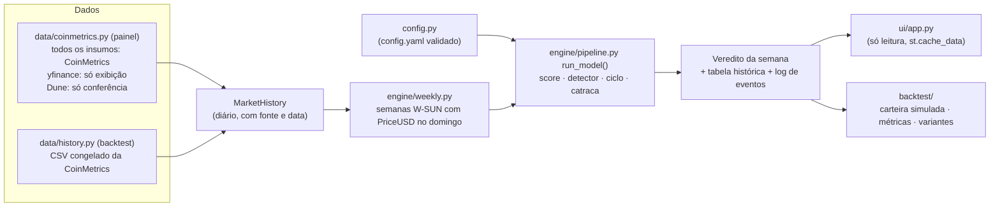

# BitSignal — Modelo de Ciclo Unificado e Painel Só de Leitura

*   **Author:** @burizinho
*   **Status:** Fase 1 — Approved para implementação (2026-11-08). Fase 2 — Proposed. A aprovação cobre a especificação e o Plano de Implementação da Fase 1; não homologa o código, não valida a estratégia financeira (Q1 não executada) e não autoriza publicar recomendações do modelo novo.
*   **Date:** 2026-11-08
*   **Predecessor:** [concepts_brief.md](../../concepts_brief.md)
*   **Revisão:** revisão EGM de 2026-11-08 incorporada (relatórios `zoom_out_report.md`, `comprehension_report.md`, `critic_report.md`, `critic_report_r2.md`, `intermediate_zoom_out_report.md`, `intermediate_zoom_out_report_r2.md` e `goldfish_review_report.md` na raiz do repositório).

> **Reconciliação com o brief (2026-11-08):** este documento mantém 11 divergências em relação ao [concepts_brief.md](../../concepts_brief.md): faixas de venda, detector de reversão, compras, rejeição da escada por ATH, reinício, reserva, fonte on-chain, fonte de preço, critério de sucesso, linha do painel e janela 2019+. Todas vêm das decisões Q1, Q2, Q3, Q5, Q5a, Q6, Q7, Q9 e da escolha da fonte de preço. O brief fica como registro histórico das premissas iniciais.
>
> **Manter não é validar.** Os componentes estão em três situações:
>
> | Situação | Itens |
> |---|---|
> | **Decidido** (decisão de projeto) | Arquitetura sem estado; fontes CoinMetrics (modelo) / Dune (conferência) / yfinance (exibição); teto de venda de 50% compartilhado e catraca; reinício em duas etapas; reserva-base não renovável; política de dados ausentes; critérios e benchmarks da Q1 |
> | **Hipótese experimental** (implementar parametrizado; não apresentar como comprovado) | Escada de venda 5/15/30%; política de severidade do detector de reversão (Q5b: 10/25/50% com SMA50w); compra pelo score 2%/4% mantendo a sobra de caixa (Q9) |
> | **Pendência técnica** (critério de aceite antes de publicar) | Testes de indisponibilidade, atraso e cobertura da CoinMetrics; uso comercial bloqueado até haver licença (CC BY-NC); testes técnicos de replay (sem informação futura, paridade, saldos) |

## Glossário

| Termo | Significado |
|---|---|
| **Score** | Score de valuation 0–100: soma ponderada de seis insumos normalizados (§4). |
| **Escada de venda** | Metas de venda acumulada disparadas pelo score: ≥ 85 → 5%, ≥ 90 → 15%, ≥ 93 → 30% da posição-base. Na Q5 era a "opção C". |
| **Detector de reversão** | Mecanismo independente do score que mede perda de tendência do preço e define metas de venda de 10/25/50% (§5). Na Q5 era a "opção D". |
| **Armamento por ATH / por score ≥ 60 / por score > 35** | Condições que ligam o detector de reversão (Q5a). O padrão é o armamento por ATH. |
| **Catraca** | Venda acumulada-alvo do ciclo; só sobe dentro do ciclo, com teto de 50%. |
| **`V_esc` / `V_det`** | Meta de venda acumulada pedida na semana pela escada de venda e pelo detector de reversão. A catraca fica com o maior valor entre elas, limitado ao teto. |
| **Veredito** | Saída do modelo para a semana mais recente: fase, venda acumulada-alvo, compra programada, motivo e estado dos dados. |
| **Linha do topo** | Elemento do painel que exibe o veredito (§8). |
| **Máxima de 52 semanas** | Maior fechamento semanal (W-SUN) entre as últimas 52 semanas completas, incluindo a semana avaliada. |
| **Posição-base** | BTC da carteira no início do ciclo; base de todas as metas de venda. |
| **Reserva-base** | Caixa em USD destinado a compras, fixado no início da campanha; não é recomposto a cada ciclo. |
| **Campanha** | Período que começa quando o usuário define a reserva-base e segue até ele declarar uma nova; no backtest, a campanha começa na data de início da carteira simulada. |
| **Compra pelo score / Compra uniforme / Compra por queda do ATH** | Escadas de compra da Q9. O padrão é a compra pelo score; a compra uniforme é o benchmark; a compra por queda do ATH foi rejeitada. |
| **Normalização fixa / por limites altos / por percentil / híbrida** | Formas de converter cada insumo em 0–100 (Q5). O padrão é a normalização fixa atual. |
| **ACUMULAR / MANTER / DISTRIBUIR** | Fase exibida, derivada do estado do ciclo (§6). |
| **Variante mínima** | Modelo só por preço (A2): fase por preço/SMA200w, compras e vendas por distância do ATH. Roda como comparação. |
| **STOP_2 / C0** | Rótulos do código atual: STOP_2 é o trailing stop que manda vender tudo menos 20%; C0 é o primeiro degrau de compra por queda de 30% do ATH. Ambos saem. |

--------------------------------------------------------------------------------

## Overview

O BitSignal é um painel Streamlit publicado no Streamlit Community Cloud. Ele mostra em que fase do ciclo macro o Bitcoin está, a venda acumulada-alvo do ciclo, em % da posição-base, e quanto da reserva-base comprar naquela semana. O único usuário é o dono do projeto. Ele só olha o painel e executa as operações por conta própria, registrando tudo numa planilha externa.

Este design faz quatro mudanças:

1. Troca os dois sistemas de decisão que hoje coexistem por um único modelo de ciclo. Os dois sistemas atuais são o Composite Score 0–100 e os degraus por distância do ATH com trailing stops.
2. Corrige os erros de cálculo que hoje distorcem o score.
3. Substitui o backtest atual, que usa dados sintéticos e números fixos, por um backtest com histórico real desde 2010-07-18.
4. Remove do código os alertas, o registro de transações e o cálculo de imposto, que o usuário não usa.

O modelo continua sendo uma ferramenta de leitura. O app não executa ordens nem guarda o saldo do usuário.

A entrega tem duas fases (§9). A **Fase 1** entrega o modelo padrão completo, o painel novo e o backtest contra os dois benchmarks da Q1. A **Fase 2** traz o catálogo de variantes de comparação, com especificação própria.

## The Problem

**O painel pode mostrar ordens que se contradizem, e o número em que ele se baseia está errado.**

- **Dois sistemas independentes.** A aba "Sentinela" mostra o Composite Score com faixas de venda em 80/85/90. A aba "Plano Nacional" manda comprar ou vender só pela distância do preço até um ATH fixo de US$ 126 mil. O score não participa dessa decisão. Os trailing stops podem mandar vender 80% da posição enquanto os degraus de compra mandam comprar (`bitsignal/strategy/trailing_stops.py`, `bitsignal/strategy/weekly_evaluator.py`). Há três tetos de venda diferentes no código e na tela: 40%, ~58–80% e 75%.
- **O score está distorcido por erros de cálculo:**
  - O Pi Cycle Bottom está com a comparação invertida (`bitsignal/engine/indicators.py:45`, `is_picycle_bottom_triggered`). Desde 2019 ele marca "fundo" em 75% dos dias; a fórmula certa marca 13%. Isso trava 15% do peso do score em 0.
  - Candles diários e semanais ainda abertos entram no cálculo.
  - O `config.yaml` não é lido pelo motor do score.
  - Os valores fixos de contingência (MVRV 2,10, Puell 1,05, câmbio R$ 5,80) aparecem como dado real, com a data de agora. Por isso a checagem de dado velho nunca dispara.
- **Não há como saber se o modelo funciona.** O backtest atual deriva MVRV e Puell do próprio preço, fixa a redução de drawdown em 35% e o número de falsos positivos em 0, e não tem histórico suficiente para 2017. Uma exploração com dados reais da CoinMetrics (seção 4.1 do brief; números exploratórios: score diário, insumo ausente = 50) mostrou duas coisas:
  - O score acerta a direção: passa de 90 em 2017 e em abril/2021 e cai abaixo de 20 em 2022.
  - Mas ele chega a 80 entre 200 e 300 dias antes do pico, a preços entre 7% e 47% do valor do pico, e não vê o topo de novembro/2021 (máximo 65,5). Do jeito que está, as faixas de venda venderiam cedo demais.
- **O app em produção reexecuta o pipeline inteiro a cada visita.** Depois da primeira hora, cada visita roda o pipeline de novo, porque o upsert não atualiza `created_at`. O SQLite é apagado a cada reinício do Streamlit Cloud, e a API da Binance responde HTTP 451 a IPs dos EUA, onde o Streamlit Cloud roda.

**Proposta, em uma frase:** uma função pura recebe o histórico de mercado e devolve fase, venda acumulada-alvo e compra da semana em percentuais. Ela é avaliada por um backtest sobre dados da CoinMetrics, sem dados sintéticos e sem informação futura, e o painel só a exibe.

## Goals

*   **G1 — Um modelo só.** Uma função sem estado, `run_model(history, config) -> ReplayResult`, usada pelo painel e pelo backtest. Ela chama `replay()`, a máquina de estados semanal do §6. Os módulos de degraus por ATH, trailing stops e o gauge atual (`bitsignal/ui/cycle_gauge.py`, que repete ~40 constantes próprias) deixam de decidir qualquer coisa.
*   **G2 — Cálculo correto e rastreável.**
    *   Pi Cycle corrigido, com teste de tabela-verdade.
    *   Só semanas fechadas entram no cálculo.
    *   Todos os pesos, limites e faixas vêm de um único arquivo de configuração validado na carga.
    *   Cada insumo do painel mostra a fonte e a data real do dado.
*   **G3 — Backtest reproduzível, sem dados sintéticos e sem informação futura.**
    *   Usa um CSV congelado da CoinMetrics Community (2010-07-18 em diante).
    *   Sem dado sintético e sem preencher valores ausentes com 50.
    *   Critério de sucesso definido antes de rodar (Q1).
    *   Simulação da carteira com saldos de BTC e caixa.
    *   Três janelas: calibração até 2018-12-31; validação histórica de desenvolvimento de 2019-01-01 até o congelamento (não é amostra independente); validação prospectiva depois do congelamento.
    *   Sensibilidades da variante padrão na Fase 1 (reserva, atraso de execução, entrada tardia); variantes de comparação, inclusive limiares a ±5 pontos, na Fase 2.
*   **G4 — Critério de sucesso mensurável (Q1).** A estratégia completa cumpre, ao mesmo tempo:
    *   patrimônio final ≥ 90% do comprar e segurar;
    *   queda máxima do patrimônio pelo menos 10 p.p. menor;
    *   patrimônio final ≥ ao do DCA uniforme completo.

    Os eventos de diagnóstico (lista única no §7) mostram volumes, preços médios e falsos positivos. O objetivo é a relação entre patrimônio e risco de queda profunda, não acertar topos e fundos exatos.
*   **G5 — Painel só de leitura, com origem dos dados visível.**
    *   Uma linha de ação no topo, no formato único do §8.
    *   Insumos com selo de origem e data.
    *   Estado do score visível: `ok`, `intervalo` ou `indisponível`; tela sem veredito quando os dados estão `desatualizados` ou a CoinMetrics falha (Q6).
    *   Interface toda em português.
*   **G6 — Custo previsível no Streamlit Cloud.**
    *   Dados em cache por tempo (`st.cache_data`) e nenhuma escrita em disco.
    *   O estado do modelo (fase, ATH de referência, catraca) é recalculado a partir do histórico a cada carga.
*   **G7 — Menos código.** Remover alertas, registro de transações, imposto e runbook bancário, sem quebrar o painel em nenhum commit intermediário.

## Non-Goals

*   Alertas por Telegram ou qualquer outro canal.
*   Registrar compras e vendas, calcular saldo, custo médio, DARF ou instruções de PIX. O usuário mantém isso numa planilha.
*   Qualquer análise de imposto, inclusive no backtest. O backtest mede resultado bruto em BTC e em USD (decidido em 2026-11-08).
*   Manter o Dune como fonte do modelo. Pela Q7, a CoinMetrics Community alimenta painel e backtest, e o Dune fica só como conferência.
*   Persistir dados no servidor: sem SQLite e sem banco externo.
*   Otimizar os limiares para maximizar o retorno passado. Os limiares são congelados antes da validação.
*   Executar ordens em corretoras.
*   Aconselhamento financeiro. O app aplica regras definidas pelo usuário e mostra como elas teriam se comportado no passado.

## Decisões registradas e questões abertas

Esta seção registra **o que** foi decidido e **por quê**. A regra operacional de cada decisão fica em um único lugar, no Technical Plan (Architecture), indicado em "Regra". Se as duas seções divergirem, vale o Technical Plan, e a divergência é um defeito a corrigir.

### Decisões

*   **Q1 — Critério de sucesso (2026-11-08).**
    *   **Decisão:** a aprovação histórica compara a estratégia completa com dois benchmarks na mesma carteira contínua, por três critérios cumulativos (patrimônio ≥ 90% do comprar e segurar; queda máxima pelo menos 10 p.p. menor; patrimônio ≥ DCA uniforme completo). Os eventos históricos são só diagnóstico. A carteira contínua decide, e a entrada tardia em 2019 é só um cenário de diagnóstico. A reserva-base é 0,5 BTC em USD, fixa.
    *   **Motivo:** medir patrimônio e risco, não acertar topos e fundos exatos; evitar premiar bons preços com volume insignificante; impedir que uma carteira nova em 2019 apague o efeito das decisões de 2014–2018. A carteira herda o estado do modelo, sem executar vendas passadas, porque o replay começa em 2010-07-18: isso preserva o armamento do detector pelo ATH de nov/2013 e mantém o mesmo estado no painel e no backtest.
    *   **Limites:** os limites 90% / 10 p.p. / ≥ DCA uniforme, as datas, o tamanho da reserva e as políticas da Q5b e da Q9 são política de risco fixada antes do teste e não mudam depois de ver resultados. A janela 2019+ é validação histórica de desenvolvimento, **não** amostra independente, porque seus eventos influenciaram as decisões. Aprovação técnica e aprovação financeira são separadas.
    *   **Regra:** §7 (Backtest).
*   **Q2 — Teto, piso e catraca (2026-11-08).**
    *   **Decisão:** piso de 50% da posição-base por ciclo; teto de venda de 50% compartilhado entre escada de venda e detector, sem cotas; vale o sinal mais severo, sem soma; catraca que só sobe dentro do ciclo; sem recompra automática. O painel mostra "venda acumulada-alvo" em % da posição-base, nunca "vendido", com as compras em campo próprio.
    *   **Motivo:** permitir que o detector proteja um topo que o score não vê, limitando o custo de falsos positivos sem exigir recompra.
    *   **Regra:** §6 (ciclo e catraca) e §8 (tela).
*   **Q3 — Reinício de ciclo e ATH de referência (2026-11-08).**
    *   **Decisão:** reinício em duas etapas (armar com score baixo, efetivar com score recuperado e sem episódio ativo do detector); ATH de referência nunca zerado; o piso vale por ciclo, não para sempre. Limiares e contagem de semanas: §6.
    *   **Motivo:** as compras da fase de acumulação entram na posição-base do ciclo seguinte; evitar que uma única semana de score baixo reinicie o ciclo.
    *   **Regra:** §6. A alternativa "queda de 60% do ATH" ficou fora do conjunto executável (§7) por falta de regra de saída.
*   **Q4 — Precedência entre sinais. Superada pela Q5a e pelo §6.**
*   **Q5 — Normalização e escada de venda (2026-11-08).**
    *   **Decisão:** manter a normalização fixa atual; escada de venda provisória em 85/90/93 → 5/15/30%; o experimento "escada sozinha contra escada + detector" fica para a Fase 2 (variante `ladder_only`). A normalização por percentil foi descartada; limites altos e normalização híbrida rodam só como comparação.
    *   **Motivo:** o score mede valuation e chega cedo aos topos; o momento da reversão fica a cargo do detector.
    *   **Regra:** §4.
*   **Q5a — Armamento do detector (2026-11-08).**
    *   **Decisão:** detector independente do score, armado por novo ATH nas últimas 52 semanas.
    *   **Motivo:** na exploração, foi a única regra que pegou o pós-topo de 2025, quando o score do ciclo ficou abaixo de 60. Falsos positivos pequenos consomem o orçamento de venda do ciclo; isso é aceito. O primeiro disparo é tardio (−57% em 2018, −38% em jan/2022). Os armamentos por score ≥ 60 e por score > 35 ficam como comparação.
    *   **Regra:** §5.
*   **Q5b — Severidade do detector (2026-11-08), política experimental de risco.**
    *   **Decisão:** N1 = 10%, N2 = 25% com confirmação pela SMA50w, N3 = 50% depois de N2 e com o preço ≤ 60% da máxima de 52 semanas.
    *   **Motivo:** exigir piora da tendência longa antes de vendas maiores, em vez de aumentar a venda só porque o preço caiu mais. Na exploração ([`sev.py`](../reviews/bitcoin_unified_cycle_model/sev.py)), os falsos positivos de mai/2021, set/2024 e mar/2025 ficaram em N1 e as baixas de 2018, 2022 e pós-topo de 2025 chegaram a N3.
    *   **Limites:** são 3 contra 3 casos, escolhidos olhando 2019–2026. Não é calibração validada; não há otimização adicional no S6. O custo da confirmação tardia ainda não foi medido (em 2022, N3 veio a ~56% da máxima de 52 semanas).
    *   **Regra:** §5.
*   **Q6 — Dados ausentes, atrasados e recuperados (2026-11-08).**
    *   **Decisão:** congelar decisões do score quando falta dado essencial; intervalo de score quando a ausência é secundária; sem veredito quando a CoinMetrics falha, não tem preço ou está atrasada, com o último histórico da sessão exibido só como contexto; replay integral quando o dado volta, com aviso de reconstrução; valores fixos de contingência contam como ausentes.
    *   **Motivo:** nenhuma decisão irreversível da catraca pode nascer de dado incompleto, e um veredito velho não pode aparecer como atual. Sem persistência, o painel não consegue comparar com o carregamento anterior; ele só descreve a reconstrução atual.
    *   **Regra:** §3 (semanas e atraso), §4 (estados do score) e §8 (tela).
*   **Q7 — Fonte dos dados (2026-11-08).**
    *   **Decisão:** CoinMetrics Community é a fonte única de todos os insumos do modelo (painel e backtest), incluindo preço e hashrate. O Dune fica só como conferência, e o yfinance só exibe o preço atual.
    *   **Motivo:** o replay precisa de séries completas e coerentes desde 2010-07-18, e o código atual consome só a última linha do Dune ([ingestion.py:216](../../bitsignal/ingestion.py#L216)). A consistência do histórico prevalece sobre a preferência original pelo Dune.
    *   **Regra:** §2.
*   **Q9 — Compras (2026-11-08), política experimental.**
    *   **Decisão:** compra pelo score só na fase ACUMULAR (2% da reserva-base por semana com score ≤ 20, 4% com score ≤ 10); a reserva-base não é recomposta no reinício; a sobra de caixa ao fim da fase **fica em caixa**, sem compra automática. A compra uniforme é benchmark; a compra por queda do ATH foi descartada; comprar toda a sobra no reinício roda só como comparação.
    *   **Motivo:** a escada por queda do ATH gastava a reserva longe do fundo nas baixas de 2018 e 2022; comprar a sobra no reinício concentraria compras quando a condição favorável já passou.
    *   **Limites:** os números exploratórios (2018: 1,36×; 2022: 1,30×; fase atual até 2026-11-07: 1,17× o fundo) partiram de reserva cheia em cada fase e precisam ser refeitos com o motor final.
    *   **Regra:** §6 (compras) e §7 (benchmarks).

### Ainda abertas

*   **Q8 — Bug de página em branco.** Correção definida (§8): `main()` explícita. Falta confirmar o bug no app publicado.

## Critical User Journeys (CUJs)

### CUJ 1: Consultar o veredito da semana

*   **Given**:
    *   O painel está publicado no Streamlit Cloud.
    *   A semana W-SUN mais recente já está disponível na CoinMetrics (em geral na segunda-feira, §3).
    *   A CoinMetrics responde.
*   **When**: O usuário abre o painel.
*   **Then**:
    *   Em ≤ 10 s na partida a frio, e em < 2 s com cache, o topo mostra a linha no formato único do §8.
    *   Logo abaixo aparecem o score e seu estado, os seis insumos com fonte e data, e a venda acumulada-alvo do ciclo comparada ao teto (por exemplo, "venda acumulada-alvo: 20% de no máximo 50%").
    *   Nenhum valor em BTC ou em R$ é inventado.

### CUJ 1b: Tela durante ACUMULAR

*   **Given**: O reinício da Q3 está armado (fase ACUMULAR), e a catraca do ciclo vigente está, por exemplo, em 50%.
*   **When**: O usuário abre o painel.
*   **Then**:
    *   O destaque é "Compra programada nesta semana: Y% da reserva-base", sujeita ao caixa disponível.
    *   A linha "Venda acumulada-alvo no ciclo: 50% da posição-base (ciclo iniciado em dd/mm/aaaa)" continua visível, sem destaque.
    *   O aviso fixo explica que as compras desta fase não alteram a posição-base do ciclo atual e que a meta não é uma ordem.

### CUJ 2a: Falta um insumo secundário

*   **Given**: A CoinMetrics responde, mas um insumo que não é MVRV nem Puell está ausente na semana (ex.: a série `HashRate` sem linha naquele domingo), somando ≤ 20% do peso.
*   **When**: O usuário abre o painel.
*   **Then**:
    *   O score aparece no estado `intervalo`, com `score_min` e `score_max`.
    *   O insumo ausente aparece com o selo "ausente".
    *   Decisões só saem se o intervalo inteiro confirmar o limiar (§4).

### CUJ 2b: Falta MVRV ou Puell, ou a CoinMetrics está fora do ar ou atrasada

*   **Given**: Falta MVRV ou Puell, ou falta mais de 20% do peso, ou a CoinMetrics não respondeu, ou os dados estão `desatualizados` (§3).
*   **When**: O usuário abre o painel.
*   **Then**:
    *   Com `PriceUSD` presente: score `indisponível`, escada de venda e reinício suspensos, detector de reversão ativo.
    *   Sem a CoinMetrics, ou com dados atrasados: score e detector indisponíveis; tela sem veredito, com hora da última tentativa, botão de nova consulta, preço do yfinance ("somente exibição") e, se existir na sessão, o último histórico bom só em gráficos, marcado como desatualizado (§8).
    *   Nenhum valor fixo é mostrado como real.

### CUJ 3: Avaliar o modelo no backtest

*   **Given**: O CSV congelado da CoinMetrics está versionado em `data/historical/`, e os parâmetros estão congelados em `config/frozen/`.
*   **When**: O usuário roda `bitsignal backtest`, ou abre a aba de backtest no painel.
*   **Then**:
    *   Antes do congelamento (S6): só a janela de calibração, sem critérios 2019+. Depois do congelamento: os três critérios da Q1 (APROVADO / NÃO APROVADO por critério) da variante padrão contra comprar e segurar e contra o DCA uniforme completo, na janela de desenvolvimento (2019+), lado a lado com o `approval` gravado no S6.
    *   Depois, os diagnósticos por evento (lista única no §7): % vendido ou comprado, preço médio ponderado, custo de oportunidade e falsos positivos.
    *   As sensibilidades da variante padrão (§7), no CLI. A aba do painel mostra só a variante padrão e os benchmarks (§8). As variantes de comparação ficam para a Fase 2.
    *   Um gráfico de preço em escala log com as fases sombreadas e a curva de patrimônio.
    *   Nada é buscado na rede.

### CUJ 4: Ajustar um limiar

*   **Given**: O usuário quer mudar um limiar, por exemplo o primeiro degrau da escada de venda de 85 para 87.
*   **When**: Ele edita o bloco `sell_ladder:` do config (blocos descritos na etapa S2) e roda o backtest.
*   **Then**:
    *   Painel e backtest passam a usar o novo valor, sem nenhuma constante duplicada em outro arquivo.
    *   Um config inválido falha na carga com uma mensagem que diz qual campo está errado, por exemplo pesos que não somam 1 ou faixas fora de ordem.
    *   Se o config em uso difere do arquivo congelado, o painel mostra "parâmetros diferentes dos congelados: status aprovado não se aplica". Editar depois do congelamento invalida o status aprovado e a trilha prospectiva.

## Technical Plan (Architecture)

### 1. Visão geral

O sistema passa a ter três camadas, sem estado persistente:

1. **Dados** buscam o histórico de mercado e devolvem um único `MarketHistory`. Cada insumo traz a fonte e a data real do dado.
2. **Modelo** é uma função pura (`run_model(history, config) -> ReplayResult`) que devolve, para cada fechamento semanal, o score, o estado do detector, o estado do ciclo e a recomendação. O painel usa a última linha; o backtest usa todas.
3. **Apresentação** (painel Streamlit e comando `bitsignal backtest`) só lê o resultado do modelo.



### 2. Dados

*   **Fonte única do modelo (Q7):** todo insumo do modelo vem exclusivamente da CoinMetrics Community: `PriceUSD`, `CapMrktCurUSD`, `CapMVRVCur`, `IssTotUSD` e `HashRate`, em série diária desde 2010-07-18 (`HashRate` desde 2009-01-09). As cinco séries estão no plano Community (catálogo verificado em 2026-11-08). As variantes prontas `PuellMul*` e `CapRealUSD` não estão no plano gratuito. O Mempool.space e a Binance saem do código.
*   **Painel (`MarketHistory` ao vivo):**
    *   **Busca:** as 5 séries numa chamada paginada, com cache de 6 h e respeitando o limite de 10 requisições a cada 6 s.
    *   **Preço exibido:** o yfinance só mostra o "preço agora", com selo próprio. Ele não entra em nenhum cálculo e não substitui a CoinMetrics se ela falhar.
    *   **Dune (conferência):** se `DUNE_API_KEY` e `DUNE_QUERY_ID` estiverem configurados, o painel mostra os valores recentes do Dune ao lado dos da CoinMetrics, com alerta de divergência (métrica, data, magnitude) quando as datas coincidem. O Dune não altera score, catraca nem reinício. Sem chave, o modelo funciona normalmente.
    *   **Fonte e data:** cada `MarketHistory` carrega `source` ∈ {`coinmetrics_live`, `coinmetrics_frozen`} e `as_of` (data da última linha), nunca `now()`. Valores fixos de contingência (MVRV 2,10, Puell 1,05) deixam de existir.
*   **Backtest:** usa o CSV congelado `data/historical/btc_coinmetrics.csv`, com as mesmas 5 séries. Um comando gera o CSV (`bitsignal fetch-history`); o backtest e os testes nunca acessam a rede.
*   **Derivações comuns** (mesma função para as duas fontes):
    *   realized cap = `CapMrktCurUSD / CapMVRVCur` (`CapMVRVCur` é a razão MVRV, não o Z-score);
    *   MVRV Z = (`CapMrktCurUSD` − realized cap) / desvio-padrão expansivo de `CapMrktCurUSD`;
    *   Puell = `IssTotUSD` / média de 365 dias de `IssTotUSD`, sem preencher lacunas;
    *   Hash Ribbon = SMA30 e SMA60 diárias do `HashRate`. Cruzamento para cima no dia d: `SMA30_d ≥ SMA60_d` e `SMA30_(d−1) < SMA60_(d−1)`. Estado da semana W-SUN, calculado só depois que a semana fecha: CAPITULATION se `SMA30 < SMA60` no domingo; senão BUY_RECOVERY se houve cruzamento para cima em algum dia de segunda a domingo daquela semana; senão NORMAL. O código atual (`ingestion.py`, `>` estrito e só o último dia) é substituído por esta regra.

    Painel e backtest usam a mesma fonte e as mesmas funções. O teste de paridade confere que as datas de fechamento, a agregação semanal e as fórmulas são idênticas nos dois caminhos.
*   **Antes da implantação:** confirmar no catálogo que as 5 séries continuam no plano Community. Licença CC BY-NC: uso comercial bloqueado até haver licença.

### 3. Cadência, semanas e atraso dos dados

*   O modelo decide **uma vez por semana**, no fechamento de domingo (W-SUN, UTC).
*   **Rótulo da CoinMetrics:** a linha com `time = D 00:00Z` representa o fechamento do dia UTC D.
*   **Quando a semana entra no modelo:** uma semana W-SUN entra quando existe `PriceUSD` válido no domingo dela. Em geral isso acontece na segunda-feira, por causa da defasagem de ~1 dia. As demais séries podem faltar naquela semana; cada insumo ausente é tratado pelos estados do §4. Sem `PriceUSD` no domingo, a semana não entra.
*   **Insumo ausente × aquecimento:** um insumo está em **aquecimento** quando a janela dele ainda não se completou (SMA200w ≈ 200 semanas, ~mai/2014; SMA471 diária; MVRV Z com pelo menos 2 anos de desvio expansivo; Puell com 365 dias). Está **ausente** quando a janela já se completou mas falta o dado. Os dois contam como ausentes para o score (§4); o selo na tela distingue "aquecimento" de "ausente".
*   **Atraso (estado `desatualizado`):** se a semana mais recente que entrou no modelo terminou mais de 9 dias antes do momento da carga (UTC), os dados estão desatualizados: a fonte responde mas parou de publicar. Os 9 dias cobrem a defasagem normal de segunda-feira. O painel não mostra veredito (§8).
*   **Base de cada indicador:**
    *   **Diária, amostrada no domingo:** SMA111, SMA350, SMA471, EMA150 (Pi Cycle), MVRV Z, Puell, Hash Ribbon.
    *   **Semanal, sobre fechamentos de domingo:** SMA30w, SMA50w, SMA200w, RSI(14), máxima de 52 semanas (glossário), `reference_ath_usd`.
*   **Convenções de cálculo:** a série diária é reindexada no calendário completo, sem preencher lacunas; toda janela (rolling, ewm, expanding) exige `min_periods` igual ao tamanho da janela; a primeira semana da série não conta como novo ATH.
*   **Mesmo código nos dois lados:** o backtest atual usa RSI(98) diário e SMA(1400); essas diferenças deixam de existir.

### 4. Score de valuation e escada de venda

*   **Composição:** seis insumos, cada um convertido em 0–100 pela normalização fixa (mapeamento linear com corte entre mínimo e máximo), com pesos e limites lidos do config:

    | Insumo | Peso | 0 em | 100 em |
    |---|---|---|---|
    | MVRV Z | 25% | ≤ 0,15 | ≥ 5,00 |
    | Preço / SMA200w | 20% | ≤ 1,0 | ≥ 3,5 |
    | Puell | 20% | ≤ 0,45 | ≥ 2,20 |
    | Pi Cycle: spread SMA111 / (2 × SMA350); força 0 quando o Pi Cycle Bottom está ativo | 15% | ≤ 0,70 | ≥ 1,00 |
    | RSI(14) semanal | 10% | ≤ 32 | ≥ 80 |
    | Hash Ribbon (estado discreto, §2) | 10% | — | — |

    O Hash Ribbon não é linear: BUY_RECOVERY = 10, CAPITULATION = 20, NORMAL = 50.
*   **Pi Cycle Bottom corrigido:** ativo quando `EMA150 < SMA471 × 0,745`.
*   **Estados do score, a cada semana (Q6):**
    *   `ok`: todos os insumos presentes; `score_min = score_max = score`.
    *   `intervalo`: falta algum insumo que não é MVRV nem Puell, somando ≤ 20% do peso. `score_min` e `score_max` saem com cada insumo ausente no mínimo e no máximo do seu domínio (0–100 nos contínuos; Hash Ribbon ∈ {10, 20, 50}). Com 10% do peso ausente, o intervalo tem 10 pontos de largura, o que bloqueia novos degraus em 85–93; o estado é útil nas confirmações de reinício.
    *   `indisponível`: falta MVRV ou Puell, ou mais de 20% do peso. O score não decide nada, e a semana não conta nem zera os contadores de reinício (§6). O detector continua, porque só usa preço.
    *   Não há renormalização de pesos nem valor 50 fictício.
*   **Escada de venda** (hipótese experimental, Q5). Metas de venda acumulada sobre a posição-base; vale o maior degrau atingido; usa `score_min`:

    | `score_min` semanal | `V_esc` |
    |---|---|
    | ≥ 85 | 5% |
    | ≥ 90 | 15% |
    | ≥ 93 | 30% |

### 5. Detector de reversão (fonte normativa da Q5a e da Q5b)

*   **Armamento:** o detector está armado na semana t se houve um novo máximo do `cummax` do fechamento semanal em alguma das últimas 52 semanas (incluindo t).
*   **Episódio** (contagens de semanas são por linha semanal válida, §3):
    *   **Abre** na primeira semana armada em que há 2 fechamentos semanais seguidos abaixo da SMA30w e o fechamento está ≤ 80% da máxima de 52 semanas (disparo).
    *   **Fecha** depois de 2 fechamentos semanais seguidos acima da SMA30w, mesmo que o armamento tenha expirado durante o episódio.
    *   **Novo episódio:** exige um novo disparo com armamento válido naquela semana. Não exige um ATH posterior ao episódio anterior.
    *   **Semana do fechamento:** nessa semana `level` ainda mostra o nível do episódio; o fechamento vale a partir da semana seguinte (`level = 0`). Por isso o reinício de ciclo (§6, passo 3) nunca acontece na própria semana do fechamento. O campo `end` do episódio é a semana do fechamento.
*   **Níveis dentro do episódio** (política experimental, Q5b), avaliados em ordem na mesma semana:

    | Nível | Condição | `V_det` |
    |---|---|---|
    | N1 | Disparo do episódio | 10% |
    | N2 | N1 atingido e 2 fechamentos semanais seguidos < SMA50w | 25% |
    | N3 | N2 atingido (nesta semana ou antes, no mesmo episódio) e fechamento ≤ 60% da máxima de 52 semanas | 50% |

    *   O nível só sobe dentro do episódio. Um disparo contínuo não repete vendas.
    *   `level` é o nível do episódio ativo; "sem episódio ativo" significa `level == 0`.
    *   Se as condições de N2 e N3 já valem na semana do disparo, o nível vai direto ao mais alto.
    *   **Ordem dentro da semana:** primeiro o disparo (se não há episódio), depois os níveis N2 e N3, e por último o teste de fechamento do episódio. Na semana do disparo não se testa fechamento.
    *   **Janela do N2:** os 2 fechamentos seguidos abaixo da SMA50w podem incluir a semana anterior ao disparo; o que conta é a semana atual e a anterior.
*   **Números configuráveis:** a estrutura destas regras é fixa; as janelas (30, 50, 52 semanas), o número de semanas de confirmação (2, vale para o disparo, o fechamento e o N2) e os limiares (80% e 60% da máxima de 52 semanas) vêm do config.
*   **Reprodução:** [`docs/reviews/bitcoin_unified_cycle_model/sev.py`](../reviews/bitcoin_unified_cycle_model/sev.py) implementa exatamente estas regras (versão de 2026-11-08). É um script exploratório, não um teste validado.

### 6. Ciclo, catraca, reinício e compras (fonte normativa da Q2, Q3 e Q9)

Estado reconstruído semana a semana por `replay()`, chamado por `run_model()`. Nada é gravado.

```text
estado do ciclo
  cycle_id, cycle_start_date
  ratchet_sell        # venda acumulada-alvo do ciclo (só sobe)
  reset_pending       # reinício armado (fase ACUMULAR)
  arm_count, confirm_count
  reference_ath_usd   # cummax do fechamento semanal; nunca zera
  cap = 1 - floor     # do config (padrão 0,50)

a cada semana t que entrou no modelo (§3), nesta ordem:
  1. status, score_min, score_max = score(t)        # ok | intervalo | indisponível (§4)
     level = detector(t)                            # 0..3 (§5) ; V_det = metas[level]
  2. se status != indisponível:                     # semanas indisponíveis não contam nem zeram
       arm_count     = arm_count + 1     se score_max <= 20 senão 0
       confirm_count = confirm_count + 1 se score_min >= 30 senão 0
     se não reset_pending e arm_count >= 2: reset_pending = True
  3. se reset_pending e confirm_count >= 2 e level == 0:
       novo ciclo: ratchet_sell = 0 ; cycle_id += 1 ; cycle_start_date = t
                   reset_pending = False ; arm_count = confirm_count = 0
       (a reserva-base NÃO é recomposta; a sobra de caixa fica em caixa)
       nesta semana não se aplica escada nem detector -> fim da semana
  4. V_esc = escada(score_min) se status != indisponível senão 0
     V_det_eff = 0 se reset_pending senão V_det
     ratchet_sell = min(cap, max(ratchet_sell, V_esc, V_det_eff))
  5. se reset_pending e status != indisponível:
       compra = 4% da reserva-base se score_max <= 10
                2% se score_max <= 20
                0 caso contrário
       (no backtest, limitada ao caixa simulado)
```

*   **Catraca:** só sobe dentro do ciclo, com teto `cap`. Uma melhora dos indicadores não devolve capacidade de venda; só o reinício (passo 3) a renova. Não há recompra automática.
*   **Piso por ciclo:** o piso vale por ciclo, não para sempre. Exemplo: 1 BTC → 0,5 → 0,25 após dois ciclos, sem compras.
*   **Precedência compra × venda:** enquanto `reset_pending` estiver ligado, o detector não eleva a catraca, e a escada de venda não sobe porque exige `score_min` ≥ 85. Venda e compra nunca aparecem na mesma semana. Hoje o STOP_2 manda vender enquanto o C0 manda comprar; essa regra elimina esse conflito.
*   **Fase exibida:** ACUMULAR se `reset_pending`; DISTRIBUIR se `ratchet_sell > 0` no ciclo; MANTER nos outros casos.
*   **Compras:** só na fase ACUMULAR, em % fixo da reserva-base (não do saldo). A reserva-base não é recomposta no reinício. A sobra de caixa ao fim da fase fica em caixa; o caixa só cresce com o produto das vendas ou com uma nova campanha definida pelo usuário.
*   **Posição-base durante ACUMULAR:** enquanto o reinício está pendente, a catraca e a posição-base do ciclo vigente continuam valendo. As compras da fase não aumentam a meta de venda desse ciclo. Na efetivação do reinício, a nova posição-base é o saldo de BTC da carteira (simulada, no backtest; na planilha do usuário, na vida real). Exemplo: posição-base de 1 BTC, meta de 50% e 0,20 BTC comprados em ACUMULAR → a meta do ciclo vigente continua 0,50 BTC; a nova posição-base sai do saldo no reinício.
*   **Log de eventos:** `replay()` devolve, além do estado por semana, um log reconstruído em memória dos eventos que levaram à meta atual: data, mecanismo, limiar cruzado, mudança da catraca, reinício de ciclo e semanas com score `indisponível`.

### 7. Backtest (fonte normativa da Q1; Fase 1: variante padrão, benchmarks e sensibilidades)

*   **Carteira contínua (decide a aprovação):**
    *   Começa na primeira semana em que os seis insumos estão fora do aquecimento (~mai/2014), com 1 BTC + reserva-base.
    *   **Reserva-base:** caixa em USD igual a 0,5 × `PriceUSD` daquela data; capital adicional, fixo em USD, nunca recomposto. Capital total ≈ 1,5 BTC.
    *   **Herança do estado do modelo:** o replay começa em 2010-07-18, e a carteira nasce depois, possivelmente no meio de um ciclo. Ela herda o estado do modelo (catraca, fase, ATH) **sem executar retroativamente** as vendas daquele estado: no ciclo em curso, só vende `max(0, catraca_t − catraca_no_início)` sobre o seu BTC inicial; nos ciclos seguintes, segue as regras normais.
    *   **Conservação de patrimônio:** toda compra reduz o caixa e aumenta o BTC pelo preço de execução mais o custo; toda venda faz o inverso. Mudança de fase ou reinício nunca cria capital.
    *   **Execução sem informação futura:** a operação de uma semana é executada ao `PriceUSD` do primeiro dia posterior ao domingo do sinal (segunda-feira; `execution_lag_days = 1`), com custo de 0,3% por operação. Hipótese registrada: a CoinMetrics publica a linha de domingo antes do fechamento de segunda (UTC). Sensibilidade obrigatória com `execution_lag_days = 2`. Se faltar preço no dia de execução, usa-se o primeiro dia seguinte com preço em até 7 dias; senão a operação é descartada e registrada.
    *   **Curva de patrimônio diária**, marcada a mercado com `PriceUSD`; a queda máxima usa essa curva.
    *   Sem imposto (Non-Goal). O caixa não rende.
*   **Benchmarks (mesmo capital inicial, mesmos preços de execução):**
    *   **Comprar e segurar:** todo o capital convertido em BTC na data inicial.
    *   **DCA uniforme completo:** as mesmas vendas (escada + detector), compra uniforme de 1/52 da reserva-base em toda semana de ACUMULAR, qualquer que seja o estado do score, e a mesma política de caixa (sobra fica em caixa). "Mesmas vendas" significa a mesma catraca em % da posição-base.
*   **Aprovação financeira:** os três critérios da Q1, sobre o trecho de 2019-01-01 até o fim da carteira contínua, com cada curva de patrimônio normalizada para 100 em 2019-01-01:
    1. patrimônio final ≥ 90% do comprar e segurar;
    2. queda máxima do patrimônio pelo menos 10 p.p. menor que a do comprar e segurar;
    3. patrimônio final ≥ ao do DCA uniforme completo.

    O relatório imprime APROVADO / NÃO APROVADO por critério, sem nota agregada, e mostra também os patrimônios absolutos e os resultados desde ~2014.
*   **Aprovação técnica (bloqueia o congelamento e a publicação):** a lista única de testes do Verification Plan (replay determinístico, conservação de patrimônio, ausência de informação futura, paridade painel × backtest, regras do ciclo e do detector, golden).
*   **Antes do congelamento**, o backtest só reporta a janela de calibração; os critérios 2019+ são **gravados uma única vez**, depois do congelamento (S6); recálculos posteriores (CLI ou painel) são só exibição.
*   **Publicação:**

    | Situação | Decisão |
    |---|---|
    | Aprovação técnica falha | Não publicar |
    | Técnica OK, critérios financeiros não atingidos | Painel identificado na tela como "experimental", sem alegação de estratégia validada |
    | Técnica OK e os três critérios atingidos | "Desempenho histórico aprovado", com ressalva e sem promessa de rentabilidade |
    | Parâmetros e código congelados, acompanhados com dados futuros | Evidência independente |

*   **Congelamento e hash do modelo:** o arquivo congelado (S6) guarda os blocos que afetam decisões (`score`, `sell_ladder`, `detector`, `cap`, `cycle`, `buys` e, de `backtest`, só `initial_btc`, `reserve_btc_equiv`, `execution_lag_days`, `fee`, `approval_window_start`, `criteria`) e o `model_hash`: SHA-256 do JSON canônico desses blocos, gerado a partir do config já validado (`model_payload`, item 8: chaves ordenadas, sem espaços). Ficam **fora** do hash: `data`, parâmetros de UI e de rede (`retry_cooldown_s`, ttl), caminhos, `frozen_params` e o próprio hash. O painel calcula o `model_hash` dos blocos em uso e compara com o do arquivo congelado.
*   **Janelas:** calibração até 2018-12-31; validação histórica de desenvolvimento de 2019-01-01 até a data de congelamento (não é amostra independente); validação prospectiva depois do congelamento. Sequência: calibração → congelamento → validação de desenvolvimento → validação prospectiva. Não há folds de walk-forward.
*   **Eventos de diagnóstico (lista única, em ordem):** fundo de 2015, topo de dez/2017, fundo de 2018, topo de abr/2021, topo de nov/2021, fundo de 2022, topo de out/2025. O topo de 2013 **não é avaliável** (SMA200w em aquecimento). Na janela de calibração, a escada de venda tem **um único topo** (2017).
*   **Saídas por ciclo** (fórmulas no item 30 do plano): preço médio ponderado de venda como % do pico seguinte; preço médio de compra como múltiplo do fundo; % da posição vendida a preço ≤ 2/3 da máxima posterior (venda prematura); queda máxima do patrimônio; BTC final e USD final; episódios de venda falsa e o custo de cada um em BTC; reinícios falsos (atenção a mar/2020 e mai/2021); uso da reserva-base.
*   **Variantes de comparação — Fase 2.** Registradas aqui para pré-registro; a implementação e as questões em aberto (ver "Fase 2" no plano) ficam para o design da Fase 2. A padrão decide; as demais nunca podem substituí-la depois de ver os resultados:

    | Nome | Regra completa |
    |---|---|
    | `default` | Escada de venda + detector com armamento por ATH + compra pelo score, sobra em caixa (**padrão**) |
    | `ladder_only` | Como `default`, com `V_det = 0` sempre |
    | `arm_score60` | Como `default`, mas o detector está armado na semana t se `score_max ≥ 60` em alguma das últimas 26 semanas com status ≠ `indisponível` |
    | `arm_score35` | Como `default`, mas o detector está armado na semana t se `score_min > 35` naquela semana; com status `indisponível`, não está armado |
    | `det_sma20` | Como `default`, com SMA20w no lugar da SMA30w no disparo e no fechamento do episódio |
    | `norm_high` | Como `default`, com limites de 100 pontos: MVRV Z 7, preço/SMA200w 5, Puell 3,5, RSI 85 (os de 0 pontos não mudam) |
    | `norm_hybrid` | Como `default`, com cada limite = 75% do original + 25% do valor máximo do insumo nos ciclos encerrados até a data (picos anteriores a t), com variação limitada a ±20% do original |
    | `minimal` | Modelo à parte (Fase 2). Fase: ACUMULAR se fechamento < SMA200w; DISTRIBUIR se preço/SMA200w ≥ 3,5 ou Pi Cycle Top (SMA111 ≥ 2 × SMA350, ou seja, spread ≥ 1,0, no domingo); MANTER nos demais. Vendas sobre a posição-base do ciclo: 15% na primeira semana com preço/SMA200w ≥ 3,5 e 15% na primeira semana com Pi Cycle Top (teto 30%). Compras sobre a reserva-base: 40% na primeira semana de ACUMULAR, 30% na primeira semana com queda ≥ 50% do `reference_ath_usd` e 30% na primeira com queda ≥ 70%. Ciclo novo a cada entrada em ACUMULAR (zera vendas); compras não se repetem dentro da mesma fase ACUMULAR |
    | `floor40` | Como `default`, com piso 40% → `cap = 0,60` |
    | `floor60` | Como `default`, com piso 60% → `cap = 0,40` (o N3 de 50% fica limitado a 40%) |
    | `leftover_buy` | Como `default`, mas no passo 3 do §6 compra todo o caixa restante ao `PriceUSD` de execução |
    | `thr_plus5`, `thr_minus5` | Como `default`, com **todos** os limiares de score deslocados +5 / −5 pontos: escada (85/90/93), armar e efetivar reinício (20/30) e compras (20/10). Limiares acima de 100 ou abaixo de 0 ficam inatingíveis |

    `reset_dd60` (reinício por queda de 60% do ATH) saiu do conjunto executável: a regra de saída da fase ACUMULAR nunca foi especificada, e inventá-la agora seria escolher parâmetro sem pré-registro. Fica registrada como pendente.

*   **Sensibilidades da variante padrão (Fase 1;** fonte única: `backtest.sensitivities` no config): reserva-base 0 / 1,0 BTC (mesmo início e mesmas regras); `execution_lag_days = 2`; entrada tardia em 2019-01-01 (carteira nova de 1 BTC + 0,5 BTC em USD, com a mesma herança de estado; não é amostra independente).

### 8. Painel

*   **Linha do topo (formato único):** "Semana fechada em dd/mm · FASE · Venda acumulada-alvo no ciclo: X% da posição-base (ciclo iniciado em dd/mm/aaaa) · Compra programada nesta semana: Y% da reserva-base · Motivo: …".
    *   A meta é uma referência do modelo, não uma ordem nem uma quantidade negociada; o painel nunca diz "vendido".
    *   O campo de compra mostra "—" fora de ACUMULAR ou com score `indisponível`; quando há compra, ela está sujeita ao caixa disponível.
    *   A tela distingue posição-base, venda acumulada-alvo, compras programadas e (só no backtest) saldo simulado.
*   **Em ACUMULAR:** a compra programada é o destaque. A venda acumulada-alvo do ciclo vigente continua visível, sem destaque, só para rastreabilidade. Aviso fixo: "As compras desta fase não alteram a posição-base do ciclo atual. A meta de venda não é uma ordem automática nem considera operações já executadas."
*   **Abaixo da linha:**
    *   score, estado do score e os seis insumos, com selo de fonte, data e "aquecimento"/"ausente" quando for o caso;
    *   estado do detector (desarmado / armado / episódio em N1–N3);
    *   histórico do ciclo atual;
    *   log de eventos que determinam a meta, com a hora do recálculo e o aviso "dados históricos recuperados ou revisados podem alterar esta reconstrução, inclusive para baixo, se os ciclos reconstruídos mudarem". O painel não afirma que a meta mudou em relação ao carregamento anterior, porque não guarda essa comparação;
    *   tabela de conferência do Dune, se configurado;
    *   aba de backtest que **calcula ao vivo**, a partir do CSV congelado e com `st.cache_data`, só a variante padrão e os benchmarks (as sensibilidades ficam no CLI). Se existe arquivo congelado com `model_hash` igual ao dos parâmetros em uso, mostra a janela de desenvolvimento (2019+) e o selo vindo do `approval` gravado; senão, mostra só a janela de calibração e o aviso "parâmetros diferentes dos congelados" (ou "sem parâmetros congelados"). Nunca calcula a janela 2019+ antes do congelamento;
    *   atribuição CC BY-NC.
*   **Tela sem veredito (CoinMetrics fora do ar, sem `PriceUSD` ou `desatualizado`, Q6):** não mostra fase, meta nem compra. Mostra:
    *   o aviso com a hora UTC da última tentativa e um botão "Tentar de novo" que limpa o cache da busca e refaz a consulta, com intervalo mínimo entre cliques configurável (`retry_cooldown_s`, padrão 30 s, proteção contra o limite de requisições; não afeta regras financeiras);
    *   o preço do yfinance, com o selo "somente exibição";
    *   se houver na sessão um histórico carregado antes com sucesso (`st.session_state`, só em memória), gráficos com esse histórico, a data da última observação e o aviso de que está desatualizado. Esse histórico **nunca** alimenta `run_model()`, veredito, catraca, compras nem reinício. Sem histórico em memória (app reiniciado ou sessão nova), só o aviso e o preço.
    *   Quando a busca volta a funcionar, o modelo é reconstruído por inteiro.
*   **Cache e disco:** `st.cache_data` com ttl de 6 h para a série da CoinMetrics e de 15 min para o preço exibido do yfinance. Nenhuma escrita em disco; o SQLite sai.
*   **Bug da página em branco (Q8):** o `streamlit_app.py` passa a chamar uma função `main()` explícita em `bitsignal/ui/app.py`, em vez de depender do `import`.

### 9. Fases de entrega

*   **Fase 1 — modelo padrão, painel e backtest essencial.** Saneamento, fontes CoinMetrics, indicadores, replay, catraca, reinício, detector, compras, painel novo, backtest da variante padrão contra comprar e segurar e DCA uniforme completo, sensibilidades da variante padrão, testes técnicos (paridade, sem informação futura, conservação, golden offline), congelamento e avaliação única dos três critérios da Q1. Enquanto a Fase 1 não termina, o painel antigo fica no ar com aviso de "em revisão" e nenhuma recomendação do modelo novo é publicada antes da aprovação técnica.
*   **Fase 2 — variantes de comparação.** O catálogo do §7 (e `reset_dd60`) com especificação própria, sem alterar as decisões Q1–Q9 nem os parâmetros congelados da Fase 1.
*   **Fim da etapa de design:** quando a revisão aprovar a Fase 1 como pronta para implementar. "Pronto para implementar" não significa estratégia validada; a validação financeira só existe depois do S6.

## Alternatives Considered

Cada alternativa abaixo foi avaliada no brief ou nas decisões Q1–Q9 deste documento. As que ainda rodam no backtest como comparação estão marcadas. Os números citados em A2–A15 são **exploratórios**: score diário, com insumo ausente preenchido com 50 e semanas ainda abertas. Eles orientaram as escolhas, mas precisam ser refeitos com o motor final.

### Arquitetura geral

#### A1: Manter os dois sistemas lado a lado (score + degraus por ATH com trailing stops)

*   **Pros**: Nenhuma mudança de modelo; o usuário já conhece as duas abas.
*   **Cons**:
    *   Gera ordens contraditórias: o STOP_2 manda vender 80% enquanto o C0 manda comprar.
    *   Há três tetos de venda diferentes (40%, ~58–80% e 75%).
    *   O ATH fixo envelhece.
*   **Reason for Rejection**: O usuário pediu um modelo único. Manter os dois preserva o conflito que motivou o projeto.

#### A2: Usar só o preço (fase por preço/SMA200w, compras e vendas por distância do ATH)

*   **Pros**: Poucos parâmetros; sem dependência de dados on-chain.
*   **Cons**:
    *   Não distingue topo de meio de alta.
    *   Os múltiplos de pico sobre o ATH anterior caem a cada ciclo (≈17× → 3,5× → 1,8×).
*   **Reason for Rejection**: Não é estável entre ciclos e descarta MVRV e Puell, que o usuário quer manter. Continua como variante mínima no backtest.

#### A3: Persistir estado (SQLite, banco externo ou CSV com commit semanal por GitHub Actions)

*   **Pros**: Permitiria retomar sinais só de forma prospectiva e mostrar "a meta mudou em relação à semana passada".
*   **Cons**:
    *   O disco do Streamlit Cloud é efêmero.
    *   Precisaria de um job agendado, de um token de escrita e de um segredo a mais.
    *   Todo o estado é derivável do histórico.
*   **Reason for Rejection**: O `replay()` integral e sem estado dá a mesma meta atual, com um aviso de reconstrução (Q6).

### Score e normalização (Q5)

#### A4: Normalização por percentil histórico expansivo

*   **Pros**: Sem limites fixados manualmente; se adapta a ciclos menores.
*   **Cons**: No teste, vendeu ainda mais cedo (2017: a 7% do preço do pico no nível 75), nunca chegou a 93 e chegou a 76 no meio do ciclo (2023–26).
*   **Reason for Rejection**: Pior resultado nas vendas e mais ruído.

#### A5: Limites de topo mais altos (MVRV Z 7, preço/SMA200w 5, Puell 3,5, RSI 85)

*   **Pros**: Vendas finais mais perto do pico (2017: 83%; 2021: 77%); pouco ruído no meio do ciclo.
*   **Cons**:
    *   Os limites foram escolhidos olhando 2017 e 2021.
    *   Em novembro/2021 o score fica em 48.
    *   Se os picos continuarem caindo, o score pode nunca disparar.
*   **Reason for Rejection**: Alto risco de sobreajuste. Continua como concorrente no backtest.

#### A6: Normalização híbrida com adaptação lenta

*   **Pros**: Reduz a dependência de limites fixos sem a volatilidade dos percentis.
*   **Cons**: Estimar limites "a partir de ciclos encerrados" antes de 2021 é ajustar com dois pontos.
*   **Reason for Rejection**: Não entra como padrão. É avaliada isoladamente, sem misturar com as regras de execução.

#### A7: Usar um único score para valuation e para o momento da reversão

*   **Pros**: Um só mecanismo e menos parâmetros.
*   **Cons**: Nenhuma normalização viu o topo de novembro/2021 (máximo 48–69). O score mede quanto o mercado está esticado, não quando ele vira.
*   **Reason for Rejection**: Substituído por escada de venda pelo score + detector de reversão independente (Q5).

### Teto de venda e ciclo (Q2, Q3)

#### A8: Piso de 60% (teto de 40%) ou sem piso

*   **Pros**:
    *   **Piso de 60%:** protege mais contra falsos positivos.
    *   **Sem piso:** sai de verdade de um topo que o score não vê.
*   **Cons**:
    *   **Piso de 60%:** atravessa quedas de −77% com 60% da posição.
    *   **Sem piso:** um falso positivo do detector (ex.: maio/2021) liquida quase tudo e exige recompra.
*   **Reason for Rejection**: Ficou o piso de 50% com teto compartilhado (fórmula da catraca no §6). Os pisos de 40% e 60% rodam como variantes de comparação.

#### A9: Cotas de venda separadas (score 30%, detector 20%)

*   **Pros**: Cada mecanismo tem orçamento previsível.
*   **Cons**: Se o score não vê o topo, o detector fica limitado a 20%.
*   **Reason for Rejection**: Substituído pelo teto compartilhado.

#### A10: Reinício de ciclo por queda de 60% do ATH, ou por halving

*   **Pros**:
    *   **Queda de 60%:** só preço, fácil de explicar.
    *   **Halving:** determinístico e sem parâmetro.
*   **Cons**:
    *   **Queda de 60%:** o limiar separa por pouco maio/2021 (−53%) de 2022 (−77%).
    *   **Halving:** supõe que o mercado segue o halving; em 2024 o ATH veio antes dele.
*   **Reason for Rejection**: Ficou o reinício em duas etapas pelo score (Q3). A queda de 60% ficou fora do conjunto executável (§7) por falta de regra de saída.

### Detector de reversão (Q5a)

#### A11: Armar o detector por score ≥ 60 em 26 semanas, ou por score > 35

*   **Pros**:
    *   **Score ≥ 60:** nenhum falso positivo em 2019–2025.
    *   **Score > 35:** a regra mais simples.
*   **Cons**:
    *   **Score ≥ 60:** não viu o pós-topo de 2025, porque o score do ciclo ficou abaixo de 60.
    *   **Score > 35:** perde novembro/2021 e 2025.
*   **Reason for Rejection**: As duas tornam o detector dependente do score, o que anula o motivo de ele existir. Continuam como referência no backtest.

#### A12: Vender até o teto no primeiro disparo do detector

*   **Pros**: Proteção máxima numa reversão real.
*   **Cons**: Em maio/2021 teria vendido 50% a ~US$ 35 mil, antes de o preço subir 1,8×.
*   **Reason for Rejection**: Substituído por severidade progressiva (10% → 25% → 50%) com confirmação pela SMA50w (Q5b). A versão só por queda (≤ 65% / ≤ 50% da máxima de 52 semanas) também foi rejeitada: na exploração, levou maio/2021 a 25%.

### Compras (Q9)

#### A13: Escada por queda do ATH (brief: DCA + lotes em −50% e −70% + restante na SMA50w)

*   **Pros**: Melhor nos episódios curtos de 2019–2020.
*   **Cons**: Pior nas baixas principais (2018: 1,88×; 2022: 1,82× o fundo). Os gatilhos já estão atingidos quando a fase ACUMULAR começa.
*   **Reason for Rejection**: Gasta a reserva longe do fundo.

#### A14: DCA uniforme no tempo

*   **Pros**: Sem parâmetro de preço nem de score.
*   **Cons**: Sobra 46–77% da reserva nas fases curtas.
*   **Reason for Rejection**: Não é o padrão, mas é o benchmark obrigatório da Q1.

#### A15: Renovar a reserva de compras a cada reinício de ciclo

*   **Pros**: Simples de exibir ("% da reserva do ciclo").
*   **Cons**: Em 2018–2020 a Q3 gera três ciclos seguidos. A reserva seria gasta três vezes: dinheiro fictício.
*   **Reason for Rejection**: A reserva-base é da campanha e só cresce com o produto das vendas ou com uma nova campanha definida pelo usuário.

### Dados (Q6, Q7)

#### A16: Renormalizar os pesos quando falta um insumo, ou usar 50 no lugar do insumo ausente

*   **Pros**: O score é sempre calculado.
*   **Cons**:
    *   **Renormalizar:** sem MVRV e Puell, o score vira um score de preço e pode subir a catraca de forma irreversível.
    *   **Usar 50:** esconde extremos.
*   **Reason for Rejection**: Substituído por congelar quando falta dado essencial e por intervalo de score quando a ausência é secundária.

#### A17: Dune como fonte primária do modelo (com ou sem CoinMetrics como contingência)

*   **Pros**: Respeita a instrução original de manter a fonte on-chain.
*   **Cons**:
    *   O código atual só consome a última linha do Dune.
    *   O `replay()` precisa de séries completas desde 2010-07-18.
    *   Intercalar as fontes cria saltos perto dos limiares.
*   **Reason for Rejection**: CoinMetrics é a fonte única do modelo, e o Dune fica como conferência (Q7).

#### A18: Manter MVRV e Puell sintéticos derivados do preço no backtest

*   **Pros**: Não precisa de fonte on-chain histórica.
*   **Cons**: Conta a mesma variável três vezes e não testa o modelo que o painel usa.
*   **Reason for Rejection**: A CoinMetrics fornece as séries reais desde 2010.

### Critério de sucesso (Q1)

#### A19: Critério por evento (venda ≥ 75% do pico, compra ≤ 1,3× o fundo)

*   **Pros**: Fácil de auditar.
*   **Cons**: Premia bons preços com volume insignificante.
*   **Reason for Rejection**: Fica como diagnóstico obrigatório, não como critério de aprovação.

#### A20: Só relatório, sem aprovado/reprovado

*   **Pros**: Não depende de limites fixados com amostra pequena.
*   **Cons**: A decisão de publicar fica sujeita à leitura posterior dos números.
*   **Reason for Rejection**: Risco de sobreajuste na interpretação.

### Fonte de preço

#### A21: yfinance (ou junção CoinMetrics + yfinance) como preço do modelo

*   **Pros**: Fechamento do mesmo dia; não depende de um único fornecedor.
*   **Cons**:
    *   O yfinance só tem dados a partir de 2014. O painel reconstruiria ciclos a partir de ~2018 e divergiria do backtest.
    *   Os fechamentos diferem do `PriceUSD` perto dos limiares.
    *   A junção intercala fontes, como na Q7.
*   **Reason for Rejection**: Fica a CoinMetrics `PriceUSD` como série única. O yfinance só exibe o preço atual.

### Escopo

#### A22: Publicar só o painel corrigido, sem backtest

*   **Pros**: É o caminho mais curto até o painel.
*   **Cons**: Mostraria metas de venda acumulada sem nenhuma evidência histórica.
*   **Reason for Rejection**: Aceita com restrição. Um painel identificado na tela como "experimental" pode ser publicado sem cumprir os três critérios financeiros da Q1. Mas para mostrar metas de venda acumulada ele precisa passar nos testes técnicos de replay: sem informação futura e com paridade entre painel e backtest.

## Risks & Mitigations

| Risco | Impacto | Mitigação | Onde |
|---|---|---|---|
| CoinMetrics fora do ar (ponto único de falha de preço e on-chain) | Sem veredito no painel | Tela sem veredito com contexto histórico só de consulta; cache de 6 h reduz a exposição | Q6, Q7, CUJ 2b |
| Painel antigo continua no ar durante S1–S6 com ordens dos dois sistemas atuais | Usuário age por uma ordem que o novo modelo não daria | S0 coloca no painel atual um aviso fixo "Em revisão: as ordens desta tela vêm do modelo antigo e não devem ser seguidas" até o S7 | S0 |
| CoinMetrics responde mas para de publicar | Veredito velho exibido como atual | Estado `desatualizado` (regra no §3); tela sem veredito | Q6, §3, CUJ 2b |
| CoinMetrics revisa dados históricos | O replay ao vivo diverge do CSV congelado e a catraca muda | Aviso de reconstrução; teste que compara o histórico ao vivo com o CSV congelado na janela comum e reporta diferenças | Q6, §2 |
| Limite de 10 req/6 s num IP compartilhado do Streamlit Cloud (erro 429) | Busca falha na partida a frio | Uma chamada paginada por carga; backoff com 3 tentativas; cache de 6 h | §2, S3 |
| Séries saem do plano Community | Insumo ausente permanente | `check_catalog()` antes da implantação e no `fetch-history` | Q7, S3 |
| Licença CC BY-NC | Uso comercial proibido | Atribuição no painel; uso comercial bloqueado até haver licença | NFR |
| yfinance (biblioteca não oficial) quebra | Some o "preço agora" | Só exibição; erros não são propagados; o modelo não depende dele | §2 |
| Sobreajuste por muitas variantes numa janela contaminada | Resultado otimista | Variante padrão pré-registrada; demais só comparação; parâmetros congelados antes da validação; janela 2019+ rotulada como não independente | Q1, §7 |
| Calibração com um único topo utilizável (2017) e severidade do detector escolhida vendo 2019–2026 | Níveis de venda pouco fundamentados | Escada e detector tratados como política experimental congelada; 2019+ só diagnóstico; evidência independente só na validação prospectiva | §7, Q5b |
| Usuário confunde a meta acumulada com uma ordem nova, ou soma as compras de ACUMULAR à posição-base antes do reinício | Venda acima do pretendido | Texto "venda acumulada-alvo" (nunca "vendido"); data de início do ciclo visível; aviso fixo em ACUMULAR de que as compras não alteram a posição-base do ciclo vigente | Q2, §8, CUJ 1b |

--------------------------------------------------------------------------------

## Non-Functional Requirements

*   **Desempenho:** a partida a frio (≤ 10 s, como no CUJ 1) busca ~6 mil linhas diárias da CoinMetrics em 1–2 páginas (`page_size=10000`), dentro do limite de 10 requisições a cada 6 s. O `replay()` é vetorizado, exceto pelo laço semanal da máquina de estados (~850 semanas), e deve rodar em < 1 s. Com cache, o painel abre em < 2 s.
*   **Segurança:** sem segredos obrigatórios. `DUNE_API_KEY` e `DUNE_QUERY_ID` são opcionais, só para a tabela de conferência. As variáveis do Telegram saem do `.env.example`.
*   **Licença de dados:** CoinMetrics Community é CC BY-NC. O painel mostra a atribuição. Uso comercial exige reavaliar.
*   **Reversão:** cada etapa da implementação é um commit separado, e o painel continua funcionando depois de cada uma. Para voltar atrás, reverte-se o commit; não há migração de dados.

--------------------------------------------------------------------------------

## Detailed Implementation Plan

A entrega tem duas fases (§9). Este plano detalha a **Fase 1** e lista o escopo da **Fase 2**, que terá especificação própria.

Etapas da Fase 1, nesta ordem. Cada etapa tem um ou mais commits e termina com o painel funcionando e com o seu critério de aceite cumprido:

| Etapa | Conteúdo | Depende de | Critério de aceite da etapa |
|---|---|---|---|
| **S0** | Correção da página em branco (Q8), aviso no painel antigo, `bitsignal ui` | — | Com `pip install -e ".[ui,dev]"`, `pytest -q` passa; `streamlit run streamlit_app.py` e `bitsignal ui` abrem o painel antigo com o aviso; clicar em "Atualizar" não deixa a página em branco |
| **S1** | Correções de indicadores e paliativo do `created_at` | S0 | `pytest -q` passa com os novos testes de indicadores |
| **S2** | Config único (schema, YAML literal, hash, arquivo congelado) | S1 | `tests/test_config.py` passa; o painel antigo continua abrindo |
| **S3** | Camada de dados CoinMetrics, comando `fetch-history`, CSV congelado | S2 | CSV com ≥ 5.900 linhas versionado; `tests/test_coinmetrics.py` e `tests/test_history.py` passam sem rede |
| **S4** | Motor puro (`engine/`) e testes técnicos de motor, incluindo paridade e ausência de informação futura | S3 | Os testes do item 25 e todos os anteriores passam sem rede |
| **S5** | Golden do detector, backtest essencial (padrão + 2 benchmarks + sensibilidades), comando `backtest` novo | S4 | Os testes dos itens 27 e 34 e todos os anteriores passam sem rede; `bitsignal backtest --window calibration` roda em < 60 s |
| **S6** | Congelamento e validação única 2019+ | S5 | Arquivo congelado versionado; aprovação técnica OK; `approval` gravado uma única vez num commit separado |
| **S7** | Painel novo | S6 | `tests/test_app_smoke.py` passa; checagens manuais do Verification Plan |
| **S8** | Remover código morto e comandos antigos | S7 | `pytest -q` e `ruff check` passam; nenhum import dos módulos apagados |
| **S9** | Dependências fixadas, cobertura e documentação | S8 | Build limpo em Python 3.11; metas de cobertura atingidas |

**Convenções que valem para todo o plano:**

*   **Nomes de colunas da série diária** (`MarketHistory.daily`, índice `date`, calendário diário completo, sem `ffill`): `price`, `mc`, `mvrv_ratio`, `iss_usd`, `hashrate`. Derivadas: `mvrv_z`, `puell`, `hash_sma30`, `hash_sma60`, `hash_cross_up`, `sma111`, `sma350`, `sma471`, `ema150`.
*   **Nomes de colunas semanais** (índice: domingo W-SUN): `price`, `trend_sma` (SMA de `detector.trend_sma_weeks`), `n2_sma` (SMA de `detector.n2_sma_weeks`), `sma200w`, `rsi14w`, `high52w` (máximo de `detector.arming_weeks` semanas), `ath` (= `reference_ath_usd`), `new_ath`, `price_to_sma200w`, `picycle_spread`, `picycle_bottom`, `hash_ribbon`, as amostras de domingo das derivadas diárias e uma coluna `state_<insumo>` por insumo do score. Janelas semanais contam linhas semanais válidas, não semanas de calendário.
*   **Insumo → colunas:** `mvrv_z` → `mvrv_z`; `price_to_sma200w` → `price_to_sma200w`; `puell` → `puell`; `picycle` → `picycle_spread` e `picycle_bottom` (estado `WARMUP` até existir `sma471`; antes disso `picycle_bottom` é NaN); `rsi14w` → `rsi14w`; `hash_ribbon` → `hash_ribbon`. Fora do status `OK`, a coluna `score` é NaN e só `score_min`/`score_max` têm valor.
*   **Janelas:** todo rolling, ewm e expanding usa `min_periods` igual à janela (MVRV Z: 730 dias). Nenhum valor ausente vira 50 nem é preenchido.
*   **Enums** (`bitsignal/models.py`, valores em código; rótulos de tela em português):

    | Enum | Valores (código → rótulo) |
    |---|---|
    | `ScoreStatus` | `OK` → "ok"; `INTERVAL` → "intervalo"; `UNAVAILABLE` → "indisponível" |
    | `InputState` | `PRESENT` → "presente"; `WARMUP` → "aquecimento"; `MISSING` → "ausente" |
    | `DataStatus` | `OK` → "ok"; `STALE` → "desatualizado"; `UNAVAILABLE` → "indisponível" |
    | `Phase` | `ACCUMULATE` → "ACUMULAR"; `HOLD` → "MANTER"; `DISTRIBUTE` → "DISTRIBUIR" |
    | `HashRibbonState` | `NORMAL`, `CAPITULATION`, `BUY_RECOVERY` (mantido) |
    | `EventType` | `SELL_STEP`, `DETECTOR_LEVEL`, `RESET_ARMED`, `CYCLE_START`, `SCORE_UNAVAILABLE` |

### Target Files to Create/Modify (Fase 1)

#### S0 — Página em branco e aviso no painel antigo

##### 1. `streamlit_app.py` (Modify)

*   **Type / Scope**: Entrypoint do Streamlit Cloud.
*   **Proposed Changes**: Mantém a inserção do root no `sys.path` e a limpeza de `sys.modules` (os commits 1cdf128 e 53e1e04 as adicionaram por causa do Cloud; ficam até o S9 provar que são dispensáveis). Troca `import bitsignal.ui.app` por `from bitsignal.ui.app import main` seguido de `main()`. Antes, confirmar o bug no app publicado clicando em "Atualizar".

##### 2. `bitsignal/ui/app.py` (Modify)

*   **Type / Scope**: Painel atual.
*   **Proposed Changes**: Envolver o corpo do módulo (depois do bloco de `sys.path` das linhas 10–23, que fica no nível do módulo) numa função `main()`, sem mudar o comportamento. `st.set_page_config` é a primeira chamada dentro de `main()`. Acrescentar no topo `st.warning("Em revisão: as ordens desta tela vêm do modelo antigo e não devem ser seguidas.")`. O aviso sai no S7.

##### 3. `bitsignal/cli.py` (Modify, aditivo)

*   **Type / Scope**: CLI.
*   **Proposed Changes**: `cmd_ui` passa a rodar `streamlit run <raiz>/streamlit_app.py` (hoje roda `bitsignal/ui/app.py`, que depois do S0 só define `main()` e ficaria em branco).

##### 4. `tests/test_ui_entry.py` (Create)

*   **Type / Scope**: Teste unitário.
*   **Proposed Changes**: `streamlit_app.py` chama `main()` (mock de `bitsignal.ui.app.main`, importando o arquivo via `runpy` duas vezes: `main` é chamado duas vezes). `cmd_ui` monta o caminho de `streamlit_app.py` (mock de `subprocess.run`).

#### S1 — Correções de indicadores

##### 5. `bitsignal/engine/indicators.py` (Modify)

*   **Type / Scope**: Funções puras.
*   **Proposed Changes**:
    *   `is_picycle_bottom_triggered` passa a ser `ema_150 < sma_471 * 0.745` (usada pelo painel antigo; sai no S8).
    *   `calculate_200w_sma_ratio` devolve `NaN` quando `sma_200w <= 0`.
    *   **Novas funções vetoriais** (Series → Series), usadas pelo motor novo: `sma(s, n)` (`rolling(n, min_periods=n).mean()`) e `ema(s, n)` (`ewm(span=n, adjust=False, min_periods=n).mean()`); `rsi_wilder(s, n=14)` (Wilder com `ewm(alpha=1/n, adjust=False, min_periods=n)`, sem `fillna`; perda média 0 com ganho > 0 → 100; preço constante (0/0) → NaN); `picycle_spread(sma111, sma350)`; `picycle_bottom(ema150, sma471, factor)`; `price_to_sma(price, sma)` (NaN quando `sma <= 0`); `mvrv_z(mc, mvrv_ratio)` (RC = MC / razão; Z = (MC − RC) / desvio-padrão expansivo de MC com `min_periods = 730`); `puell(iss_usd)` (`iss_usd / iss_usd.rolling(365, min_periods=365).mean()`); `hash_ribbon_daily(hashrate) -> DataFrame[hash_sma30, hash_sma60, hash_cross_up]` (cruzamento com `≥`, conforme o §2).
    *   As funções antigas (`calculate_sma`, `calculate_ema`, `calculate_rsi`, `calculate_picycle_top_ratio`, `calculate_200w_sma_ratio`, `is_picycle_bottom_triggered`) ficam só para o código antigo e saem no S8.

##### 6. `tests/test_indicators.py` (Modify)

*   **Type / Scope**: Teste unitário.
*   **Proposed Changes**:
    *   No teste existente `test_picycle_top_and_bottom` (`tests/test_indicators.py:46`), trocar a asserção que confirma a comparação invertida por uma tabela-verdade de `is_picycle_bottom_triggered` (acima, abaixo e igual ao limite). Acrescentar a mesma tabela-verdade para a função nova `picycle_bottom()`, que é a que sobrevive ao S8.
    *   Testes das funções vetoriais: `rsi_wilder` devolve NaN nas posições 0–13 (primeiro valor em `s.index[14]`), NaN para preço constante e nunca 50 por preenchimento; `mvrv_z` não usa o futuro (truncar em t não muda Z ≤ t); `puell` é NaN nos primeiros 364 dias; `hash_ribbon_daily` marca `hash_cross_up` só no dia em que `SMA30 ≥ SMA60` depois de `SMA30 < SMA60`, inclusive no caso de igualdade.

##### 7. `bitsignal/storage/db.py` (Modify)

*   **Type / Scope**: Paliativo temporário, removido no S8.
*   **Proposed Changes**: Os upserts de `daily_scores` e `daily_metrics` passam a gravar `created_at = CURRENT_TIMESTAMP`, para o painel antigo parar de rodar o pipeline a cada visita.

#### S2 — Config único

##### 8. `bitsignal/config.py` (Create)

*   **Type / Scope**: Configuração (pydantic v2, todos os modelos com `extra="forbid"`).
*   **Proposed Changes**:
    *   **Modelos e mapeamento para o YAML:** `Config` com os campos `score: ScoreConfig`, `sell_ladder: SellLadderConfig`, `detector: DetectorConfig`, `cap: CapConfig`, `cycle: CycleConfig`, `buys: BuysConfig`, `backtest: BacktestConfig`, `data: DataConfig`, `ui: UiConfig`. Cada modelo valida o que está no YAML do item 9.
    *   **Validações:** pesos do score somam 1 (± 1e-9); `max > min` em cada insumo; limiares da escada e percentuais estritamente crescentes; `levels.pct` crescentes e ≤ `1 − floor`; `0 < floor < 1`.
    *   **Detector:** a estrutura das regras é fixa (§5); os números vêm do config (`arming_weeks`, `trend_sma_weeks`, `confirm_weeks`, `trigger_max_ratio_to_high52`, `n2_sma_weeks`, `n3_max_ratio_to_high52`, `levels`). `confirm_weeks` vale para o disparo, o fechamento do episódio e o N2. `levels` é uma lista de 3 floats estritamente crescente, com o último ≤ `1 − floor` (na Fase 2 essa validação será revista para `floor60`).
    *   **Formas:** `sell_ladder: list[tuple[float, float]]` (limiares e percentuais estritamente crescentes); `buys.tiers: list[tuple[float, float]]` em ordem crescente de limite, usando a primeira faixa com `score_max ≤ limite`; `InputConfig.min`/`max` obrigatórios exceto em `hash_ribbon`.
    *   `load_config(path=None) -> Config`; caminho padrão `Path(__file__).resolve().parents[1] / "config" / "config.yaml"`.
    *   `apply_overrides(cfg, overrides: dict) -> Config`: merge profundo de dicionários, listas substituídas por inteiro, revalidação completa no fim; nunca altera `cfg`.
    *   `MODEL_FIELDS = ("score", "sell_ladder", "detector", "cap", "cycle", "buys")` e `MODEL_BACKTEST_FIELDS = ("initial_btc", "reserve_btc_equiv", "execution_lag_days", "fee", "approval_window_start", "criteria")`.
    *   `model_payload(cfg) -> dict`: os `MODEL_FIELDS` de `cfg.model_dump(mode="json")` mais `{"backtest": <só os MODEL_BACKTEST_FIELDS>}`.
    *   `model_hash(cfg) -> str` = `sha256(json.dumps(model_payload(cfg), sort_keys=True, separators=(",", ":"), ensure_ascii=False).encode()).hexdigest()`, calculado sobre o objeto validado.
    *   `FrozenParams` (pydantic): `frozen_at: datetime`, `csv_sha256: str`, `model_hash: str`, `model: dict` (= `model_payload(cfg)`), `approval: Approval | None`, onde `Approval = {run_at: datetime, window: "development", passed: {equity_vs_bnh: bool, dd_improvement_pp: bool, equity_vs_uniform: bool}, values: {equity_vs_bnh: float, dd_improvement_pp: float, equity_vs_uniform: float}}` (mesmas chaves de `backtest.criteria`).
    *   `load_frozen_params(path) -> FrozenParams | None` (None se o arquivo não existe); `write_frozen_params(path, frozen)` grava YAML com chaves ordenadas. Caminhos do config (`data.csv_path`, `backtest.frozen_params`) são resolvidos contra a raiz do repositório.
    *   `validate_for_panel(cfg)`: lança `ConfigError("buys.mode", "opção só para backtest")` se `buys.mode != "score_dca"`. Na Fase 1 é a única opção de comparação que existe no schema (o benchmark uniforme usa `buys.mode = "uniform"` por override). É chamada pelo painel (item 37) só no config do veredito.
    *   `ConfigError(path, message)` com o caminho do campo.

##### 9. `config/config.yaml` (Modify — reescrita)

*   **Type / Scope**: Configuração.
*   **Proposed Changes**: Saem os blocos atuais `system`, `metrics`, `integrity`, `alerting`, `endpoints` e `strategy` (o painel antigo não quebra: `weekly_evaluator.py:146-152` tem defaults para todo `strategy.*`, e o resto do código antigo não lê o arquivo). Conteúdo literal:

    ```yaml
    score:
      inputs:                      # chaves canônicas usadas no código e nos selos
        mvrv_z:          {weight: 0.25, min: 0.15, max: 5.00}
        price_to_sma200w: {weight: 0.20, min: 1.00, max: 3.50}
        puell:           {weight: 0.20, min: 0.45, max: 2.20}
        picycle:         {weight: 0.15, min: 0.70, max: 1.00}
        rsi14w:          {weight: 0.10, min: 32.0, max: 80.0}
        hash_ribbon:     {weight: 0.10}
      hash_ribbon_points: {NORMAL: 50.0, CAPITULATION: 20.0, BUY_RECOVERY: 10.0}
      picycle_bottom_factor: 0.745
      essential: [mvrv_z, puell]
      max_missing_weight: 0.20
    sell_ladder:                   # [score_min mínimo, venda acumulada]
      - [85.0, 0.05]
      - [90.0, 0.15]
      - [93.0, 0.30]
    detector:
      arming_weeks: 52
      trend_sma_weeks: 30
      confirm_weeks: 2
      trigger_max_ratio_to_high52: 0.80
      n2_sma_weeks: 50
      n3_max_ratio_to_high52: 0.60
      levels: [0.10, 0.25, 0.50]
    cap:
      floor: 0.50
    cycle:
      arm_score: 20.0
      arm_weeks: 2
      confirm_score: 30.0
      confirm_weeks: 2
    buys:
      mode: score_dca              # score_dca | uniform (uniform só no benchmark)
      tiers:                       # [score_max máximo, % da reserva-base por semana]
        - [10.0, 0.04]
        - [20.0, 0.02]
      uniform_weeks: 52
    backtest:
      initial_btc: 1.0
      reserve_btc_equiv: 0.5
      start: first_all_valid_week  # ou uma data ISO
      execution_lag_days: 1
      fee: 0.003
      calibration_end: 2018-12-31
      approval_window_start: 2019-01-01
      criteria: {equity_vs_bnh: 0.90, dd_improvement_pp: 10.0, equity_vs_uniform: 1.00}
      sensitivities:
        reserve_0:       {backtest: {reserve_btc_equiv: 0.0}}
        reserve_1:       {backtest: {reserve_btc_equiv: 1.0}}
        lag_2:           {backtest: {execution_lag_days: 2}}
        late_entry_2019: {backtest: {start: 2019-01-01}}
      events:
        - {name: fundo_2015, kind: bottom, window: [2014-12-01, 2015-09-30]}
        - {name: topo_2017, kind: top, window: [2017-11-01, 2018-01-31]}
        - {name: fundo_2018, kind: bottom, window: [2018-11-01, 2019-02-28]}
        - {name: topo_2021_abr, kind: top, window: [2021-03-01, 2021-05-15]}
        - {name: topo_2021_nov, kind: top, window: [2021-10-01, 2021-12-15]}
        - {name: fundo_2022, kind: bottom, window: [2022-06-01, 2023-01-31]}
        - {name: topo_2025, kind: top, window: [2025-09-01, 2025-11-30]}
      frozen_params: null          # caminho do arquivo congelado (S6); fora do model_hash
    data:
      csv_path: data/historical/btc_coinmetrics.csv
      max_staleness_days: 9
    ui:
      cache_ttl_coinmetrics: "6h"         # str repassado ao st.cache_data
      cache_ttl_spot: "15m"
      retry_cooldown_s: 30
    ```

    `start` é `Literal["first_all_valid_week"] | date`. Cada evento é avaliado na janela de datas indicada (o extremo é o máximo ou o mínimo do `price` diário dentro dela).

##### 10. `tests/test_config.py` (Create)

*   **Type / Scope**: Teste unitário.
*   **Proposed Changes**: O YAML versionado carrega; chave desconhecida, pesos que não somam 1, escada fora de ordem, `max <= min` e `levels` acima de `1 − floor` geram `ConfigError` com o caminho; `apply_overrides` faz merge profundo, substitui listas e não altera o original; `model_hash` não muda quando só `data`, `ui` ou `backtest.frozen_params` mudam e muda quando muda qualquer campo de `model_payload` (inclusive `backtest.fee` e `backtest.criteria`); `write_frozen_params` + `load_frozen_params` preservam o hash; `validate_for_panel` rejeita `buys.mode = uniform` e aceita o default.

#### S3 — Dados

##### 11. `bitsignal/data/__init__.py` (Create)

*   **Type / Scope**: Pacote.
*   **Proposed Changes**: Exporta `fetch_coinmetrics`, `load_frozen_history`, `MarketHistory`, `DataUnavailable`.

##### 12. `bitsignal/data/coinmetrics.py` (Create)

*   **Type / Scope**: Cliente HTTP.
*   **Proposed Changes**:
    *   Constantes do módulo (não vão para o config): `URL = "https://community-api.coinmetrics.io/v4/timeseries/asset-metrics"` com parâmetros `assets=btc`, `metrics=<as 5 do mapa>`, `frequency=1d`, `start_time=2010-07-18`, `page_size=10000`; `CATALOG_URL = "https://community-api.coinmetrics.io/v4/catalog-v2/asset-metrics?assets=btc&metrics=<as 5>"`, `METRICS = {"PriceUSD": "price", "CapMrktCurUSD": "mc", "CapMVRVCur": "mvrv_ratio", "IssTotUSD": "iss_usd", "HashRate": "hashrate"}`, `PAGE_SIZE = 10000`, `START = "2010-07-18"`.
    *   `class DataUnavailable(Exception)`.
    *   `fetch_coinmetrics(session=None) -> pd.DataFrame` com índice `date` (a linha `time = D 00:00Z` vira a data D) e as colunas curtas do mapa acima, `float64`. Segue `next_page_url` até o fim, espera ≥ 0,6 s entre páginas, até 3 novas tentativas (4 chamadas no total) com espera de 1, 2 e 4 s em 5xx ou 429. Lança `DataUnavailable` se faltar coluna ou se a resposta não tiver linhas.
    *   `check_catalog(session=None) -> dict[str, bool]`: lê `data[0].metrics[*]` da resposta; uma métrica conta como disponível se tem uma entrada em `frequencies` com `frequency == "1d"` e `community == true`. Métrica ausente da resposta → `False`.

##### 13. `bitsignal/data/history.py` (Create)

*   **Type / Scope**: Modelo de dados + derivações.
*   **Proposed Changes**:
    *   `@dataclass(frozen=True) MarketHistory`: `daily: pd.DataFrame` (reindexado no calendário diário de 2010-07-18 até `as_of`, sem `ffill`), `source: Literal["coinmetrics_live", "coinmetrics_frozen"]`, `as_of: date` (última data com `price`), `fetched_at: datetime`. Método `truncate(t: date) -> MarketHistory` (linhas ≤ t; `as_of` recalculado).
    *   `from_frame(df, source, fetched_at) -> MarketHistory`.
    *   `load_frozen_history(path) -> MarketHistory` lê o CSV e o `.meta.json`.
    *   `write_frozen_history(df, csv_path) -> dict` grava CSV e meta; avisa no log quando há lacunas internas em qualquer coluna (datas listadas no meta como `gaps`).
    *   `derive_daily(history, cfg) -> pd.DataFrame`: acrescenta as colunas derivadas da convenção acima, incluindo `picycle_bottom` com `cfg.score.picycle_bottom_factor`, usando só as funções vetoriais do item 5. Mesma função para painel e backtest.
    *   `MarketHistory.csv_sha256: str | None` (lido do `.meta.json`; `None` no histórico ao vivo).
    *   `compare_histories(live, frozen, rel_tol=1e-6) -> pd.DataFrame`: datas e colunas em que o histórico ao vivo difere do congelado na janela comum (mitigação do risco "CoinMetrics revisa dados históricos"). O `fetch-history` (item 16) roda essa comparação contra o CSV anterior e imprime as diferenças antes de sobrescrever.

##### 14. `bitsignal/data/spot.py` (Create)

*   **Type / Scope**: Exibição.
*   **Proposed Changes**: `fetch_spot_usd() -> tuple[float, datetime] | None` via yfinance `BTC-USD`; erros viram `None`. Só a UI importa.

##### 15. `bitsignal/data/dune.py` (Create)

*   **Type / Scope**: Conferência.
*   **Proposed Changes**:
    *   **Copia, adaptado** (não move), o trecho de leitura do Dune de `ingestion.py:207-224`: `fetch_dune_latest(api_key, query_id) -> dict | None` com `date`, `mvrv_z`, `puell`. O `ingestion.py` continua intacto até o S8, para o painel antigo não cair nos valores fixos.
    *   `@dataclass Divergence(metric: str, date: date, coinmetrics: float, dune: float, delta: float)`.
    *   `compare_with(daily_derived, dune_row) -> list[Divergence]`: compara com a linha diária da data do Dune (se existir); alerta se |ΔMVRV Z| > 0,3 ou |ΔPuell| > 0,1.
    *   Nunca é importado por `engine/` nem por `backtest/`.

##### 16. `bitsignal/cli.py` (Modify, aditivo)

*   **Type / Scope**: CLI.
*   **Proposed Changes**: Novo comando `fetch-history [--out data/historical/btc_coinmetrics.csv]`: chama `check_catalog` (falha se alguma métrica não for Community), `fetch_coinmetrics` e `write_frozen_history`; imprime linhas, `as_of` e lacunas. Os comandos antigos não mudam.

##### 17. `data/historical/btc_coinmetrics.csv` e `data/historical/btc_coinmetrics.meta.json` (Create)

*   **Type / Scope**: Dados versionados.
*   **Proposed Changes**: Gerados por `bitsignal fetch-history` (item 16). CSV com `date,price,mc,mvrv_ratio,iss_usd,hashrate` desde 2010-07-18 (~600 KB). Meta: `source_url`, `metrics`, `fetched_at`, `rows`, `last_date`, `gaps`, `license: "CC BY-NC 4.0"`, `sha256`.

##### 18. `tests/test_coinmetrics.py`, `tests/test_history.py` e `tests/test_dune.py` (Create)

*   **Type / Scope**: Testes sem rede (`requests` mockado).
*   **Proposed Changes**: Paginação com 2 páginas; métrica ausente → `DataUnavailable`; retry em 429 com `time.sleep` mockado; `check_catalog` com resposta simulada (métrica fora do Community → `False`); `test_dune.py`: limiares 0,3 / 0,1, data sem linha diária → sem divergência, `fetch_spot_usd` devolve `None` quando o yfinance lança erro; mapeamento de nomes e tipos; `from_frame` reindexa o calendário sem preencher; `truncate` corta e recalcula `as_of`; `compare_histories` acha uma revisão injetada; `derive_daily` produz as colunas da convenção e NaN durante o aquecimento.

#### S4 — Motor puro e testes técnicos de motor

##### 19. `bitsignal/models.py` (Modify, aditivo)

*   **Type / Scope**: Tipos compartilhados.
*   **Proposed Changes**: Acrescenta os enums da tabela de convenções e as dataclasses:
    *   `Event(date, type: EventType, mechanism: str, threshold: float | None, before: float | None, after: float | None, note: str)`;
    *   `Verdict(week: date, data_status: DataStatus, phase: Phase | None, sell_target: float | None, cycle_start: date | None, buy_pct: float | None, reason: str, score_status: ScoreStatus | None)` (campos `None` quando não há veredito);
    *   `ReplayResult(weeks: pd.DataFrame, events: list[Event], as_of: date, model_hash: str)`.

    Os tipos antigos ficam até o S8.

##### 20. `bitsignal/engine/weekly.py` (Create)

*   **Type / Scope**: Amostragem semanal.
*   **Proposed Changes**: `to_weekly(daily_derived, as_of, cfg) -> pd.DataFrame`:
    *   Semanas W-SUN cujo domingo tem `price` e cujo domingo é ≤ `as_of` (semana fechada).
    *   Colunas semanais da convenção. `new_ath` é verdadeiro quando `price > ath` da semana anterior (a primeira semana não é ATH). `high52w` = máximo de `price` nas últimas `cfg.detector.arming_weeks` semanas, incluindo a atual (`min_periods` igual à janela). `trend_sma` e `n2_sma` usam `cfg.detector.trend_sma_weeks` e `n2_sma_weeks`.
    *   `hash_ribbon` semanal conforme o §2: CAPITULATION se `hash_sma30 < hash_sma60` no domingo; senão BUY_RECOVERY se `hash_cross_up` em algum dia de segunda a domingo; senão NORMAL; NaN se as SMAs não existem.
    *   `state_<insumo>`: `PRESENT`, `WARMUP` (antes da primeira data em que a janela do insumo se completou) ou `MISSING` (depois dela, com valor NaN).

##### 21. `bitsignal/engine/score.py` (Create; substitui `normalizer.py` no S8)

*   **Type / Scope**: Score.
*   **Proposed Changes**:
    *   `normalize_linear(series, lo, hi)`: NaN continua NaN.
    *   `score_weekly(weekly, cfg) -> pd.DataFrame` com `score`, `score_min`, `score_max`, `status` (`ScoreStatus`) e `pts_<insumo>`. Status conforme o §4; no `INTERVAL`, cada insumo ausente entra no mínimo e no máximo do domínio (0–100; Hash Ribbon: mínimo e máximo de `hash_ribbon_points`).
    *   O Pi Cycle usa `picycle_spread` e vale 0 quando `picycle_bottom` é verdadeiro.

##### 22. `bitsignal/engine/detector.py` (Create)

*   **Type / Scope**: Detector.
*   **Proposed Changes**: `detect(weekly, cfg) -> pd.DataFrame` com `armed`, `triggered`, `episode_id`, `level` (0–3) e `v_det`. Implementa o §5, incluindo a ordem dentro da semana, a janela do N2 e a regra da semana do fechamento. Não recebe o score: na Fase 1 o armamento é só por ATH. `episodes(detect_df) -> list[dict]` converte as colunas no schema do golden (`start`, `n2`, `n3`, `end`, `max_level`).

##### 23. `bitsignal/engine/cycle.py` (Create)

*   **Type / Scope**: Máquina de estados.
*   **Proposed Changes**:
    *   `replay(weekly, score_df, detector_df, cfg) -> tuple[pd.DataFrame, list[Event]]`. Estado inicial: `cycle_id = 0`, `cycle_start_date` = primeira semana, `ratchet_sell = 0`, `reset_pending = False`, contadores 0. Implementa os passos 1–5 do §6, na ordem. O passo 5 tem um ramo para `buys.mode = "uniform"` (usado só pelo benchmark, item 29): `buy_pct = 1 / uniform_weeks` em toda semana com `reset_pending`, qualquer que seja o status do score.
    *   Colunas devolvidas (além das de entrada): `score`, `score_min`, `score_max`, `status`, `level`, `armed`, `episode_id`, `v_esc`, `v_det`, `v_det_eff`, `ratchet_sell`, `reset_pending`, `cycle_id`, `cycle_start_date`, `phase`, `buy_pct`.
    *   **Eventos** (um por ocorrência):

        | Tipo | Quando | `mechanism` | `threshold` | `before` / `after` |
        |---|---|---|---|---|
        | `SELL_STEP` | `ratchet_sell` sobe | `escada` ou `detector` (o que definiu o novo valor) | limiar de score (escada) ou nível (detector) | catraca antes / depois |
        | `DETECTOR_LEVEL` | `level` sobe | `detector` | nível | nível antes / depois; `note = "neutralizado (ACUMULAR)"` se `reset_pending` |
        | `RESET_ARMED` | `reset_pending` passa a verdadeiro | `score` | `arm_score` | — |
        | `CYCLE_START` | passo 3 | `score` | `confirm_score` | catraca do ciclo anterior / 0 |
        | `SCORE_UNAVAILABLE` | transição de outro status para `UNAVAILABLE` | `dados` | — | — |

    *   **Motivo do veredito (`reason`)**, por fase: DISTRIBUIR → descrição do último `SELL_STEP` do ciclo (data, mecanismo, limiar); ACUMULAR → "reinício armado em <data>; score_max <valor> → compra <pct>"; MANTER → "sem sinal no ciclo iniciado em <data>". Acrescenta "score em intervalo" ou "score indisponível" quando for o caso.
    *   `data_status(result: ReplayResult, now_utc: datetime, cfg) -> DataStatus`: a semana W-SUN "termina" no domingo + 1 dia, 00:00 UTC; `STALE` se `now_utc − fim > max_staleness_days` dias; senão `OK`. `UNAVAILABLE` é produzido pelo painel quando `load_history` falha (rótulo na tela: "fonte indisponível").
    *   `latest_verdict(result, now_utc, cfg) -> Verdict`: se `data_status` não é `OK`, devolve `Verdict` sem fase, meta nem compra; senão monta a partir da última semana e dos eventos do ciclo.

##### 24. `bitsignal/engine/pipeline.py` (Create)

*   **Type / Scope**: Composição.
*   **Proposed Changes**: `run_model(history: MarketHistory, cfg) -> ReplayResult` = `derive_daily(history, cfg) → to_weekly(daily, history.as_of, cfg) → score_weekly(weekly, cfg) → detect(weekly, cfg) → replay(weekly, score_df, detector_df, cfg)`, mais `model_hash(cfg)`. Única porta do modelo, usada pelo painel, pelo backtest e pelo CLI.

##### 25. Testes de motor (Create): `tests/test_weekly.py`, `tests/test_score.py`, `tests/test_detector.py`, `tests/test_cycle.py`, `tests/test_no_lookahead.py`, `tests/test_parity.py`

*   **`test_weekly.py`:** semana sem `price` no domingo é descartada; com `price` e outra série ausente entra com `MISSING`; `WARMUP` × `MISSING`; semana ainda aberta (domingo > `as_of`) é descartada; primeira semana não é ATH; Hash Ribbon: cruzamento na quarta → BUY_RECOVERY; cruzamento na quarta e `SMA30 < SMA60` no domingo → CAPITULATION; igualdade no dia do cruzamento conta.
*   **`test_score.py`:** os três status; intervalo com 10% ausente (10 pontos de largura); Hash Ribbon ausente usa 10–50; nenhum NaN vira 50.
*   **`test_detector.py`** (séries sintéticas): armamento expira depois de 52 semanas sem ATH; episódio abre só armado; não repete disparo; nível só sobe; episódio continua depois que o armamento expira; episódio novo exige disparo armado mas não ATH novo; N2 com a semana anterior ao disparo; N3 só com N2 atingido; N2 e N3 na mesma semana do disparo; na semana do fechamento `level` mantém o nível e volta a 0 na seguinte; `episodes()` devolve `end` = semana do fechamento.
*   **`test_cycle.py`:** catraca nunca desce no ciclo; reinício em duas etapas (15, 15, 35, 35); semana `UNAVAILABLE` não conta nem zera; reinício só com `level == 0`; na semana do reinício não se aplica escada nem detector; o reinício não acontece na semana de fechamento de um episódio; `buy_pct` não depende de `cycle_id`; ramo `uniform` compra `1/52` em semana `UNAVAILABLE` com `reset_pending`; compra e venda nunca na mesma semana; `v_det_eff = 0` com `reset_pending`; teto `1 − floor`; um caso por linha da tabela de eventos e um por fase do `reason`; `data_status` com fim da semana 8 dias antes → `OK` e 10 dias antes → `STALE`; `latest_verdict` sem fase quando `STALE`.
*   **`test_no_lookahead.py`:** com `numpy.random.default_rng(20261108)`, 20 datas t; `run_model(history.truncate(t)).weeks` igual a `run_model(history).weeks` até t, coluna a coluna (CSV congelado).
*   **`test_parity.py`:** resposta HTTP simulada montada a partir do CSV congelado; o caminho do painel (`fetch_coinmetrics` → `from_frame` → `run_model`) e o do backtest (`load_frozen_history` → `run_model`) produzem `weeks` idênticos.

#### S5 — Golden do detector e backtest essencial

##### 26. `docs/reviews/bitcoin_unified_cycle_model/sev.py` (Modify — reescrita)

*   **Type / Scope**: Oráculo independente do detector (script de revisão, fora do pacote).
*   **Proposed Changes**: Não executa `probe.py` e não importa `bitsignal`; usa só `pandas`/`numpy`. Lê o CSV (`--csv`), monta semanas pela regra do §3 (domingo com `price`, só semanas fechadas, `min_periods` iguais à janela), aplica o §5 e grava (`--out`) uma lista JSON `[{start, n2, n3, end, max_level}]` com datas ISO, todos os episódios desde 2010, `end: null` para episódio aberto e `n2`/`n3: null` quando não atingidos. `--csv` passa a ser obrigatório (o modo antigo com rede sai). Contagens de semanas por linha semanal válida, como no §3.

##### 27. `tests/golden/detector_episodes.json` + `tests/test_detector_golden.py` (Create)

*   **Type / Scope**: Valor esperado do detector, sem rede.
*   **Proposed Changes**: Gerar com `python docs/reviews/bitcoin_unified_cycle_model/sev.py --csv data/historical/btc_coinmetrics.csv --out tests/golden/detector_episodes.json`. Conferir manualmente os 6 casos da Q5b (mai/2021, set/2024 e mar/2025 com `max_level = 1`; 2018, jan/2022 e pós-topo de 2025 com `max_level = 3`); diferenças devidas só à exclusão da semana aberta vão para a mensagem do commit; qualquer outra diferença bloqueia o commit e volta para o design. O teste compara `episodes(detect(...))` sobre o CSV congelado com o JSON, episódio a episódio. Mudar o JSON exige commit separado.

##### 28. `bitsignal/backtest/portfolio.py` (Create)

*   **Type / Scope**: Simulação de carteira.
*   **Proposed Changes**: `simulate(result: ReplayResult, daily_price: pd.Series, cfg, start: date, ratchet_at_start: float) -> Simulation`, com `Simulation(trades: DataFrame, equity: DataFrame)`; `equity` é **diária** (`btc`, `cash`, `equity_usd`) desde `start`.
    *   **Capital:** 1 BTC (`initial_btc`) + `reserve_usd` em caixa.
    *   **Execução:** a operação da semana W (domingo D) usa `price` de `D + execution_lag_days`; se faltar, o primeiro dia seguinte com `price` em até 7 dias; senão a operação é descartada e registrada em `trades` com `status = "skipped"`.
    *   **Venda:** meta da semana `target_btc = max(0, ratchet_sell − baseline) × base_btc`, onde `base_btc` é o BTC da carteira no fechamento do domingo em que o ciclo começou (ou da semana de `start`) e `baseline = ratchet_at_start` só no ciclo em curso em `start` (0 nos seguintes). Vende `q = min(target_btc − sold_in_cycle, btc)` se `q > 0`, ao preço de execução `exec_price`; recebe `q × exec_price × (1 − fee)`.
    *   **Compra:** gasta o valor bruto `usd = min(buy_pct × reserve_usd, cash)`; a taxa sai desse valor: recebe `usd × (1 − fee) / exec_price` BTC.
    *   **Sobra:** fica em caixa (Q9); o reinício não recompõe a reserva-base.
    *   **Invariante (identidade exata, com a taxa descontada do valor bruto):** compra: `Δcash + Δbtc × exec_price = −fee × usd`; venda: `Δcash + Δbtc × exec_price = −fee × q × exec_price`. Tolerância `1e-9 × max(1, |notional|)`; senão `AssertionError`. Exemplos: compra de 1.000 USD com `fee = 0,003` → `Δcash = −1.000`, `Δbtc × exec_price = 997` → soma −3,00 = −0,003 × 1.000; venda de 0,1 BTC a 50.000 → `Δcash = 4.985`, `Δbtc × exec_price = −5.000` → soma −15,00 = −0,003 × 0,1 × 50.000.
    *   **Reserva:** `reserve_usd = reserve_btc_equiv × price(start)`.

##### 29. `bitsignal/backtest/benchmarks.py` (Create)

*   **Type / Scope**: Benchmarks da Q1.
*   **Proposed Changes**:
    *   `buy_and_hold(daily_price, cfg, start) -> Simulation`: converte todo o capital em BTC na execução da primeira semana (com `fee`) e não opera mais.
    *   `uniform_complete(history, cfg, start, ratchet_at_start) -> Simulation`: `run_model(history, apply_overrides(cfg, {"buys": {"mode": "uniform"}}))` + `simulate`. O ramo `uniform` do passo 5 está no `replay()` (item 23). As vendas seguem a mesma catraca em % da posição-base (as quantidades diferem porque a posição-base depende das compras). Mesmo capital, `start` e sobra em caixa.

##### 30. `bitsignal/backtest/metrics.py` (Create)

*   **Type / Scope**: Métricas e diagnósticos.
*   **Proposed Changes**:
    *   `max_drawdown(equity_usd) -> float` (em p.p., sobre a curva diária).
    *   `rebase(equity_usd, d) -> Series`: devolve só as linhas com data ≥ d, divididas pela primeira delas e multiplicadas por 100; a queda máxima dos critérios usa a série rebaseada.
    *   `criteria(strategy, bnh, uniform, cfg) -> dict`: devolve `{"passed": {...}, "values": {...}}` com as chaves de `backtest.criteria`, sobre as curvas rebaseadas em `approval_window_start`.
    *   `premature_sales(trades, daily_price)`: % do BTC vendido em vendas cujo preço é ≤ 2/3 do máximo de `price` nos 365 dias seguintes.
    *   `false_sells(trades, daily_price)`: unidade = **operação de venda**; falsa se o mínimo de `price` nos 180 dias seguintes for > 0,70 × `exec_price`; reporta número e custo em BTC (BTC vendido × (1 − `exec_price` / máximo dos 365 dias seguintes)).
    *   `per_cycle(trades, weeks, daily_price)`: por `cycle_id`, preço médio ponderado de venda como % do pico (máximo de `price` até o próximo `CYCLE_START`) e preço médio ponderado de compra como múltiplo do fundo (mínimo de `price` na fase ACUMULAR que precede o ciclo).
    *   **Janela futura incompleta:** operações sem 180/365 dias de dados à frente são excluídas do diagnóstico e contadas à parte (`excluded`).
    *   `false_resets(events)`: `CYCLE_START` ocorrido menos de 52 semanas depois do anterior.
    *   `event_diagnostics(trades, daily_price, events_cfg)`: por evento da lista do config, % vendido (topos) ou % da reserva comprada (fundos) dentro da janela, preço médio ponderado e custo de oportunidade (vendas: (máximo da janela − preço) × BTC vendido; compras: (preço − mínimo da janela) × BTC comprado).
    *   `reserve_usage(trades, weeks)`: % da reserva-base gasto por fase ACUMULAR e caixa final.

##### 31. `bitsignal/backtest/engine.py` (Modify — reescrita)

*   **Type / Scope**: Orquestração.
*   **Proposed Changes**:
    *   `@dataclass BacktestReport`: `window: Literal["calibration", "development"]`, `model_hash`, `csv_sha256` (de `MarketHistory.csv_sha256`), `start: date`, `end: date`, `strategy: Simulation`, `bnh: Simulation`, `uniform: Simulation`, `criteria: dict | None` (só na janela `development`), `diagnostics: DataFrame`, `false_resets: int`, `reserve_usage: DataFrame`, `sensitivities: dict[str, dict]`.
    *   `run_backtest(history, cfg, window="calibration", frozen: FrozenParams | None = None, sensitivities=True) -> BacktestReport`:
        *   `start` = `cfg.backtest.start` resolvido para uma semana: `first_all_valid_week` = primeira semana com os seis `state_* == PRESENT`; uma data = primeira semana W-SUN cujo domingo é ≥ a data. `ratchet_at_start` = `ratchet_sell` do replay nessa semana.
        *   `window="calibration"`: simula até `calibration_end`; **não** calcula critérios 2019+.
        *   `window="development"`: exige `frozen` com `model_hash == model_hash(cfg)`; simula até o fim e calcula `criteria`.
        *   `sensitivities`: roda cada override de `backtest.sensitivities` na mesma janela, chamando `run_model` + `simulate` diretamente (sem checagem de hash, que vale só para o `cfg` base). Sensibilidade cujo `start` cai depois do fim da janela é reportada como "não aplicável" (ex.: `late_entry_2019` na calibração).
        *   Benchmarks também chamam `run_model`/`simulate` diretamente.
    *   Some o que existe hoje: proxies sintéticos, `bnh_dd*0.65`, `false_positive_count=0`, `lead_days`, `BacktestReport.summary`.

##### 32. `bitsignal/backtest/report.py` (Create)

*   **Type / Scope**: Saída.
*   **Proposed Changes**: `to_text(report) -> str` (CLI) e `to_frames(report) -> dict[str, DataFrame]` (UI: `criteria`, `diagnostics`, `equity`, `phases`). Cabeçalho fixo: "2019 até o congelamento é validação histórica de desenvolvimento, não amostra independente."

##### 33. `bitsignal/cli.py` (Modify)

*   **Type / Scope**: CLI.
*   **Proposed Changes**: `backtest [--window calibration|development] [--no-sensitivities] [--record]` (padrão: `calibration`) passa a usar `load_frozen_history` + `run_backtest` + `to_text`. Depois do S6, `--window development` sem `--record` mostra lado a lado os critérios do `approval` gravado e o recálculo. `--record` só vale com `--window development` (item 35).

##### 34. Testes de backtest (Create/Modify): `tests/test_backtest.py` (reescrita) e `tests/test_golden.py` + `tests/golden/replay_summary.json`

*   **`test_backtest.py`** (séries sintéticas): preço sobe 2× e cai 50% com patrimônio, queda máxima e critérios calculados à mão; compra limitada ao caixa; custo aplicado; execução no dia D+lag e fallback de 7 dias; operação descartada registrada; comprar e segurar usa todo o capital; uniforme compra `1/52` em semana `UNAVAILABLE` com `reset_pending`; conservação de patrimônio numa série com reinícios e fases alternadas; `ratchet_at_start` impede vendas retroativas; rebase deixa as três curvas em 100 e descarta as linhas anteriores; total gasto em compras ≤ `reserve_usd` + produto das vendas, e `CYCLE_START` não aumenta o caixa; a identidade da invariante com os dois exemplos numéricos do item 28; sensibilidade fora da janela → "não aplicável"; `window="development"` sem arquivo congelado (ou com hash diferente) falha; cada diagnóstico com um caso feito à mão.
*   **`test_golden.py`:** `run_model` + `run_backtest(history, cfg, window="calibration")` sobre o CSV congelado comparados com `replay_summary.json` (`{"cycle_starts": [datas], "sell_steps": [{date, mechanism, after}], "calibration": {strategy_equity_end, bnh_equity_end, uniform_equity_end, strategy_max_dd}}`, números com `rel_tol = 1e-9`). Gerado por `python -m bitsignal.backtest.report --golden tests/golden/replay_summary.json`. Sem critérios 2019+. Mudar o JSON exige commit separado.

#### S6 — Congelamento e validação única

##### 35. `bitsignal/cli.py` (Modify) e `config/frozen/params_<AAAA-MM-DD>.yaml` (Create)

*   **Type / Scope**: Congelamento.
*   **Proposed Changes**:
    *   Novo comando `freeze-params [--out config/frozen/params_<data>.yaml]`: recusa se os testes técnicos da lista do Verification Plan falharem (o comando roda `pytest --no-cov` com essa lista); grava `FrozenParams` com `approval: null`, `model_hash`, `model` (os `MODEL_FIELDS`), `frozen_at` e `csv_sha256`.
    *   `backtest --window development --record`: recusa se `approval` já existe; roda uma vez e grava `approval` no arquivo congelado.
    *   **Ordem única e obrigatória do S6** (o comando `evaluate` é do S7 e não participa):
        1. **Congelar:** `freeze-params` roda a lista de testes técnicos; se algum falha, recusa. Recusa também se o arquivo de destino já existe (um congelamento nunca é sobrescrito). Grava o arquivo com `approval: null`. **Commit 1:** o arquivo congelado e o `config.yaml` com `backtest.frozen_params` apontando para ele.
        2. **Avaliar 2019+ e gravar uma única vez:** `backtest --window development --record` recusa se `approval` já existe, se o `model_hash` dos parâmetros em uso difere do congelado, ou se o arquivo congelado não está commitado (`git status --porcelain` do arquivo não vazio). Roda uma vez e grava `approval`. **Commit 2:** só o arquivo com `approval` preenchido.
        3. **Depois disso:** qualquer mudança de parâmetro muda o `model_hash`; o `--record` recusa, e o painel mostra "parâmetros diferentes dos congelados". Um novo congelamento só pode ser feito em arquivo novo, com outra data, e o anterior fica no repositório como histórico; ele nunca recebe novo `approval`.
*   **Testes (`tests/test_cli.py`, Create):** com `subprocess` e `run_backtest` mockados: `freeze-params` recusa quando os testes falham; `--record` recusa com `approval` já gravado; `--record` recusa sem `--window development`; `--record` recusa com `model_hash` diferente ou com o arquivo congelado não commitado; `freeze-params` recusa quando o arquivo já existe; caminho feliz grava o schema `FrozenParams` e depois o `approval`.

#### S7 — Painel novo

##### 36. `bitsignal/ui/charts.py` (Create; substitui `cycle_gauge.py`)

*   **Type / Scope**: Gráficos Plotly.
*   **Proposed Changes**: Reaproveita o desenho dos gauges de `cycle_gauge.py`, sem constantes próprias: `score_gauge(score, ladder)`, `sell_target_gauge(ratchet, cap)`, `price_phases_chart(weeks)` (escala log, fases sombreadas, eventos), `equity_chart(frames)`.

##### 37. `bitsignal/ui/app.py` (Modify — reescrita)

*   **Type / Scope**: Painel só de leitura, conforme o §8.
*   **Proposed Changes**:
    *   Mantém o bloco de `sys.path` das linhas 10–23 (removido só se o S9 provar que é dispensável) e expõe `main()`.
    *   **Pontos de injeção (nível do módulo):** `CONFIG_PATH`, `get_config()` (chama `load_config(CONFIG_PATH)`), `load_history`, `cached_model`, `cached_spot` e `cached_backtest`. O teste do item 39 aplica patch nesses nomes.
    *   `@st.cache_data(ttl=cfg.ui.cache_ttl_coinmetrics) load_history()` (`fetch_coinmetrics` → `from_frame`) e `@st.cache_data(ttl=cfg.ui.cache_ttl_coinmetrics) cached_model(history)` (`run_model`); `@st.cache_data(ttl=cfg.ui.cache_ttl_spot) cached_spot()`.
    *   Antes de calcular: `validate_for_panel(cfg)`.
    *   Monta a tela do §8: linha do topo a partir de `latest_verdict(result, now_utc, cfg)`; insumos com `state_*` e fonte; detector; ciclo e log com aviso de reconstrução; conferência do Dune (`data/dune.py`) se houver chave; aba "Backtest": `F = load_frozen_params(cfg.backtest.frozen_params)`; se `F` existe e `F.model_hash == model_hash(cfg)`, `cached_backtest` roda `run_backtest(load_frozen_history(cfg.data.csv_path), cfg, window="development", frozen=F, sensitivities=False)` e mostra o selo vindo de `F.approval` ("experimental" se `approval` falta ou algum critério é falso; "desempenho histórico aprovado" se os três são verdadeiros); senão roda com `window="calibration"`, `sensitivities=False`, e mostra o aviso "parâmetros diferentes dos congelados" ou "sem parâmetros congelados"; glossário; atribuição CC BY-NC.
    *   Tela sem veredito (§8) quando `load_history` falha ou `data_status` é `STALE`; último histórico bom em `st.session_state`, só para gráficos; botão "Tentar de novo" chama `load_history.clear()` e respeita `cfg.ui.retry_cooldown_s`.
    *   Sai o aviso do S0 e tudo do painel antigo: SQLite, aba fiscal, quantidades em BTC/R$ e textos em inglês; o painel deixa de chamar `cli.cmd_run_daily` (a função é apagada no S8).

##### 38. `bitsignal/cli.py` (Modify)

*   **Type / Scope**: CLI.
*   **Proposed Changes**: Novo comando `evaluate`: `fetch_coinmetrics` → `from_frame` → `run_model(history, cfg)` → `latest_verdict(result, datetime.now(timezone.utc), cfg)`, imprime o veredito e os eventos do ciclo.

##### 39. `tests/test_app_smoke.py` (Create)

*   **Type / Scope**: Teste de UI sem rede (`streamlit.testing.v1.AppTest`).
*   **Proposed Changes**: Patches em `bitsignal.ui.app.get_config`, `bitsignal.ui.app.load_history`, `bitsignal.data.spot.fetch_spot_usd` e `bitsignal.config.load_frozen_params`; `DUNE_API_KEY` removida do ambiente. Com `load_history` devolvendo o CSV congelado: a linha do topo aparece; com `as_of` 10 dias antes de agora, a tela sem veredito aparece; com `load_history` lançando `DataUnavailable`, idem; com `buys.mode = uniform` no config, o painel mostra o erro de `validate_for_panel`; sem arquivo congelado, a aba mostra a calibração e o aviso, sem erro; com arquivo congelado de hash igual e `approval` com os três critérios verdadeiros, aparece o selo "desempenho histórico aprovado".

#### S8 — Remover código morto

##### 40. Remoções (Delete) e `bitsignal/cli.py` (Modify)

*   **Type / Scope**: Limpeza, nesta ordem: (1) `cli.py` remove `db-init`, `run-daily`, `strategy-*`, `cmd_run_daily`, a função `load_config` antiga (`cli.py:59-63`), a opção global `--db-path` e os imports sem uso (`yaml`, `pandas`, módulos abaixo); (1b) `tests/test_indicators.py` (Modify) remove os testes das funções antigas e mantém os das funções vetoriais; (2) apagar os módulos; (3) apagar os testes; (4) remover os tipos antigos de `models.py`; (5) `pytest -q` e `ruff check`.
*   **Proposed Changes**: Apagar:
    *   `bitsignal/alerts/`, `bitsignal/strategy/`, `bitsignal/storage/` (inteiros);
    *   `bitsignal/ingestion.py`, `bitsignal/integrity.py`, `bitsignal/engine/normalizer.py`, `bitsignal/ui/cycle_gauge.py`;
    *   as funções escalares antigas de `engine/indicators.py` (item 5);
    *   `data/bitsignal.db`;
    *   os testes `test_alerts.py`, `test_storage.py`, `test_strategy_dca.py`, `test_strategy_storage.py`, `test_strategy_tax_br.py`, `test_strategy_trailing_stops.py`, `test_strategy_weekly_evaluator.py`, `test_ui_cycle_gauge.py`, `test_ingestion.py`, `test_integrity.py`, `test_normalizer.py`;
    *   em `models.py`: `MarketCandle`, `MarketDataSnapshot`, `MiningDataSnapshot`, `OnChainSnapshot`, `DailyMetrics`, `NormalizedMetricScore`, `DailyCompositeResult`, `AlertType`, `SystemStatus`, `MetricStaleness`, `HysteresisState`.

##### 41. `docs/reviews/bitcoin_unified_cycle_model/probe.py` (Modify)

*   **Type / Scope**: Registro histórico.
*   **Proposed Changes**: Cabeçalho de comentário: "Registro do teste exploratório de 2026-11-08. Importa `bitsignal.engine.normalizer` e `calculate_rsi` de `bitsignal.engine.indicators`, apagados no S8; não é mais executável." Nenhuma outra mudança.

##### 42. `.gitignore` e `.env.example` (Modify)

*   **Type / Scope**: Repositório e ambiente.
*   **Proposed Changes**: `.gitignore` acrescenta `data/*.db` e garante que `data/historical/` e `config/frozen/` não são ignorados. `.env.example`: remove as variáveis do Telegram, `DATABASE_PATH` e `LOG_LEVEL`; mantém `DUNE_API_KEY` e **adiciona** `DUNE_QUERY_ID`, ambos opcionais.

#### S9 — Dependências, cobertura e documentação

##### 43. `requirements.txt` e `pyproject.toml` (Modify)

*   **Type / Scope**: Dependências e configuração de testes.
*   **Proposed Changes**:
    *   `pyproject.toml`: dependências principais `pydantic`, `requests`, `pandas`, `numpy`, `pyyaml`, `python-dotenv`, `yfinance`; extra `ui = [streamlit, plotly]`; extra `dev = [pytest, pytest-cov, ruff]`; remover `tenacity`. Todas com `==` na versão resolvida por `pip install -e ".[ui,dev]"` em Python 3.11 no commit do S9 (o commit registra o `pip freeze`).
    *   Sem `addopts` de cobertura (para o `freeze-params` não falhar ao rodar um subconjunto). `[tool.coverage.report]` com `omit = ["bitsignal/ui/*"]`.
    *   `.github/workflows/ci.yml` (Create): em Python 3.11, `pip install -e ".[ui,dev]"`, `ruff check bitsignal tests`, `pytest -q --cov=bitsignal --cov-fail-under=70` e `pytest -q --cov=bitsignal/engine --cov=bitsignal/backtest --cov-fail-under=90`. Os mesmos quatro comandos são o critério local do S9.
    *   `requirements.txt`: só `-e .[ui]`.
    *   Testar no Streamlit Cloud se a inserção de `sys.path` em `streamlit_app.py` e `app.py` ainda é necessária com `-e .[ui]`; se não for, removê-la neste commit, senão manter.

##### 44. `README.md` (Modify)

*   **Type / Scope**: Documentação.
*   **Proposed Changes**: Reescrever em português: o que o painel mostra; o modelo (escada de venda, detector, ciclo, catraca, compras); as fontes (CoinMetrics CC BY-NC, Dune como conferência); como rodar `fetch-history`, `backtest`, `freeze-params` e `evaluate`; o que significa "validação histórica de desenvolvimento"; as duas fases. Sai: Telegram, runbooks, SQLite e a tabela de calibração antiga.

##### 45. `docs/designs/SITEMAP.md` (Modify)

*   **Type / Scope**: Índice de designs.
*   **Proposed Changes**: A entrada deste design já existe (linha 7); passa a status "Approved" quando a revisão terminar. As entradas `bitcoin_macro_cycle_sentinel.md` e `bitcoin_national_execution_strategy.md` (linhas 5–6) mudam o status para "Superseded".

### Fase 2 — Variantes de comparação (escopo; especificação própria)

Não bloqueia a Fase 1. Entra depois que a Fase 1 estiver publicada, com um design próprio que fecha as questões abaixo antes de qualquer código:

*   **Arquivos previstos:** `bitsignal/backtest/variants.py` (`VARIANTS`), `bitsignal/backtest/minimal.py`, extensões de `config.py` (chaves de comparação) e de `cli.py` (`backtest --variants`), `tests/test_variants.py` (lista fixa de nomes).
*   **Variantes:** as da tabela do §7, mais `reset_dd60`.
*   **Questões a fechar no design da Fase 2:**
    *   `ladder_only`: chave `detector.enabled` e se o detector desligado deixa de bloquear o reinício.
    *   `norm_high` e `norm_hybrid`: onde guardar os limites alternativos e como obter os "picos de ciclos encerrados" sem depender do `replay()`.
    *   `minimal`: compras fora de ACUMULAR, gatilhos já atendidos na entrada, base das vendas, bloco de config e despacho em `run_backtest`.
    *   `reset_dd60`: regra de saída da fase ACUMULAR.
    *   `validate_for_panel` estendido a todas as opções de comparação.

### Checklist de implementação (Nits restantes da revisão, Etapa 9 rodada 2)

Itens de redação que não mudam comportamento; resolver ao implementar o item indicado.

*   [ ] **cd-r2-23 (itens 2 e 4):** o `st.warning` fica logo depois de `st.set_page_config`, dentro de `main()`. O teste de `runpy` executa `runpy.run_path("streamlit_app.py")` duas vezes e só então verifica que `main` foi chamado duas vezes.
*   [ ] **st-r2-14 (itens 31, 33, 37 e Verification Plan):** usar só o nome "janela de desenvolvimento (2019+)".
*   [ ] **st-r2-15 (itens 19, 23 e 30):** um nome por conceito no código. `ath` (coluna) = `reference_ath_usd` (§6). `cycle_start_date` em todo lugar. `score_status` no `Verdict` = `status` na tabela. `sell_target` no `Verdict` = `ratchet_sell` na tabela. Declarar as equivalências em docstrings.
*   [ ] **st-r2-25a (item 25):** descrever o caso do reinício como "armado na 2ª semana, efetivado na 4ª (scores 15, 15, 35, 35)".
*   [ ] **st-r2-25b (item 23):** "colunas devolvidas além das colunas de `weekly`".
*   [ ] **st-r2-25d (item 3):** o título é "(Modify)", sem "aditivo", porque muda o `cmd_ui`.
*   [ ] **st-r2-25e:**
    *   o critério "checagens manuais" do S7 cita os itens E2E do Verification Plan;
    *   o status "Approved" no SITEMAP (item 45) só muda quando a Fase 1 for aceita formalmente para implementação.

### Verification Plan

*   **Build**: `pip install -e ".[ui,dev]"` sem erro em Python 3.11.
*   **Unit Tests**: `pytest -q` passa em todas as etapas. Do S3 em diante, todos os testes rodam sem rede (CSV congelado ou HTTP simulado).
*   **Static Analysis & Linting**: `ruff check bitsignal tests` sem erros (mesmo comando no CI e nos critérios das etapas).
*   **Test Coverage Requirement**: ≥ 90% de linhas em `bitsignal/engine/` e `bitsignal/backtest/`; ≥ 70% no pacote todo, excluindo `bitsignal/ui/` (configurado no item 43).
*   **Testes técnicos que bloqueiam o congelamento e a publicação** (lista única, citada pelo §7 e pelo S6): `tests/test_weekly.py`, `tests/test_score.py`, `tests/test_detector.py`, `tests/test_detector_golden.py`, `tests/test_cycle.py`, `tests/test_no_lookahead.py`, `tests/test_parity.py`, `tests/test_backtest.py`, `tests/test_golden.py`. São também os testes obrigatórios de avanço entre etapas a partir do S4 (conservação, causalidade, paridade, episódios do detector) e, com `tests/test_cli.py`, do congelamento.
*   **E2E/Integration**:
    *   `bitsignal fetch-history` cria um CSV com ≥ 5.900 linhas e `check_catalog()` todo verdadeiro.
    *   `bitsignal backtest --window calibration` roda offline em < 60 s e não imprime critérios 2019+.
    *   `bitsignal evaluate` imprime o veredito da última semana fechada.
    *   `streamlit run streamlit_app.py` e `bitsignal ui` locais: a linha do topo aparece; clicar em qualquer controle não deixa a página em branco; sem chave do Dune o painel funciona.
    *   Depois do deploy, as mesmas verificações no Streamlit Cloud.
*   **Critérios financeiros (Q1):** são gravados uma única vez, no S6, sobre a janela de desenvolvimento (2019+), no arquivo congelado; recálculos posteriores são só exibição. O resultado define se o painel é "experimental" ou "desempenho histórico aprovado". Não bloqueia a publicação técnica, e "pronto para implementar" não significa estratégia validada.
