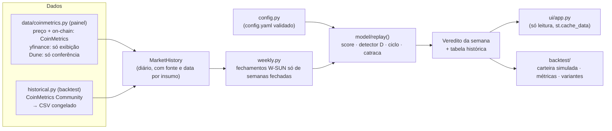

# BitSignal — Modelo de Ciclo Unificado e Painel Só de Leitura

*   **Author:** @burizinho
*   **Status:** Proposed
*   **Date:** 2026-11-08
*   **Predecessor:** [concepts_brief.md](concepts_brief.md)

> **Reconciliação com o brief (2026-11-08):** este documento mantém as 11 divergências em relação ao [concepts_brief.md](concepts_brief.md): faixas de venda, detector D, compras, rejeição da escada por ATH, reinício, reserva, fonte on-chain, fonte de preço, critério de sucesso, linha do painel e janela 2019+. Todas foram decididas nas Q1–Q9 e na escolha da fonte de preço. O brief fica como registro histórico das premissas iniciais.
>
> **Manter não é validar.** Os componentes estão em três situações:
>
> | Situação | Itens |
> |---|---|
> | **Aprovado** (decisão de projeto) | Arquitetura sem estado; fontes CoinMetrics / Dune / yfinance; teto de 50% compartilhado e catraca; reinício em duas etapas; reserva não renovável; política de dados ausentes; critérios e benchmarks da Q1 |
> | **Hipótese experimental** (implementar parametrizado; não apresentar como comprovado) | Escada C 5/15/30%; níveis 10/25/50% do detector D e critérios de agravamento (Q5b); DCA 2%/4%; normalização D2 |
> | **Pendência técnica** (critério de aceite antes de publicar) | Destino da sobra de caixa (Q9); testes de indisponibilidade e cobertura da CoinMetrics; restrição de uso comercial (CC BY-NC) até haver licença; testes técnicos de replay (sem informação futura, paridade, saldos) |

--------------------------------------------------------------------------------

## Overview

O BitSignal é um painel Streamlit publicado no Streamlit Community Cloud. Ele mostra em que fase do ciclo macro o Bitcoin está e quanto comprar ou vender naquela semana. O único usuário é o dono do projeto. Ele só olha o painel e executa as operações por conta própria, registrando tudo numa planilha externa.

Este design faz quatro mudanças:

1. Troca os dois sistemas de decisão que hoje coexistem por um único modelo de ciclo. Os dois sistemas atuais são o Composite Score 0–100 e os degraus por distância do ATH com trailing stops.
2. Corrige os erros de cálculo que hoje distorcem o score.
3. Substitui o backtest atual, que usa dados sintéticos e números fixos, por um backtest com histórico real desde 2010.
4. Remove do código os alertas, o registro de transações e o cálculo de imposto, que o usuário não usa.

O modelo continua sendo uma ferramenta de leitura. O app não executa ordens nem guarda o saldo do usuário.

## The Problem

**O painel pode mostrar ordens que se contradizem, e o número em que ele se baseia está errado.**

- **Dois sistemas que não conversam.** A aba "Sentinela" mostra o Composite Score com faixas de venda em 80/85/90. A aba "Plano Nacional" manda comprar ou vender só pela distância do preço até um ATH fixo de US$ 126 mil. O score não participa dessa decisão. Os trailing stops podem mandar vender 80% da posição enquanto os degraus de compra mandam comprar (`strategy/trailing_stops.py`, `strategy/weekly_evaluator.py`). Há três tetos de venda diferentes no código e na tela: 40%, ~58–80% e 75%.
- **O score está distorcido por erros de cálculo:**
  - O Pi Cycle Bottom está com a comparação invertida (`engine/indicators.py:44`). Desde 2019 ele marca "fundo" em 75% dos dias; a fórmula certa marca 13%. Isso trava 15% do peso do score em 0.
  - Candles diários e semanais ainda abertos entram no cálculo.
  - O `config.yaml` não é lido pelo motor do score.
  - Os valores fixos de reserva (MVRV 2,10, Puell 1,05, câmbio R$ 5,80) aparecem como dado real, com a data de agora. Por isso a checagem de dado velho nunca dispara.
- **Não há como saber se o modelo funciona.** O backtest atual deriva MVRV e Puell do próprio preço, fixa a redução de drawdown em 35% e o número de falsos positivos em 0, e não tem histórico suficiente para 2017. Um teste rápido com dados reais da CoinMetrics (seção 4.1 do brief) mostrou duas coisas:
  - O score acerta a direção: passa de 90 em 2017 e em abril/2021 e cai abaixo de 20 em 2022.
  - Mas ele chega a 80 entre 200 e 300 dias antes do pico, a 7–47% do preço do pico, e não vê o topo de novembro/2021 (máximo 65,5). Do jeito que está, as faixas de venda venderiam cedo demais.
- **O app em produção gasta recursos sem necessidade.** Depois da primeira hora, cada visita roda o pipeline inteiro de novo, porque o upsert não atualiza `created_at`. O SQLite é apagado a cada reinício do Streamlit Cloud, e a Binance tende a ser bloqueada nos servidores dos EUA.

**Proposta, em uma frase:** uma função pura recebe o histórico de mercado e devolve fase, faixa e ação em percentuais. Ela é calibrada e validada por um backtest honesto sobre dados da CoinMetrics, e o painel só a exibe.

## Goals

*   **G1 — Um modelo só.** Uma função sem estado, `avaliar(historico) -> Veredito`, usada pelo painel e pelo backtest. Os módulos de degraus por ATH, trailing stops e o gauge com constantes próprias deixam de decidir qualquer coisa.
*   **G2 — Cálculo correto e rastreável.**
    *   Pi Cycle corrigido, com teste de tabela-verdade.
    *   Só candles fechados entram no cálculo.
    *   Todos os pesos, limites e faixas vêm de um único arquivo de configuração validado na carga.
    *   Cada insumo do painel mostra a fonte e a data real do dado.
*   **G3 — Backtest honesto e reproduzível.**
    *   Usa um CSV congelado da CoinMetrics Community (2010-07-18 em diante).
    *   Sem dado sintético e sem preencher valores ausentes com 50.
    *   Critério de acerto definido antes de rodar.
    *   Simulação real da carteira.
    *   Walk-forward: calibra até 2017 e testa 2021 e 2022 fora da amostra.
    *   Teste de sensibilidade de ±5 pontos nos limiares.
*   **G4 — Critério de sucesso mensurável (Q1).** A estratégia completa cumpre, ao mesmo tempo:
    *   patrimônio final ≥ 90% do comprar e segurar;
    *   queda máxima do patrimônio ≥ 10 p.p. menor;
    *   patrimônio final ≥ ao do DCA uniforme completo.

    Os eventos de 2017, 2021, 2022 e 2025 aparecem como diagnóstico (volumes, preços médios, falsos positivos). O objetivo é a relação entre patrimônio e risco de queda profunda, não acertar topos e fundos exatos.
*   **G5 — Painel só de leitura e honesto.**
    *   Uma linha de ação no topo: fase, faixa, % a comprar ou vender e o motivo.
    *   Insumos com selo de origem.
    *   Veredito marcado como "indicativo" quando algum insumo é estimado.
    *   Interface toda em português.
*   **G6 — Custo previsível no Streamlit Cloud.**
    *   Dados em cache por tempo (`st.cache_data`) e nenhuma escrita em disco.
    *   O estado do modelo (fase, ATH corrente, degraus atingidos) é recalculado a partir do histórico a cada carga.
*   **G7 — Menos código.** Remover alertas, registro de transações, imposto e runbook bancário, sem quebrar o painel em nenhum commit intermediário.

## Non-Goals

*   Alertas por Telegram ou qualquer outro canal.
*   Registrar compras e vendas, calcular saldo, custo médio, DARF ou instruções de PIX. O usuário mantém isso numa planilha.
*   Qualquer análise de imposto, inclusive no backtest. O backtest mede resultado bruto em BTC e em USD (decidido em 2026-11-08).
*   Manter o Dune como fonte do modelo. Pela Q7, a CoinMetrics Community alimenta painel e backtest, e o Dune fica só como conferência.
*   Persistir dados no servidor: sem SQLite e sem banco externo.
*   Otimizar as faixas para maximizar o retorno passado. Os limiares são congelados antes do teste fora da amostra.
*   Executar ordens em corretoras.
*   Aconselhamento financeiro. O app aplica regras definidas pelo usuário e mostra como elas teriam se comportado no passado.

## Open Questions

*   **Q1 — Critério de sucesso. Decidido em 2026-11-08:** opção 1, carteira inteira contra benchmarks.
    *   **Comparação.** A estratégia completa (escada C, detector D, DCA pelo score) é comparada com dois benchmarks:
        *   **Comprar e segurar:** todo o capital inicial (BTC + reserva-base) convertido em BTC na data inicial.
        *   **DCA uniforme completo:** as mesmas vendas C+D, com compras B e a mesma política de caixa.

        Em todos os casos: mesmo capital inicial, mesmos preços de execução, sem novos aportes, resultado bruto, patrimônio marcado a mercado (BTC + caixa).
    *   **Aprovação histórica.** As três condições são cumulativas, e nenhuma pode ser trocada ou priorizada depois:
        1. Patrimônio final em USD ≥ 90% do comprar e segurar.
        2. Queda máxima do patrimônio pelo menos 10 p.p. menor que a do comprar e segurar.
        3. Patrimônio final em USD ≥ ao do DCA uniforme completo.
    *   **Diagnósticos obrigatórios, que não decidem a aprovação:**
        *   por evento (nov/2021, 2022, pós-topo de 2025): % vendido ou comprado, preço médio ponderado e custo de oportunidade;
        *   falsos positivos;
        *   uso da reserva.
    *   **Janela contaminada.** 2019 até a data de congelamento é **validação histórica de desenvolvimento, não amostra independente**: maio e novembro/2021, 2024–25 e 2018–26 influenciaram D, o armamento e a escada de compras.
    *   **Publicação.** Quatro situações:

        | Situação | Decisão |
        |---|---|
        | Replay incorreto, uso de informação futura ou caixa fictício | Não publicar |
        | Replay correto, critérios financeiros não atingidos | Painel experimental, sem alegação de estratégia validada |
        | Replay correto e os três critérios atingidos | "Desempenho histórico aprovado", com ressalva e sem promessa de rentabilidade |
        | Parâmetros e código congelados, acompanhados com dados futuros | Evidência independente |

    *   **Limites fixos.** Os limites 90% / 10 p.p. / 100% são política de risco, não números otimizados, e não podem mudar depois de rodar o teste.
    *   **Antes do teste definitivo.** Fechar a severidade de D (Q5b) e o destino da sobra de caixa (Q9).
    *   **Objetivo do projeto.** Melhorar a relação entre patrimônio acumulado e risco de perdas profundas, não acertar topos e fundos exatos.
*   **Q2 — Base das porcentagens, teto e piso. Decidido em 2026-11-08:**
    *   **Piso e teto.** O piso é de 50% da posição em BTC no início do ciclo. A venda acumulada tem teto de 50%, compartilhado pelos dois mecanismos, sem cota exclusiva para nenhum deles.
    *   **Fórmula.** A meta de venda é `V_alvo = min(50%, max(V_C, V_D))`. Vale o sinal mais severo; os sinais não se somam.
    *   **Catraca.** `V_alvo` só sobe dentro de um ciclo. Uma melhora temporária dos indicadores não devolve capacidade de venda. A capacidade só volta no reinício de ciclo (Q3).
    *   **Recompra.** Não há recompra automática na versão inicial.
    *   **Backtest.** Guarda o estado simulado das vendas em cada execução.
    *   **Painel.** Mostra a **exposição-alvo** (ex.: "manter 70% da posição do início do ciclo"), não uma ordem incremental, porque não conhece as operações reais.
    *   **Sensibilidade.** Os pisos de 40% e 60% rodam no backtest como comparação. O padrão é 50%.
    *   **Compras.** Em % de uma reserva-base da campanha, que não renova a cada ciclo (alterado pela Q9).
*   **Q3 — ATH corrente e reinício de ciclo. Decidido em 2026-11-08:** o reinício acontece em duas etapas, sobre fechamentos semanais.
    *   **Armar.** Score ≤ 20 em 2 fechamentos seguidos arma um reinício pendente. A catraca, a posição-base e o ATH não mudam. As compras seguem as regras normais.
    *   **Efetivar.** Score ≥ 30 em 2 fechamentos seguidos, com o detector D desligado, efetiva o novo ciclo: zera a catraca, define a nova posição-base (`cycle_start_btc`), libera um novo teto de 50% e gera um novo `cycle_id`.
    *   **ATH.** `reference_ath_usd` é o máximo histórico do preço até a data (`cummax`). Ele nunca é zerado no reinício.
    *   **Piso por ciclo.** O piso de 50% vale por ciclo, não para sempre. Exemplo: 1 BTC → 0,5 → 0,25 após dois ciclos, sem compras. O painel precisa deixar isso explícito.
    *   **Ciclo no painel.** O painel mostra "ciclo iniciado em dd/mm/aaaa", para o usuário achar a posição-base na planilha dele.
    *   **Calibração.** Os limiares 20/30 e as 2 semanas são fixados antes da avaliação fora da amostra.
    *   **Teste.** O backtest mede reinícios falsos, com atenção a março/2020 e maio/2021. A opção "queda de 60% do ATH" roda como concorrente independente, não como condição extra.
*   **Q4 — Precedência entre sinais.** A fase do score sempre manda, e a saída por tendência só vale dentro da fase DISTRIBUIR?
*   **Q5 — Recalibração da normalização. Decidido em 2026-11-08:**
    *   Manter a normalização atual como referência.
    *   O percentil histórico (A) foi descartado.
    *   Os limites altos (B) ficam só como concorrente no backtest.
    *   A configuração provisória é a escada de venda deslocada para cima (C).
    *   O experimento prioritário é **C contra C + detector de reversão independente (D)**: o score mede valuation, o detector mede perda de tendência, e uma coisa não depende da outra.
    *   Uma normalização híbrida com adaptação lenta e limitada (D2) será avaliada separadamente, sem misturar com mudanças nas regras de execução.
    *   Métrica principal: resultado da estratégia inteira, não o primeiro cruzamento de cada nível.
*   **Q5a — Armamento do detector de reversão. Decidido em 2026-11-08:** opção A, armamento por novo ATH histórico nos últimos 52 fechamentos semanais.
    *   **Independência.** D não depende do score, para conseguir agir em ciclos com indicadores on-chain mais baixos. No teste, foi a única regra que pegou o pós-topo de 2025.
    *   **Disparo.** 2 fechamentos semanais seguidos abaixo da SMA30w, com o preço a ≥ 20% abaixo da máxima de 52 semanas.
    *   **Severidade progressiva.** O primeiro disparo não leva direto ao teto. As metas sobem por degraus de severidade, por exemplo 10% → 25% → 50% (ver Q5b).
    *   **Episódios.** Um disparo contínuo não gera vendas repetidas; só uma mudança para um nível mais severo eleva a meta. Um ATH novo pode abrir um novo episódio de detecção, mas não reinicia a catraca. Só o reinício da Q3 renova a capacidade de venda.
    *   **Custo dos falsos positivos.** Vendas falsas pequenas também consomem o orçamento de venda do ciclo. No teste, 2024-09 e 2025-03/04 teriam gastado parte dos 50% antes do topo real.
    *   **Referências.** B (score ≥ 60 em 26 semanas) e C (score > 35) ficam como comparação no backtest.
    *   **Atraso conhecido.** O primeiro disparo veio com −57% em 2018 e −38% em jan/2022. Um experimento separado compara SMA20w e SMA30w e diferentes confirmações, sem escolher pelo melhor ajuste.
*   **Q5b — Severidade do detector.** Como distinguir correção de mercado de baixa para decidir 10%, 25% ou 50%? Vai ser resolvida por experimento (ver Plano Técnico, §7). Casos de falso positivo: mai/2021 e set/2024. Casos de proteção: 2018, jan/2022 e nov/2025.
*   **Q6 — Insumo ausente. Decidido em 2026-11-08:** congelar quando falta dado; recalcular com aviso quando o dado volta.
    *   **Insumo essencial ausente.** Se faltar MVRV ou Puell, ou mais de 20% do peso, o score fica indisponível para novas decisões. A escada C e as confirmações de reinício da Q3 ficam suspensas. O painel mostra o último score válido, marcado como desatualizado. O detector D continua, se os insumos dele (só preço) forem válidos.
    *   **Valor fixo de reserva.** MVRV 2,10 e Puell 1,05 contam como **ausentes**. Não há renormalização de pesos nem 50 fictício.
    *   **Ausência secundária.** Calcula-se o intervalo possível do score (insumos ausentes em 0 e em 100). Uma decisão só sai se o intervalo inteiro confirmar o limiar. Para as vendas em 85–93, isso quase equivale a congelar; o intervalo é útil nas confirmações de reinício (≤ 20, ≥ 30).
    *   **Dado recuperado.** O `replay()` integral roda de novo sobre o histórico disponível, sem persistência. Sinais históricos recuperados entram na catraca e nos ciclos. A venda real acontece sempre no presente.
    *   **Aviso honesto.** O painel não afirma que a meta mudou em relação ao carregamento anterior, porque não guarda essa comparação. Ele mostra:
        *   a hora do recálculo;
        *   os eventos que determinam a meta atual;
        *   o aviso de que dados recuperados ou revisados podem alterar a reconstrução, inclusive para baixo, se os ciclos reconstruídos mudarem.
    *   **Backtest.** Aplica as mesmas regras e pode simular a indisponibilidade de dados.
*   **Q7 — Fonte on-chain do painel. Decidido em 2026-11-08:** a CoinMetrics Community é a fonte on-chain única do modelo (painel e backtest). O Dune serve só para conferência.
    *   **Motivo.** O `replay()` precisa de séries diárias completas e coerentes desde ~2011, e o código atual consome só a última linha do Dune ([ingestion.py:216](bitsignal/ingestion.py:216)). A consistência do histórico prevalece sobre a preferência original pelo Dune.
    *   **MVRV Z.** É calculado com a mesma fórmula do backtest a partir de `CapMrktCurUSD` e `CapMVRVCur`. `CapMVRVCur` é a razão MVRV, não o Z-score; `CapMVRVZ` não é usado.
    *   **Puell.** É `IssTotUSD / SMA365(IssTotUSD)`, com janela válida e sem preencher lacunas. As variantes `PuellMul*` não estão no plano gratuito (catálogo verificado em 2026-11-08).
    *   **Dune.** Quando configurado, o painel mostra os valores recentes do Dune ao lado dos da CoinMetrics, com alerta de divergência (métrica, data, magnitude). O Dune não altera o score, a catraca nem os reinícios. Sem chave do Dune, o modelo funciona normalmente.
    *   **Falha da CoinMetrics.** Vale a Q6: o score fica indisponível, sem valores fixos e sem dados isolados do Dune. O detector D continua.
    *   **Teste obrigatório antes da implantação.** Confirmar no catálogo que as 5 séries continuam no plano Community. A licença Community é CC BY-NC (uso não comercial) e precisa ser reavaliada se o app for monetizado.
    *   **Futuro.** Se a query do Dune devolver o histórico completo com metodologia equivalente, ele pode virar fonte histórica alternativa. Fora de escopo agora.
*   **Q9 — Escada de compras. Decidido em 2026-11-08 (provisório):** opção C, DCA proporcional ao score, só na fase ACUMULAR.
    *   **Compras semanais.** Sobre a **reserva-base** da campanha, depois do fechamento semanal que confirmou o sinal:

        | Score semanal | Compra na semana |
        |---|---|
        | > 20 | 0% |
        | 10 < score ≤ 20 | 2% |
        | ≤ 10 | 4% |

    *   **Base e limite.** Os percentuais são fixos sobre a reserva-base, não sobre o saldo, e nenhuma compra passa do caixa disponível.
    *   **Reserva não renova.** O reinício de ciclo da Q3 não recompõe a reserva em USD. Ele renova só a capacidade de venda e a posição-base em BTC. O caixa só aumenta com novas entradas declaradas ou com o produto das vendas.
    *   **Benchmark.** B (DCA uniforme) roda como benchmark obrigatório. A (escada por queda) foi descartada: os gatilhos de −50% e −70% já estão atingidos quando a fase ACUMULAR começa.
    *   **Teste que motivou a escolha.** Preço médio como múltiplo do fundo, com cada fase partindo de reserva cheia: 2018: 1,36×; 2022: 1,30×; atual: 1,17×. Esses números precisam ser refeitos com a reserva não renovável.
    *   **Sobra ao fim da fase: em aberto (experimento).** As variantes são comprar todo o restante quando o reinício efetiva, ou manter a sobra para fases futuras. A comparação usa a carteira inteira (BTC, caixa, patrimônio em USD nas mesmas datas, mesmo capital inicial), não o preço médio.
    *   **Painel.** Mostra a compra da semana em % da reserva-base ("comprar 2% da sua reserva-base"). Não presume saldo.
*   **Q8 — Bug de página em branco.** Confirmar no app publicado se o `import` em `streamlit_app.py:22` deixa a página vazia depois da primeira interação.

## Critical User Journeys (CUJs)

### CUJ 1: Consultar a ação da semana

*   **Given**:
    *   O painel está publicado no Streamlit Cloud.
    *   O último fechamento semanal (domingo, W-SUN) já ocorreu.
    *   As fontes de preço e on-chain respondem.
*   **When**: O usuário abre o painel.
*   **Then**:
    *   Em até ~10 s na partida a frio, e em menos de 2 s com cache, o topo mostra uma linha como "Semana fechada em dd/mm: FASE · faixa · COMPRAR X% da reserva / VENDER Y% da posição / NADA — motivo".
    *   Logo abaixo aparecem o score, os seis insumos com fonte e data, e o percentual acumulado no ciclo (por exemplo, "vendido até aqui: 20% de 50%").
    *   Nenhum valor em BTC ou em R$ é inventado.

### CUJ 2: Painel com dado degradado

*   **Given**: O Dune não respondeu, ou a chave não está configurada, e a reserva também falhou.
*   **When**: O usuário abre o painel.
*   **Then**:
    *   O insumo afetado aparece com o selo "ausente" ou "estimado".
    *   O veredito aparece como "indicativo", seguindo a política decidida em Q6.
    *   Nenhum valor fixo é mostrado como real.
    *   O painel não trava e mostra o último valor bom em cache, com a idade dele.

### CUJ 3: Validar o modelo no backtest

*   **Given**: O CSV congelado da CoinMetrics está versionado em `data/historical/`, e as definições de acerto estão registradas no config.
*   **When**: O usuário roda `bitsignal backtest`, ou abre a aba de backtest no painel.
*   **Then**:
    *   Para 2017, 2021 e 2022, aparecem: acerto sim/não, data do primeiro sinal, antecedência, preço médio de venda ou compra relativo ao extremo, % vendido ou comprado até o extremo, e falsos positivos.
    *   Aparece um gráfico de preço em escala log com as fases sombreadas.
    *   Aparecem também o resultado com limiares a ±5 pontos e a comparação com a variante mínima.
    *   Nada é buscado na rede.

### CUJ 4: Ajustar uma faixa

*   **Given**: O usuário quer mudar um limiar, por exemplo o primeiro degrau de venda de 85 para 87.
*   **When**: Ele edita só o bloco `bands:` do config e roda o backtest.
*   **Then**:
    *   Painel e backtest passam a usar o novo valor, sem nenhuma constante duplicada em outro arquivo.
    *   Um config inválido falha na carga com uma mensagem que diz qual campo está errado, por exemplo pesos que não somam 1 ou faixas fora de ordem.

## Technical Plan (Architecture)

### 1. Visão geral

O sistema passa a ter três camadas, sem estado persistente:

1. **Dados** buscam o histórico de mercado e devolvem um único `MarketHistory`. Cada insumo traz a fonte e a data real do dado.
2. **Modelo** é uma função pura que recebe `MarketHistory` + `Config` e devolve, para cada fechamento semanal, o score, o estado do detector, o estado do ciclo e a recomendação. O painel usa a última linha; o backtest usa todas.
3. **Apresentação** (painel Streamlit e comando `bitsignal backtest`) só lê o resultado do modelo.



### 2. Dados

*   **Painel (`MarketHistory` ao vivo):**
    *   **Preço do modelo (decidido em 2026-11-08):** a fonte é **exclusivamente** o `PriceUSD` diário da CoinMetrics Community, a mesma série do backtest. Ela alimenta SMAs, RSI, Pi Cycle, drawdown, ATH, o detector D, os ciclos, a catraca e a execução simulada. A Binance sai do código.
    *   **Preço exibido:** o yfinance só mostra o "preço agora" no painel, com selo de fonte. Ele não entra em nenhum cálculo e não substitui a CoinMetrics se ela falhar. Nesse caso vale a Q6: score e detector ficam indisponíveis.
    *   **On-chain (Q7):** `CapMrktCurUSD`, `CapMVRVCur` e `IssTotUSD` vêm da CoinMetrics Community, em série completa desde 2010, buscados com cache de 6 h e respeitando o limite de 10 requisições a cada 6 s. O Dune, se configurado, é buscado só para a tabela de conferência.
    *   **Hashrate:** vem do Mempool.space, como hoje, protegido por try. Se falhar, vira um insumo ausente.
    *   **Fonte e data:** cada série carrega `source` (ex.: `dune`, `yfinance`, `fixed_fallback`) e `as_of` (data do último ponto real), nunca `now()`.
*   **Backtest:** usa o CSV congelado `data/historical/btc_coinmetrics.csv`, com `PriceUSD`, `CapMrktCurUSD`, `CapMVRVCur`, `IssTotUSD` e `HashRate`, desde 2010-07-18. Um comando gera o CSV (`bitsignal fetch-history`); o backtest e os testes nunca acessam a rede.
*   **Derivações comuns** (mesma função para as duas fontes):
    *   realized cap = `CapMrktCurUSD / CapMVRVCur`;
    *   MVRV Z = (MC − RC) / desvio-padrão expansivo de MC;
    *   Puell = `IssTotUSD` / média de 365 dias;
    *   Hash Ribbon = SMA30 / SMA60 do hashrate.

    Painel e backtest usam a mesma fonte e as mesmas funções. O teste de paridade confere que as datas de fechamento, a agregação semanal e as fórmulas são idênticas nos dois caminhos.

### 3. Cadência e semanas fechadas

*   O modelo decide **uma vez por semana**, no fechamento de domingo (W-SUN, UTC).
*   **Quando a semana conta:**
    *   Na CoinMetrics, a linha com `time = D 00:00Z` representa o fechamento do dia UTC D: o rótulo marca o início do intervalo.
    *   Uma semana W-SUN só entra no modelo quando a linha do domingo dela existe para **todas** as séries usadas. Em geral isso acontece na segunda-feira, por causa da defasagem de ~1 dia.
    *   Até lá, o modelo usa a semana anterior. Nenhuma decisão usa uma semana incompleta.
*   **Aquecimento:** o replay começa em 2010-07-18, mas cada indicador só fica válido depois de completar a janela dele: SMA200w ≈ 200 semanas, SMA471d, MVRV Z com desvio expansivo de pelo menos 2 anos, Puell com 365 dias. Antes disso, o insumo conta como ausente pela Q6, e o score não decide nada.
*   **Indicadores diários:** as SMAs do Pi Cycle (111/350/471 dias, EMA150) e a SMA200w são calculadas em base diária ou semanal e amostradas no fechamento da semana.
*   **RSI:** o RSI(14) é semanal, sobre fechamentos semanais.
*   **Mesma regra para os dois lados:** painel e backtest usam o mesmo código. Hoje o backtest usa RSI(98) diário e SMA(1400), e isso acaba.

### 4. Score de valuation (V_C)

*   **Composição:** seis insumos, com os pesos e limites atuais lidos do config (normalização atual mantida, Q5). O Pi Cycle Bottom é corrigido para `EMA150 < SMA471 × 0,745`.
*   **Escada de venda C** (provisória, Q5). Os valores são metas acumuladas de venda sobre a posição-base do ciclo:

| Score semanal | V_C acumulado |
|---|---|
| ≥ 85 | 5% |
| ≥ 90 | 15% |
| ≥ 93 | 30% |

*   **Catraca:** cada degrau só sobe dentro do ciclo.
*   **Insumo ausente (Q6):** o score de cada semana tem três estados: `ok`, `intervalo` (ausência secundária, com score_min e score_max) ou `indisponível` (falta MVRV ou Puell, ou mais de 20% do peso; valores fixos de reserva contam como ausentes).
    *   **Escada C:** só sobe se `score_min` ≥ limiar.
    *   **Armar o reinício:** exige `score_max` ≤ 20.
    *   **Efetivar o reinício:** exige `score_min` ≥ 30.
    *   **Score indisponível:** o score não decide nada.

### 5. Detector de reversão (V_D)

*   **Armado** quando houve um novo ATH histórico (máximo de `cummax` do fechamento semanal) nos últimos 52 fechamentos.
*   **Disparo (nível 1):** 2 fechamentos seguidos abaixo da SMA30w, com o preço ≤ 80% da máxima de 52 semanas.
*   **Níveis 2 e 3:** são critérios de agravamento definidos pelo experimento da Q5b. Metas iniciais para teste: nível 1 = 10%, nível 2 = 25%, nível 3 = 50%. Os candidatos a critério de agravamento, todos avaliados no walk-forward, são:
    *   fechamento semanal abaixo da SMA50w por 2 semanas;
    *   drawdown ≥ 35% / ≥ 50% da máxima de 52 semanas;
    *   SMA30w com inclinação negativa por N semanas.
*   **Episódios:** um episódio é a sequência de semanas desde o primeiro disparo até o preço voltar acima da SMA30w por 2 semanas. Dentro do episódio, V_D só sobe. Um episódio novo só abre depois de um ATH novo.

### 6. Ciclo, catraca e reinício (Q2, Q3)

Estado reconstruído semana a semana pelo `replay()`. Nada é gravado.

```text
estado do ciclo
  cycle_id, cycle_start_date
  ratchet_sell        # V_alvo atingido no ciclo (só sobe)
  reset_pending       # armado por score <= 20 em 2 semanas
  reference_ath_usd   # cummax do preço; nunca zera

a cada fechamento semanal t:
  V_C = escada(score_t)              ; V_D = nivel_detector_t
  ratchet_sell = min(50%, max(ratchet_sell, V_C, V_D))
  se score <= 20 por 2 semanas: reset_pending = True
  se reset_pending e score >= 30 por 2 semanas e detector desligado:
      novo ciclo -> ratchet_sell = 0, cycle_id += 1,
                    cycle_start_date = t ; reset_pending = False
      (a reserva de compras NÃO é recomposta)
  compra da semana (só se reset_pending):
      2% da reserva-base se 10 < score <= 20 ; 4% se score <= 10
      (no backtest, limitado ao caixa simulado)
```

*   **Log de eventos:** o `replay()` devolve, além do estado por semana, um log reconstruído em memória dos eventos que levaram à meta atual: data, indicador ou mecanismo, limiar cruzado, mudança da catraca, reinício de ciclo e semanas com score indisponível. Nada é gravado; o log é recalculado a cada carga.
*   **Precedência compra × venda:** enquanto `reset_pending` estiver ligado (fase ACUMULAR), o detector D não pode elevar a meta de venda. Venda e compra nunca aparecem na mesma semana. Hoje o STOP_2 manda vender enquanto o C0 manda comprar; essa regra elimina esse conflito.
*   **Fase exibida:**
    *   ACUMULAR se `reset_pending`;
    *   DISTRIBUIR se `ratchet_sell > 0` no ciclo;
    *   MANTER nos outros casos.
*   **Compras (Q9):** DCA proporcional ao score, só na fase ACUMULAR, em % fixo da reserva-base. O reinício de ciclo não recompõe a reserva. O destino da sobra ao fim da fase é decidido por experimento (§7).

### 7. Backtest

*   **Carteira simulada:**
    *   Começa com 1 BTC e uma reserva-base em USD (padrão: valor equivalente a 0,5 BTC no início da avaliação).
    *   Saldos de BTC e caixa são reconstruídos em ordem cronológica.
    *   O produto das vendas entra no caixa; a reserva não é recomposta por reinício.
    *   As metas do `replay()` são executadas no fechamento da semana do sinal, com custo de 0,3% por operação.
    *   Sem imposto (Não-objetivo). O caixa não rende.
*   **Benchmarks e variantes da Q9:**
    *   comprar e segurar;
    *   DCA uniforme (B);
    *   C comprando toda a sobra no reinício;
    *   C mantendo a sobra.
*   **Saídas por variante e por ciclo:**
    *   preço médio ponderado de venda como % do pico seguinte;
    *   preço médio de compra como múltiplo do fundo;
    *   % da posição vendida antes de o preço subir mais 50%, que mede a venda prematura;
    *   drawdown máximo do patrimônio em USD;
    *   BTC final e USD final comparados com comprar e segurar;
    *   número de episódios de venda falsa e o custo de cada um em BTC;
    *   reinícios falsos.
*   **Variantes, rodando lado a lado:**
    *   C;
    *   C + D (armamento A);
    *   C + D com armamento B e com armamento C;
    *   normalização B;
    *   D2 isolada;
    *   pisos de 40% / 50% / 60%;
    *   reinício por queda de 60%;
    *   SMA20w e SMA30w no detector;
    *   limiares a ±5 pontos.
*   **Janelas:**
    *   **Calibração:** até 2018-12-31 (topos de 2013 e 2017, fundos de 2015 e 2018).
    *   **Validação histórica de desenvolvimento:** de 2019-01-01 até a data de congelamento. Os parâmetros ficam congelados num arquivo versionado antes de rodar. Esta janela não é amostra independente (Q1).
    *   **Validação prospectiva:** semanas posteriores ao congelamento, acompanhadas com os mesmos parâmetros.
*   **Aprovação:** os três critérios cumulativos da Q1, calculados sobre o patrimônio marcado a mercado contra comprar e segurar e contra DCA uniforme completo. O relatório imprime APROVADO / NÃO APROVADO por critério, sem nota agregada.

### 8. Painel

*   **Linha do topo:** "Semana fechada em dd/mm · FASE · Exposição-alvo: manter X% da posição do início do ciclo (dd/mm/aaaa) · Compras: Y% da reserva do ciclo · motivo".
*   **Abaixo da linha:**
    *   score e os seis insumos, com selo de fonte e data;
    *   estado do detector (desarmado / armado / nível 1–3);
    *   histórico do ciclo atual;
    *   log de eventos que determinam a meta, com a hora do recálculo e o aviso "dados históricos recuperados ou revisados podem alterar esta reconstrução";
    *   aba de backtest lendo um resultado pré-calculado do CSV congelado.
*   **Cache e disco:** `st.cache_data` com ttl de 6 h para a série da CoinMetrics (preço + on-chain) e de 15 min para o preço exibido do yfinance. Nenhuma escrita em disco, e o SQLite sai.
*   **Bug da página em branco (Q8):** o `streamlit_app.py` passa a chamar uma função `main()` explícita em `ui/app.py`, em vez de depender do `import`.

## Alternatives Considered

Cada alternativa abaixo foi avaliada no brief ou nas decisões Q1–Q9 deste draft. As que ainda rodam no backtest como comparação estão marcadas.

### Arquitetura geral

#### A1: Manter os dois sistemas lado a lado (score + degraus por ATH com trailing stops)

*   **Pros**: Nenhuma mudança de modelo; o usuário já conhece as duas abas.
*   **Cons**:
    *   Gera ordens contraditórias: o STOP_2 manda vender 80% enquanto o C0 manda comprar.
    *   Há três tetos de venda diferentes (40%, ~58–80% e 75%).
    *   O ATH fixo envelhece.
*   **Reason for Rejection**: O usuário pediu um modelo único. Manter os dois preserva o conflito que motivou o projeto.

#### A2: Usar só o preço (fase por preço/SMA200w, compras e vendas por distância do ATH)

*   **Pros**: Poucos parâmetros; sem dependência de dados on-chain.
*   **Cons**:
    *   Não distingue topo de meio de alta.
    *   Os múltiplos de pico sobre o ATH anterior caem a cada ciclo (≈17× → 3,5× → 1,8×).
*   **Reason for Rejection**: Não é estável entre ciclos e descarta MVRV e Puell, que o usuário quer manter. Continua como variante mínima no backtest.

#### A3: Persistir estado (SQLite, banco externo ou CSV com commit semanal por GitHub Actions)

*   **Pros**: Permitiria retomar sinais só de forma prospectiva e mostrar "a meta mudou em relação à semana passada".
*   **Cons**:
    *   O disco do Streamlit Cloud é efêmero.
    *   Precisaria de um job agendado, de um token de escrita e de um segredo a mais.
    *   Todo o estado é derivável do histórico.
*   **Reason for Rejection**: O `replay()` integral e sem estado dá a mesma meta atual, com um aviso honesto de reconstrução (Q6).

### Score e normalização (Q5)

#### A4: Normalização por percentil histórico expansivo

*   **Pros**: Sem limites escolhidos a dedo; se adapta a ciclos menores.
*   **Cons**: No teste, vendeu ainda mais cedo (2017: 7% do pico no nível 75), nunca chegou a 93 e chegou a 76 no meio do ciclo (2023–26).
*   **Reason for Rejection**: Pior resultado nas vendas e mais ruído.

#### A5: Limites de topo mais altos (MVRV Z 7, preço/SMA200w 5, Puell 3,5, RSI 85)

*   **Pros**: Vendas finais mais perto do pico (2017: 83%; 2021: 77%); pouco ruído no meio do ciclo.
*   **Cons**:
    *   Os limites foram escolhidos olhando 2017 e 2021.
    *   Em novembro/2021 o score fica em 48.
    *   Se os picos continuarem caindo, o score pode nunca disparar.
*   **Reason for Rejection**: Alto risco de sobreajuste. Continua como concorrente no backtest.

#### A6: Normalização híbrida com adaptação lenta (D2)

*   **Pros**: Reduz a dependência de limites fixos sem a volatilidade dos percentis.
*   **Cons**: Estimar limites "a partir de ciclos encerrados" antes de 2021 é ajustar com dois pontos.
*   **Reason for Rejection**: Não entra como padrão. É avaliada isoladamente, sem misturar com as regras de execução.

#### A7: Usar um único score para valuation e para o momento da reversão

*   **Pros**: Um só mecanismo e menos parâmetros.
*   **Cons**: Nenhuma normalização viu o topo de novembro/2021 (máximo 48–69). O score mede quanto o mercado está esticado, não quando ele vira.
*   **Reason for Rejection**: Substituído por score C + detector D independente (Q5).

### Teto de venda e ciclo (Q2, Q3)

#### A8: Piso de 60% (teto de 40%) ou sem piso

*   **Pros**:
    *   **Piso de 60%:** protege mais contra falsos positivos.
    *   **Sem piso:** sai de verdade de um topo que o score não vê.
*   **Cons**:
    *   **Piso de 60%:** atravessa quedas de −77% com 60% da posição.
    *   **Sem piso:** um falso positivo do detector (ex.: maio/2021) liquida quase tudo e exige recompra.
*   **Reason for Rejection**: Ficou o piso de 50% com teto compartilhado `min(50%, max(V_C, V_D))`. Os pisos de 40% e 60% rodam como sensibilidade.

#### A9: Cotas de venda separadas (score 30%, detector 20%)

*   **Pros**: Cada mecanismo tem orçamento previsível.
*   **Cons**: Se o score não vê o topo, o detector fica limitado a 20%.
*   **Reason for Rejection**: Substituído pelo teto compartilhado.

#### A10: Reinício de ciclo por queda de 60% do ATH, ou por halving

*   **Pros**:
    *   **Queda de 60%:** só preço, fácil de explicar.
    *   **Halving:** determinístico e sem parâmetro.
*   **Cons**:
    *   **Queda de 60%:** o limiar separa por pouco maio/2021 (−53%) de 2022 (−77%).
    *   **Halving:** supõe que o mercado segue o halving; em 2024 o ATH veio antes dele.
*   **Reason for Rejection**: Ficou o reinício em duas etapas pelo score (Q3). A queda de 60% roda como concorrente.

### Detector de reversão (Q5a)

#### A11: Armar o detector por score ≥ 60 em 26 semanas, ou por score > 35

*   **Pros**:
    *   **Score ≥ 60:** nenhum falso positivo em 2019–2025.
    *   **Score > 35:** a regra mais simples.
*   **Cons**:
    *   **Score ≥ 60:** não viu o pós-topo de 2025, porque o score do ciclo ficou abaixo de 60.
    *   **Score > 35:** perde novembro/2021 e 2025.
*   **Reason for Rejection**: As duas tornam o detector dependente do score, o que anula o motivo de ele existir. Continuam como referência no backtest.

#### A12: Vender até o teto no primeiro disparo do detector

*   **Pros**: Proteção máxima numa reversão real.
*   **Cons**: Em maio/2021 teria vendido 50% a ~US$ 35 mil, antes de o preço subir 1,8×.
*   **Reason for Rejection**: Substituído por severidade progressiva (10% → 25% → 50%), com critérios definidos por experimento (Q5b).

### Compras (Q9)

#### A13: Escada por queda do ATH (brief: DCA + lotes em −50% e −70% + restante na SMA50w)

*   **Pros**: Melhor nos episódios curtos de 2019–2020.
*   **Cons**: Pior nas baixas principais (2018: 1,88×; 2022: 1,82× o fundo). Os gatilhos já estão atingidos quando a fase ACUMULAR começa.
*   **Reason for Rejection**: Gasta a reserva longe do fundo.

#### A14: DCA uniforme no tempo

*   **Pros**: Sem parâmetro de preço nem de score.
*   **Cons**: Sobra 46–77% da reserva nas fases curtas.
*   **Reason for Rejection**: Não é o padrão, mas é o benchmark obrigatório da Q1.

#### A15: Renovar a reserva de compras a cada reinício de ciclo

*   **Pros**: Simples de exibir ("% da reserva do ciclo").
*   **Cons**: Em 2018–2020 a Q3 gera três ciclos seguidos. A reserva seria gasta três vezes: dinheiro fictício.
*   **Reason for Rejection**: A reserva é da campanha e só cresce com aportes declarados ou com o produto das vendas.

### Dados (Q6, Q7)

#### A16: Renormalizar os pesos quando falta um insumo, ou usar 50 no lugar do insumo ausente

*   **Pros**: O score é sempre calculado.
*   **Cons**:
    *   **Renormalizar:** sem MVRV e Puell, o score vira um score de preço e pode subir a catraca de forma irreversível.
    *   **Usar 50:** esconde extremos.
*   **Reason for Rejection**: Substituído por congelar quando falta dado essencial e por intervalo de score quando a ausência é secundária.

#### A17: Dune como fonte primária do modelo (com ou sem CoinMetrics de reserva)

*   **Pros**: Respeita a instrução original de manter a fonte on-chain.
*   **Cons**:
    *   O código atual só consome a última linha do Dune.
    *   O `replay()` precisa de séries completas desde ~2011.
    *   Intercalar as fontes cria saltos perto dos limiares.
*   **Reason for Rejection**: CoinMetrics é a fonte única do modelo, e o Dune fica como conferência (Q7).

#### A18: Manter MVRV e Puell sintéticos derivados do preço no backtest

*   **Pros**: Não precisa de fonte on-chain histórica.
*   **Cons**: Conta a mesma variável três vezes e não testa o modelo que o painel usa.
*   **Reason for Rejection**: A CoinMetrics fornece as séries reais desde 2010.

### Critério de sucesso (Q1)

#### A19: Critério por evento (venda ≥ 75% do pico, compra ≤ 1,3× o fundo)

*   **Pros**: Fácil de auditar.
*   **Cons**: Premia bons preços com volume insignificante.
*   **Reason for Rejection**: Fica como diagnóstico obrigatório, não como critério de aprovação.

#### A20: Só relatório, sem aprovado/reprovado

*   **Pros**: Honesto sobre a amostra pequena.
*   **Cons**: A decisão de publicar fica sujeita à leitura posterior dos números.
*   **Reason for Rejection**: Risco de sobreajuste na interpretação.

### Fonte de preço

#### A21: yfinance (ou junção CoinMetrics + yfinance) como preço do modelo

*   **Pros**: Fechamento do mesmo dia; não depende de um único fornecedor.
*   **Cons**:
    *   O yfinance só tem dados a partir de 2014. O painel reconstruiria ciclos a partir de ~2018 e divergiria do backtest.
    *   Os fechamentos diferem do `PriceUSD` perto dos limiares.
    *   A junção intercala fontes, como na Q7.
*   **Reason for Rejection**: Fica a CoinMetrics `PriceUSD` como série única. O yfinance só exibe o preço atual.

### Escopo

#### A22: Publicar só o painel corrigido, sem backtest

*   **Pros**: É o caminho mais curto até o painel.
*   **Cons**: Mostraria metas de exposição sem nenhuma evidência histórica.
*   **Reason for Rejection**: Rejeitada só em parte. Um painel **experimental**, claramente identificado, pode ser publicado sem cumprir os três critérios financeiros da Q1. Mas para mostrar metas de exposição ele precisa passar nos testes técnicos de replay: sem informação futura e com paridade entre painel e backtest.

--------------------------------------------------------------------------------

## Non-Functional Requirements

*   **Desempenho:** a partida a frio busca ~6 mil linhas diárias da CoinMetrics em 1–2 páginas (`page_size=10000`), dentro do limite de 10 requisições a cada 6 s. O `replay()` é vetorizado, exceto pelo laço semanal da máquina de estados (~850 semanas), e deve rodar em < 1 s. Com cache, o painel abre em < 2 s.
*   **Segurança:** sem segredos obrigatórios. `DUNE_API_KEY` e `DUNE_QUERY_ID` são opcionais, só para a tabela de conferência. As variáveis do Telegram saem do `.env.example`.
*   **Licença de dados:** CoinMetrics Community é CC BY-NC. O painel mostra a atribuição. Uso comercial exige reavaliar.
*   **Reversão:** cada etapa da implementação é um commit separado, e o painel continua funcionando depois de cada uma. Para voltar atrás, basta reverter o commit; não há migração de dados.

--------------------------------------------------------------------------------

## Detailed Implementation Plan

As etapas abaixo são commits separados, na ordem. O painel publicado continua funcionando depois de cada uma.

*   **S0** — Página em branco (Q8).
*   **S1** — Correções imediatas no código atual.
*   **S2** — Config único.
*   **S3** — Dados CoinMetrics + CSV congelado.
*   **S4** — Motor puro (`engine/`).
*   **S5** — Backtest.
*   **S6** — **Ponto de decisão do dono:** severidade de D (Q5b) e destino da sobra (Q9), depois congelar os parâmetros.
*   **S7** — Painel novo.
*   **S8** — Remover código morto.
*   **S9** — Dependências e docs.

### Target Files to Create/Modify

#### S0 — Página em branco

##### 1. `streamlit_app.py` (Modify)

*   **Type / Scope**: Entrypoint do Streamlit Cloud.
*   **Proposed Changes**: Trocar `import bitsignal.ui.app` por `from bitsignal.ui.app import main; main()`. No rerun, o `import` não executa o módulo de novo. Antes, confirmar o bug no app publicado clicando em "Atualizar".

##### 2. `bitsignal/ui/app.py` (Modify)

*   **Type / Scope**: Painel atual.
*   **Proposed Changes**: Envolver o corpo do módulo numa função `main()`, sem mudar o comportamento. O `st.set_page_config` passa a ser a primeira chamada dentro de `main()`.

#### S1 — Correções imediatas (código atual, ainda em produção)

##### 3. `bitsignal/engine/indicators.py` (Modify)

*   **Type / Scope**: Funções puras de indicadores.
*   **Proposed Changes**:
    *   `is_picycle_bottom_triggered` passa a ser `ema_150 < sma_471 * 0.745`.
    *   `calculate_200w_sma_ratio` devolve `NaN` quando `sma_200w <= 0`, em vez de 1,0.
    *   Novas funções puras: `mvrv_z(mc, mvrv_ratio)` (RC = MC / razão; Z = (MC − RC) / std expansivo de MC, `min_periods` = 730 dias), `puell(iss_usd)` (`iss / iss.rolling(365, min_periods=365).mean()`) e `hash_ribbon_state(hashrate)` (SMA30/60, retornando a série de estados).

##### 4. `tests/test_indicators.py` (Modify)

*   **Type / Scope**: Teste unitário.
*   **Proposed Changes**:
    *   Trocar a asserção que hoje confirma o comportamento errado (`:52-54`) por uma tabela-verdade do Pi Cycle Bottom: acima, abaixo e igual ao limite.
    *   Adicionar testes de `mvrv_z` (não usa o futuro: truncar a série em t não muda Z ≤ t), de `puell` (NaN nos primeiros 364 dias) e de `hash_ribbon_state`.

##### 5. `bitsignal/storage/db.py` (Modify)

*   **Type / Scope**: Paliativo temporário, removido em S8.
*   **Proposed Changes**: Os upserts de `daily_scores` e `daily_metrics` passam a fazer `created_at = CURRENT_TIMESTAMP`. Isso acaba com o pipeline rodando a cada visita até o painel novo entrar.

#### S2 — Config único

##### 6. `bitsignal/config.py` (Create)

*   **Type / Scope**: Módulo de configuração (pydantic v2).
*   **Proposed Changes**:
    *   `load_config(path: Path | None = None) -> Config`. O caminho padrão é `Path(__file__).resolve().parents[1] / "config" / "config.yaml"`. Um `apply_overrides(config, dict) -> Config` serve para as variantes.
    *   Modelos e validações:
        *   `ScoreConfig`: pesos por insumo, que precisam somar 1,0 ± 1e-9; limites `min`/`max` por insumo, com `max > min`; `essential = ["mvrv_z", "puell"]`; `max_missing_weight = 0.20`.
        *   `SellLadder`: lista de `(threshold, cumulative_pct)`, com limiares e percentuais estritamente crescentes.
        *   `DetectorConfig`: `arming` (`new_ath_52w` | `score_ge_60_26w` | `score_gt_35`), `trend_sma_weeks` (30), `confirm_weeks` (2), `drawdown_from_52w_high` (0,20) e `levels` (lista de `{pct, criterion}`, com os critérios candidatos de §5).
        *   `CapConfig`: `max_sell = 0.50`.
        *   `CycleConfig`: `arm_score = 20`, `arm_weeks = 2`, `confirm_score = 30`, `confirm_weeks = 2`, `reset_mode` (`score_two_stage` | `drawdown_60`).
        *   `BuyConfig`: `mode` (`score_dca` | `uniform`), `tiers [(20, 0.02), (10, 0.04)]`, `uniform_weekly = 1/52` e `leftover` (`buy_all_on_reset` | `keep`).
        *   `BacktestConfig`: `initial_btc = 1.0`, `reserve_btc_equiv = 0.5`, `fee = 0.003`, `calibration_end = 2018-12-31`, `criteria {equity_vs_bnh: 0.90, dd_improvement_pp: 10, equity_vs_uniform: 1.00}` e `events` (datas dos picos e fundos para os diagnósticos).
        *   `DataConfig`: URL da CoinMetrics, lista de métricas, `page_size`, ttl de cache e caminho do CSV congelado.
    *   Um config inválido gera `ConfigError` com o caminho do campo.

##### 7. `config/config.yaml` (Modify)

*   **Type / Scope**: Configuração.
*   **Proposed Changes**:
    *   Sai: `alerting`, `strategy`, `integrity` e `endpoints` (Binance, mempool, Dune execute, mirror do GitHub).
    *   Entram os blocos `score`, `sell_ladder`, `detector`, `cap`, `cycle`, `buys`, `backtest` e `data`, com os valores provisórios aprovados: escada 85/90/93 → 5/15/30%; detector A, SMA30w, 2 semanas, −20%, níveis 10/25/50%; teto de 50%; reinício 20/30 em 2 semanas; compras 2%/4%.
    *   Nesta etapa, o painel atual continua lendo as constantes antigas; o config novo só é usado pelo código das etapas S3+.

##### 8. `tests/test_config.py` (Create)

*   **Type / Scope**: Teste unitário.
*   **Proposed Changes**: O config versionado carrega sem erro. Pesos que não somam 1, escada fora de ordem e `max <= min` geram `ConfigError`. `apply_overrides` não altera o objeto original.

#### S3 — Dados

##### 9. `bitsignal/data/__init__.py` (Create)

*   **Type / Scope**: Pacote.
*   **Proposed Changes**: Exporta `fetch_coinmetrics`, `load_frozen_history` e `MarketHistory`.

##### 10. `bitsignal/data/coinmetrics.py` (Create)

*   **Type / Scope**: Cliente HTTP.
*   **Proposed Changes**:
    *   `fetch_coinmetrics(start="2010-07-18", session=None) -> pd.DataFrame` busca `PriceUSD`, `CapMrktCurUSD`, `CapMVRVCur`, `IssTotUSD` e `HashRate` com `page_size=10000`.
    *   Segue `next_page_url` até o fim, espera ≥ 0,6 s entre páginas e faz 3 tentativas com backoff em erro 5xx ou 429.
    *   O índice é `date` (UTC, sem hora), com o rótulo do intervalo mantido (linha D = fechamento do dia D).
    *   Valida as colunas e os tipos. Lança `DataUnavailable` com uma mensagem se faltar métrica (ex.: removida do plano Community).
    *   `check_catalog() -> dict[str, bool]` confere no `catalog-v2` se as 5 métricas continuam `community: true`.

##### 11. `bitsignal/data/history.py` (Create)

*   **Type / Scope**: Modelo de dados + derivações.
*   **Proposed Changes**:
    *   `@dataclass(frozen=True) MarketHistory`, com:
        *   `daily: pd.DataFrame` (price, mc, mvrv_ratio, iss_usd, hashrate);
        *   `source: str` (`coinmetrics_live` | `coinmetrics_frozen`);
        *   `as_of: date` (última linha completa);
        *   `fetched_at: datetime`.
    *   `load_frozen_history(path) -> MarketHistory` lê o CSV e o `.meta.json`.
    *   `derive_daily(history) -> pd.DataFrame` acrescenta `mvrv_z`, `puell`, `hash_state`, SMAs 111/350/471 e EMA150 usando `engine/indicators.py`. É a mesma função para o painel e para o backtest.

##### 12. `bitsignal/data/spot.py` (Create)

*   **Type / Scope**: Exibição.
*   **Proposed Changes**: `fetch_spot_usd() -> tuple[float, datetime] | None` usa o yfinance `BTC-USD` (último preço). Erros não são propagados. Só a UI importa este módulo.

##### 13. `bitsignal/data/dune.py` (Create)

*   **Type / Scope**: Conferência.
*   **Proposed Changes**:
    *   Move de `ingestion.py:206-228` a leitura de resultados do Dune: `fetch_dune_latest(api_key, query_id) -> dict | None`, devolvendo data, `mvrv_z` e `puell`.
    *   `compare_with(history_row, dune_row) -> list[Divergence]` alerta quando |ΔMVRV Z| > 0,3 ou |ΔPuell| > 0,1, só se as datas coincidirem.
    *   Nunca é usado pelo `engine/`.

##### 14. `data/historical/btc_coinmetrics.csv` e `data/historical/btc_coinmetrics.meta.json` (Create)

*   **Type / Scope**: Dados versionados.
*   **Proposed Changes**: São gerados por `bitsignal fetch-history`. O CSV tem colunas `date,price,mc,mvrv_ratio,iss_usd,hashrate`, de 2010-07-18 até a data da coleta (~600 KB). O `.meta.json` guarda `source_url`, `metrics`, `fetched_at`, `rows`, `last_date`, `license: "CC BY-NC 4.0"` e o sha256 do CSV.

##### 15. `tests/test_coinmetrics.py` (Create)

*   **Type / Scope**: Teste com HTTP simulado (`requests` mockado, sem rede).
*   **Proposed Changes**: Paginação com 2 páginas, métrica ausente gerando `DataUnavailable`, retry em 429 e conversão de tipos.

#### S4 — Motor puro

##### 16. `bitsignal/engine/weekly.py` (Create)

*   **Type / Scope**: Amostragem semanal.
*   **Proposed Changes**: `to_weekly(daily_derived) -> pd.DataFrame`:
    *   agrupa por W-SUN e só mantém semanas cujo domingo tem todas as colunas não nulas;
    *   calcula SMA30w, SMA50w, SMA200w, RSI(14) semanal, máxima de 52 semanas, `ath = cummax` e preço/SMA200w;
    *   amostra os indicadores diários no domingo.

##### 17. `bitsignal/engine/score.py` (Create; substitui `normalizer.py`)

*   **Type / Scope**: Score de valuation.
*   **Proposed Changes**:
    *   `normalize_linear(series, lo, hi)` devolve NaN para NaN, em vez de 50.
    *   `score_weekly(weekly, cfg) -> pd.DataFrame` com as colunas `score`, `score_min`, `score_max`, `status` (`ok` | `interval` | `unavailable`) e uma coluna de pontos por insumo.
    *   O status fica `unavailable` se faltar um insumo de `essential` ou mais de `max_missing_weight`.
    *   No status `interval`, os insumos ausentes entram como 0 e como 100.
    *   O Hash Ribbon usa o mapa de estados do config.

##### 18. `bitsignal/engine/detector.py` (Create)

*   **Type / Scope**: Detector de reversão.
*   **Proposed Changes**: `detect(weekly, score_df, cfg) -> pd.DataFrame` com as colunas `armed`, `triggered`, `episode_id`, `level` (0–3) e `v_d`.
    *   **Armamento** conforme `cfg.arming`.
    *   **Episódio:** abre no primeiro disparo armado e fecha com 2 fechamentos acima da SMA de tendência. Um episódio novo exige um ATH novo depois do fechamento do anterior.
    *   **Nível:** dentro do episódio só sobe, pelos critérios de `cfg.levels`.

##### 19. `bitsignal/engine/cycle.py` (Create)

*   **Type / Scope**: Máquina de estados (replay).
*   **Proposed Changes**:
    *   `replay(weekly, score_df, detector_df, cfg) -> ReplayResult`, contendo:
        *   `weeks: pd.DataFrame`: por semana, `phase`, `cycle_id`, `cycle_start`, `ratchet_sell`, `reset_pending`, `buy_pct_week`, `v_c` e `v_d_effective`;
        *   `events: list[Event]`: data, tipo (`SELL_STEP`, `DETECTOR_LEVEL`, `RESET_ARMED`, `CYCLE_START`, `SCORE_UNAVAILABLE`), mecanismo, limiar e valores antes e depois.
    *   Regras do §6, nesta ordem:
        1. A escada C usa `score_min`.
        2. Armar o reinício exige `score_max ≤ 20` em 2 semanas.
        3. Efetivar o reinício exige `score_min ≥ 30` em 2 semanas e o detector com `level == 0`.
        4. Com `reset_pending`, o `v_d` é ignorado.
        5. `ratchet = min(cap, max(ratchet, v_c, v_d))`.
        6. As compras só valem na fase ACUMULAR, pelos tiers de `cfg.buys`.
    *   `latest_verdict(result) -> Verdict` (dataclass): semana, fase, exposição-alvo (= 1 − ratchet), início do ciclo, compra da semana, motivo (texto montado a partir dos eventos) e status dos dados.

##### 20. `bitsignal/engine/pipeline.py` (Create)

*   **Type / Scope**: Composição.
*   **Proposed Changes**: `run_model(history: MarketHistory, cfg) -> ReplayResult` encadeia `derive_daily → to_weekly → score_weekly → detect → replay`. É a única porta de entrada, usada pelo painel, pelo backtest e pelo CLI.

##### 21. `bitsignal/models.py` (Modify)

*   **Type / Scope**: Tipos compartilhados.
*   **Proposed Changes**:
    *   Sai: `MarketCandle`, `MarketDataSnapshot`, `MiningDataSnapshot`, `OnChainSnapshot`, `DailyMetrics`, `DailyCompositeResult`, `AlertType`, `SystemStatus`, `MetricStaleness`, `HysteresisState`.
    *   Entra: os enums `Phase` (ACUMULAR, MANTER, DISTRIBUIR), `ScoreStatus`, `EventType` e `HashRibbonState` (mantido), mais as dataclasses `Event`, `Verdict` e `ReplayResult`.
    *   A remoção dos tipos antigos acontece em S8. Em S4 só se adicionam os novos.

##### 22. Testes do motor (Create)

*   **`tests/test_weekly.py`:**
    *   semana sem domingo completo é descartada;
    *   rótulo D = fechamento de D;
    *   aquecimento da SMA200w.
*   **`tests/test_score.py`:**
    *   os três status;
    *   intervalo com 10% ausente;
    *   valor fixo antigo (2,10) não aparece em lugar nenhum;
    *   NaN não vira 50.
*   **`tests/test_detector.py`:**
    *   as três regras de armamento numa série sintética;
    *   o episódio não repete o disparo;
    *   o nível só sobe;
    *   episódio novo só depois de ATH novo.
*   **`tests/test_cycle.py`:**
    *   a catraca nunca desce dentro do ciclo;
    *   reinício em duas etapas (série 15 → 15 → 35 → 35);
    *   reserva não renovada (dois ciclos seguidos não somam mais de 100% de compra);
    *   compra e venda nunca na mesma semana;
    *   `v_d` ignorado com `reset_pending`;
    *   teto de 50%;
    *   log de eventos completo.
*   **`tests/test_no_lookahead.py`:** para 20 datas aleatórias t, `run_model(history[:t]).weeks` é igual a `run_model(history).weeks[:t]`, coluna a coluna.

#### S5 — Backtest

##### 23. `bitsignal/backtest/portfolio.py` (Create)

*   **Type / Scope**: Simulação de carteira.
*   **Proposed Changes**: `simulate(weeks, weekly_price, cfg) -> pd.DataFrame` com BTC, caixa, patrimônio em USD, operações e custo.
    *   **Execução:** no preço de fechamento da semana do sinal.
    *   **Venda:** a meta acumulada é aplicada sobre o BTC do início do ciclo.
    *   **Compra:** % da reserva-base, limitada ao caixa.
    *   **Caixa e custo:** o produto das vendas vai para o caixa; custo de 0,3% por operação.
    *   **Sobra no reinício:** a política `leftover` vale no início de cada ciclo.

##### 24. `bitsignal/backtest/benchmarks.py` (Create)

*   **Type / Scope**: Benchmarks.
*   **Proposed Changes**:
    *   `buy_and_hold(price, capital)`: todo o capital em BTC na data inicial.
    *   `uniform_complete(...)`: mesmas vendas C+D, compras B e mesma política de caixa.

##### 25. `bitsignal/backtest/metrics.py` (Create)

*   **Type / Scope**: Métricas.
*   **Proposed Changes**:
    *   `max_drawdown(equity)`.
    *   `criteria(strategy, bnh, uniform, cfg) -> dict[str, bool]`: os três critérios da Q1, sem nota agregada.
    *   `event_diagnostics(sim, events_cfg)`: por evento, % vendido ou comprado, preço médio ponderado e custo de oportunidade.
    *   `premature_sales(sim, price)`: % vendido antes de o preço subir mais 50%.
    *   `false_episodes(...)`: episódios de venda sem queda ≥ 30% em 180 dias.
    *   `false_resets(...)`.

##### 26. `bitsignal/backtest/variants.py` (Create)

*   **Type / Scope**: Catálogo de variantes.
*   **Proposed Changes**: `VARIANTS: dict[str, dict]` com overrides de config para as variantes do §7:
    *   `C`;
    *   `C+D_A` (padrão), `C+D_B`, `C+D_C`;
    *   `normB`, `D2`;
    *   `floor40`, `floor60`;
    *   `reset_dd60`;
    *   `sma20`;
    *   `plus5`, `minus5` (limiares deslocados);
    *   `leftover_keep`, `leftover_buy`;
    *   níveis candidatos da Q5b.
    *   A D2 é implementada como um normalizador alternativo em `score.py` (limites = 75% dos originais + 25% estimados só com ciclos encerrados até a data, variação limitada a ±20%), ligado por `score.normalization: fixed | d2 | percentile`.

##### 27. `bitsignal/backtest/engine.py` (Modify — reescrita)

*   **Type / Scope**: Orquestração.
*   **Proposed Changes**: `run_backtest(history, cfg, variants=["C+D_A"]) -> BacktestReport`. Para cada variante: `run_model`, depois `simulate`, depois benchmarks, depois métricas, separados por janela (calibração / validação de desenvolvimento / prospectiva). Some tudo que existe hoje: os proxies sintéticos, `bnh_dd*0.65`, `false_positive_count=0` e `lead_days`.

##### 28. `bitsignal/backtest/report.py` (Create)

*   **Type / Scope**: Saída.
*   **Proposed Changes**:
    *   `to_text(report)` para o CLI.
    *   `to_frames(report)` para a UI: tabela de critérios, tabela por evento, curva de patrimônio e série de fases.
    *   O cabeçalho diz que 2019 até o congelamento é validação de desenvolvimento, não amostra independente.

##### 29. `tests/test_backtest.py` (Modify — reescrita)

*   **Type / Scope**: Testes de métricas em séries sintéticas.
*   **Proposed Changes**:
    *   preço sobe 2× e cai 50%: patrimônio, drawdown e critérios calculados à mão;
    *   compra limitada ao caixa;
    *   custo aplicado;
    *   comprar e segurar usa todo o capital;
    *   o DCA uniforme completo usa as mesmas vendas.

##### 30. `tests/test_golden.py` + `tests/golden/replay_summary.json` (Create)

*   **Type / Scope**: Regressão.
*   **Proposed Changes**: Roda `run_model` + `run_backtest(["C+D_A"])` sobre o CSV congelado e compara com o JSON: datas de início de ciclo, eventos e critérios. Qualquer mudança de resultado exige atualizar o golden de propósito, num commit separado.

#### S6 — Ponto de decisão do dono e congelamento

##### 31. `config/frozen/params_<AAAA-MM-DD>.yaml` (Create)

*   **Type / Scope**: Parâmetros congelados.
*   **Proposed Changes**:
    1. Rodar `bitsignal backtest --variants all --window calibration` e apresentar o relatório ao dono.
    2. **O dono escolhe** os critérios de severidade de D (Q5b) e a política de sobra (Q9) olhando **só a janela de calibração** (≤ 2018).
    3. Os valores escolhidos são copiados para este arquivo, com a data e o hash do CSV.
    4. Só depois rodar a validação de desenvolvimento (2019+) uma única vez e registrar o resultado no relatório.
    5. `config.yaml` passa a apontar para o arquivo congelado (`backtest.frozen_params`).

#### S7 — Painel novo

##### 32. `bitsignal/ui/app.py` (Modify — reescrita)

*   **Type / Scope**: Painel Streamlit só de leitura.
*   **Proposed Changes**: Tem uma `main()`. O carregamento usa `@st.cache_data(ttl=6h) load_history()` (`fetch_coinmetrics`) e `@st.cache_data(ttl=6h) model()` (`run_model`). A tela tem:
    *   **Linha do topo:** o `Verdict`.
    *   **Painel de dados:** os seis insumos com fonte, data e status, mais o preço agora (yfinance, selo "só exibição") e a tabela de conferência do Dune, se houver chave.
    *   **Detector:** estado atual.
    *   **Ciclo atual:** log de eventos, hora do recálculo e aviso de reconstrução.
    *   **Aba "Backtest":** lê o CSV congelado e mostra critérios, eventos e curvas.
    *   **Glossário.**
    *   **Rodapé:** atribuição CC BY-NC.

    Sai: SQLite, `cli.cmd_run_daily`, aba fiscal, quantidades em BTC/R$ e textos em inglês.

##### 33. `bitsignal/ui/charts.py` (Create; substitui `cycle_gauge.py`)

*   **Type / Scope**: Gráficos Plotly.
*   **Proposed Changes**: Reaproveita o desenho dos gauges de `cycle_gauge.py`, mas os valores e as faixas vêm do `Config` e do `ReplayResult`, sem constantes próprias:
    *   `score_gauge(score, ladder)`;
    *   `exposure_gauge(target, cap)`;
    *   `price_phases_chart(weeks)` (escala log, fases sombreadas, eventos marcados);
    *   `equity_chart(report)`.

##### 34. `streamlit_app.py` (Modify)

*   **Type / Scope**: Entrypoint.
*   **Proposed Changes**: Remove a manipulação de `sys.path` e a limpeza de `sys.modules`, que não são mais necessárias com `-e .` instalado, e chama `main()`. Se o Cloud exigir, mantém só a inserção do root no `sys.path`.

##### 35. `tests/test_parity.py` (Create)

*   **Type / Scope**: Paridade entre painel e backtest.
*   **Proposed Changes**: Com uma resposta HTTP simulada montada a partir do CSV congelado, o caminho do painel (`fetch_coinmetrics` → `run_model`) e o do backtest (`load_frozen_history` → `run_model`) produzem `weeks` idênticos.

#### S8 — Remover código morto

##### 36. Remoções (Delete)

*   **Type / Scope**: Limpeza, na ordem segura, depois de S7 (o painel já não importa `cli.cmd_run_daily`).
*   **Proposed Changes**: Apagar:
    *   `bitsignal/alerts/` (inteiro);
    *   `bitsignal/strategy/` (inteiro: `models`, `national_dca`, `tax_br`, `trailing_stops`, `weekly_evaluator`);
    *   `bitsignal/storage/` (inteiro);
    *   `bitsignal/ingestion.py`, `bitsignal/integrity.py`, `bitsignal/engine/normalizer.py`, `bitsignal/ui/cycle_gauge.py`;
    *   `data/bitsignal.db`;
    *   os testes `test_alerts.py`, `test_storage.py`, `test_strategy_dca.py`, `test_strategy_storage.py`, `test_strategy_tax_br.py`, `test_strategy_trailing_stops.py`, `test_strategy_weekly_evaluator.py`, `test_ui_cycle_gauge.py`, `test_ingestion.py`, `test_integrity.py`, `test_normalizer.py`;
    *   os tipos antigos de `bitsignal/models.py`.

##### 37. `bitsignal/cli.py` (Modify — reescrita)

*   **Type / Scope**: CLI.
*   **Proposed Changes**:
    *   Comandos que ficam:
        *   `fetch-history`: grava o CSV e o meta;
        *   `evaluate`: imprime o `Verdict` e os eventos do ciclo usando os dados ao vivo;
        *   `backtest [--variants ...] [--window ...]`;
        *   `freeze-params`: copia o config efetivo para `config/frozen/`;
        *   `ui`.
    *   Saem `db-init`, `run-daily` e `strategy-*`.

##### 38. `.gitignore` (Modify)

*   **Type / Scope**: Repositório.
*   **Proposed Changes**: Acrescentar `data/*.db`. Garantir que `data/historical/` **não** seja ignorado.

##### 39. `.env.example` (Modify)

*   **Type / Scope**: Ambiente.
*   **Proposed Changes**: Remover as variáveis do Telegram e `DATABASE_PATH`. Manter `DUNE_API_KEY` e `DUNE_QUERY_ID` como opcionais (só conferência).

#### S9 — Dependências e documentação

##### 40. `requirements.txt` e `pyproject.toml` (Modify)

*   **Type / Scope**: Dependências.
*   **Proposed Changes**:
    *   Fixar as versões exatas testadas de `streamlit`, `yfinance`, `pandas`, `numpy`, `plotly`, `pydantic` e `requests`.
    *   Remover `tenacity` (o retry passa a ser um laço simples em `coinmetrics.py`). Manter `python-dotenv` por causa do Dune.
    *   No `pyproject`, mover `streamlit` e `plotly` para as dependências principais (o Cloud precisa) ou manter `ui` como extra e instalar `-e .[ui]` no `requirements.txt`.

##### 41. `README.md` (Modify)

*   **Type / Scope**: Documentação.
*   **Proposed Changes**: Reescrever em português. Seções:
    *   o que o painel mostra;
    *   o modelo (score C, detector D, ciclo, catraca, compras);
    *   as fontes (CoinMetrics CC BY-NC, Dune como conferência);
    *   como rodar o backtest;
    *   o que significa "validação histórica de desenvolvimento".

    Sai: Telegram, runbooks, SQLite e a tabela de calibração antiga.

##### 42. `docs/designs/bitcoin_unified_cycle_model.md` + `docs/designs/SITEMAP.md` (Create/Modify)

*   **Type / Scope**: Design publicado.
*   **Proposed Changes**: É a cópia final deste documento (passo de finalização do draft) e a entrada no SITEMAP.

### Verification Plan

*   **Build**: `pip install -e ".[ui,dev]"` sem erro em Python 3.11.
*   **Unit Tests**: `pytest -q` passa em todas as etapas. Os testes de S4–S7 rodam sem rede, com CSV congelado ou HTTP simulado.
*   **Static Analysis & Linting**: `ruff check bitsignal tests` sem erros.
*   **Test Coverage Requirement**: ≥ 90% de linhas em `bitsignal/engine/` e `bitsignal/backtest/`; ≥ 70% no pacote todo, excluindo `ui/`.
*   **Testes técnicos que bloqueiam a publicação (Q1):**
    *   `test_no_lookahead.py`;
    *   `test_parity.py`;
    *   `test_cycle.py` (reserva não renovada, catraca, precedência);
    *   `test_golden.py`.
*   **E2E/Integration**:
    *   `bitsignal fetch-history` cria um CSV com ≥ 5.900 linhas e `check_catalog()` todo verdadeiro.
    *   `bitsignal backtest --variants all` roda offline em < 60 s e imprime os três critérios por variante.
    *   `bitsignal evaluate` imprime o veredito da última semana fechada.
    *   `streamlit run streamlit_app.py` local: a linha do topo aparece, clicar em qualquer controle não deixa a página em branco, e sem chave do Dune o painel funciona.
    *   Depois do deploy, as mesmas verificações no Streamlit Cloud.
*   **Critérios financeiros (Q1):** rodam uma vez, depois de S6, sobre a janela de validação de desenvolvimento. O resultado define se o painel é "experimental" ou "desempenho histórico aprovado". Ele não bloqueia a publicação técnica.
